# Globe Universe — art direction

**Status: usulan, menunggu keputusan (AD-0).** Setelah disetujui, dokumen ini menjadi kontrak tampilan untuk semua aset dan modul render. [ASSET_ART_AUDIO_PLAN.md](ASSET_ART_AUDIO_PLAN.md) tetap menjadi acuan budget dan metode produksi (mid-poly, LOD, tekstur, kompresi). Dokumen ini menetapkan tampilan akhir yang harus dicapai metode tersebut.

Disusun 29 September 2026 dari screenshot in-app browser (viewport 1280×860, tier high, dunia lokal: Neum Prime, kota New Babylon dan Aegis Citadel), pembacaan source, dan inventaris GLB. Semua screenshot ada di `docs/references/review-2026-09-29/`.

## 1. Ringkasan

- **Planet mode sudah punya bahasa visual yang utuh**: diorama meja dengan tile hex lembut, palet biome yang tenang, aksen faksi yang tegas, dan UI "The1" yang konsisten.
- **Town mode belum.** Dalam satu frame ada tiga model shading, tiga generasi aset, dan palet tanpa sumber tunggal. Kombinasi inilah yang membuat kota terlihat berantakan, bukan kurangnya detail.
- **Rekomendasi: *painted diorama*.** Satu bahasa visual dari orbit sampai interior: siluet besar yang terbaca, massa berkelompok, satu keluarga shading toon, palet bertingkat per biome dan budaya, serta tekstur sebagai modulasi netral.
- Referensi yang pernah diberikan pemilik proyek mengarah ke gaya yang sama: kanopi bermassa ala game stylized (`asset-direction/01-tree-canopy.png`), strip jalan kartun (`02-path-surfaces.png`), pulau diorama tilt-shift (`03-coastal-water.png`), dan globe tabletop New Dawn (`historical/new-dawn-protocol.png`).

## 2. Diagnosis town mode

### 2.1 Tiga model shading dalam satu frame

| Elemen | Material | Respons terhadap cahaya |
|---|---|---|
| Bangunan, props, terrain, orang, kendaraan | `MeshToonMaterial` ramp 3 langkah, flat normal, vertex color, modulasi atlas | Pita terang/gelap keras, faset datar |
| Pohon, semak, bangku, dermaga (`scenery.glb`) | `MeshStandardMaterial` bawaan glTF, smooth normal, tekstur albedo | Gradasi halus, specular |
| Rumput dan bunga (`groundCover`) | `MeshToonMaterial` pada kartu sprite dua sisi | Ramp toon yang sama, tetapi pada bidang datar dengan warna jenuh yang tidak mengikuti warna tanah |
| Pohon jauh (`farTrees`) | `ShaderMaterial` billboard, satu warna cahaya global (`uLight`) | Tanpa arah cahaya dan tanpa bayangan |
| Air, langit | `ShaderMaterial` custom | Palet sendiri |
| Genangan cahaya malam, marka jalan | `MeshBasicMaterial`, `MeshStandardMaterial` | Unlit dan PBR |

Akibatnya, objek yang disinari matahari yang sama terlihat seperti berasal dari game berbeda. Pohon halus berdiri di atas rumput sprite dan di samping rumah bersegi datar.

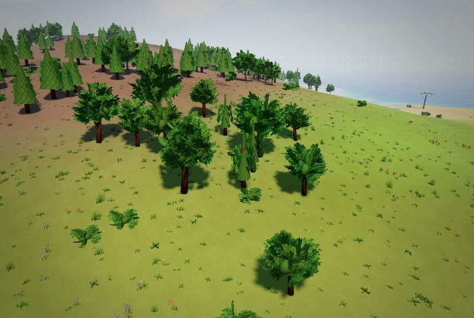

### 2.2 Tiga generasi aset

1. **Pack planet** (`assets.glb`, skala tile hex, 59 material) masih dipakai di town lewat `CATALOG`, diperbesar ke ukuran meter. Contohnya perahu di dermaga fantasy, serta lumbung, kincir angin, kapal kontainer, dan 419 baris ladang di Aegis Citadel.
2. **Pack town** (`town.glb`, 91 material) berisi low-poly flat dengan vertex color.
3. **Pack scenery** (`scenery.glb`) berisi mid-poly bertekstur dengan leaf cards.

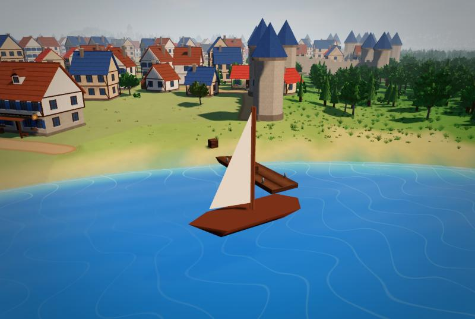

### 2.3 Palet tanpa sumber tunggal

- Ada 601 literal warna (454 unik) di 28 file JS, 337 di antaranya di `modes/town/`. Pack GLB menambah 136 warna material, dan 5 nama material punya warna berbeda antar pack (lihat [ASSETS.md](ASSETS.md) §7). Satu-satunya palet bersama adalah `TERRAN_PALETTE` di `planetTypes.js`.
- Atap rumah fantasy diambil acak dari `ROOFS = red, brown, blue, slate` di `build_town_space.py`, ditambah kerucut menara berwarna biru. Hasilnya pola "konfeti" merah-biru tanpa hierarki.
- Rumput kota berwarna kuning-hijau pucat, sedangkan sprite rumput di atasnya hijau jenuh dan gelap, sehingga sprite terlihat seperti tempelan. Kaki bukit berwarna coklat seperti lumpur.
- Tidak ada hierarki saturasi: warna primer terpakai di permukaan luas (atap), sehingga warna faksi dan landmark kalah menonjol.

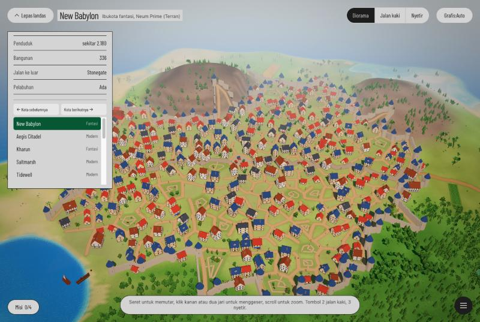

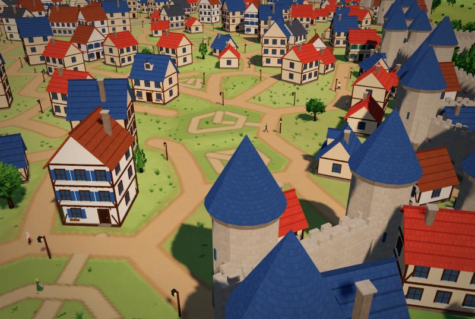

### 2.4 Komposisi dan densitas

- **Fantasy:** rumah berdiri sendiri-sendiri di lot rumput dengan jarak yang mirip. Jalan tanah lebar dan seragam. Jalur taman berbentuk berlian di tengah rumput kosong. Tiang lampu terbaca acak karena jalurnya hampir tidak terlihat.
- **Modern:** aspal mendominasi, persimpangan sangat lebar, dan jumlah bangunan sedikit dibanding luas jalan.
- Semua elemen punya bobot visual yang sama, jadi mata tidak punya titik fokus.

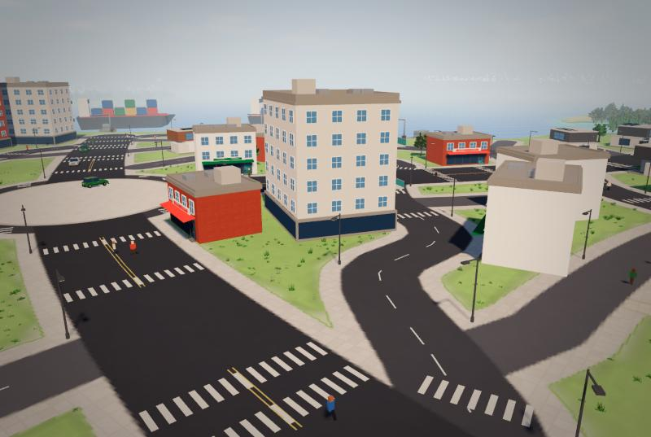

### 2.5 Skala dan kerapatan texel

- Paint map tanah dekat mencakup hingga 1.240 m pada 2048 px (≈0,6 m per texel). Dari kamera jalan kaki, tepi jalan terlihat kabur.
- Lantai marmer interior modern memakai *mirrored repeat* tiap 2,5 m, sehingga urat marmernya membentuk pola simetris seperti zebra.
- Dinding rumah berupa bidang datar besar dengan jendela yang besar relatif terhadap karakter.

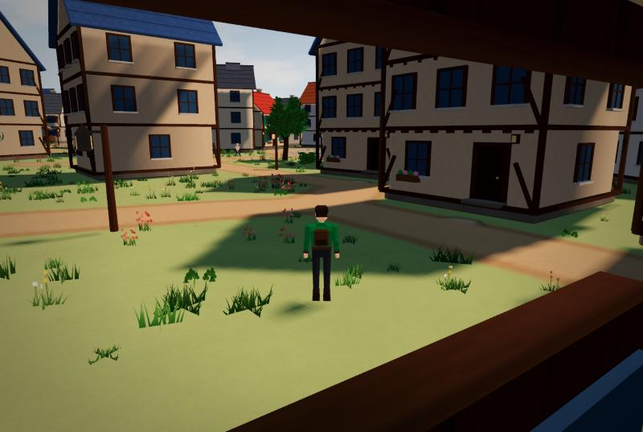

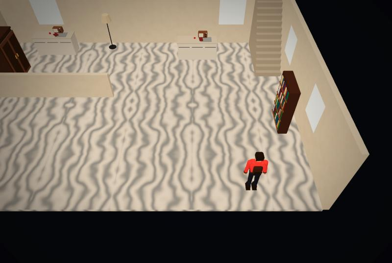

### 2.6 Identitas planet ↔ town terputus

Di globe, ibukota modern tampil sebagai menara kaca biru dengan spire putih dan border faksi merah. Di town, kota yang sama berisi apartemen krem, toko bata, dan kantor kaca yang tampak seperti kotak putih. Ibukota fantasy di globe adalah gugus kastil dan kuil, sedangkan di town menjadi hamparan atap merah-biru.

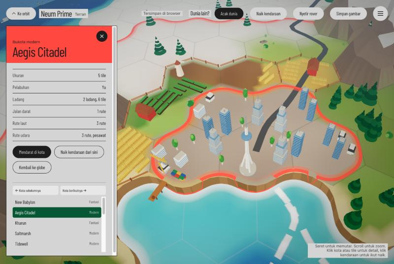

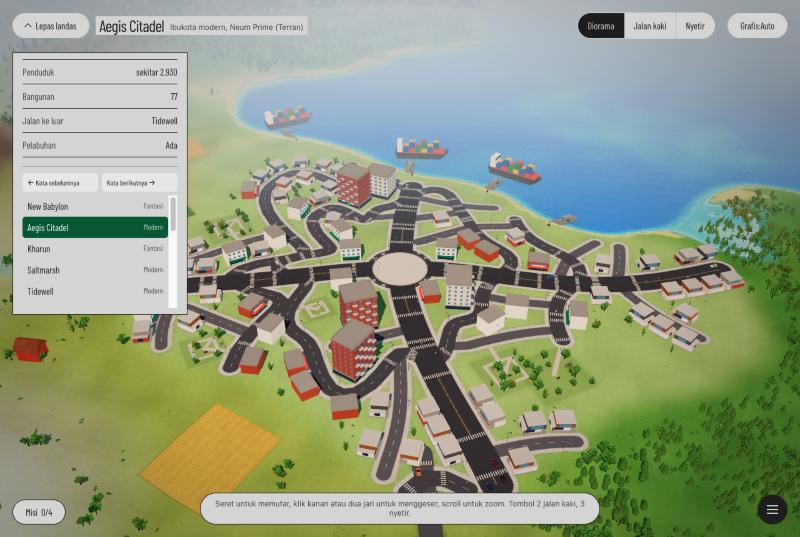

### 2.7 Artefak yang terlihat

| Artefak | Bukti | Penyebab yang sudah diverifikasi |
|---|---|---|
| Pita titik putih di horizon | Screenshot 08 dan 09 (sama, `farTrees` dimatikan) | Billboard `FarTrees`; hilang saat mesh-nya disembunyikan. |
| `m_office_v1` seperti kotak putih di siang hari | Screenshot 08, raycast ke `m_office_v1_LOD0` | Kaca berupa satu box `M_glass_teal` tanpa mullion; pola jendela hanya muncul lewat shader malam. |
| Kamera jalan kaki menembus bangunan | Screenshot 04 | `updateFollowCamera` hanya menjaga kamera di atas tanah, tanpa uji tabrakan dengan collider. |
| Pola lantai interior simetris | Screenshot 11 | `atlasMaterial` di `interior.js` memakai *mirrored repeat*. Toko modern memakai tile `marble` (2,5 m per ulangan), dan tile itu tidak dibuat untuk dicerminkan. |

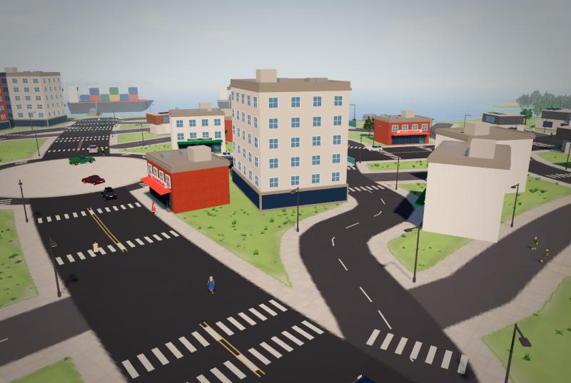

### 2.8 Yang sudah bekerja dan perlu dipertahankan

- Diorama planet mode (screenshot 12).
- Suasana malam: jendela menyala, langit berbintang, lampu hangat (screenshot 10). Genangan cahaya masih terlalu besar dan seragam.
- UI The1 yang konsisten di tiga mode.
- Space mode dengan latar biru gelap dan planet yang terbaca (screenshot 13).
- Variasi layout v2 (ward fantasy, kolektor modern).

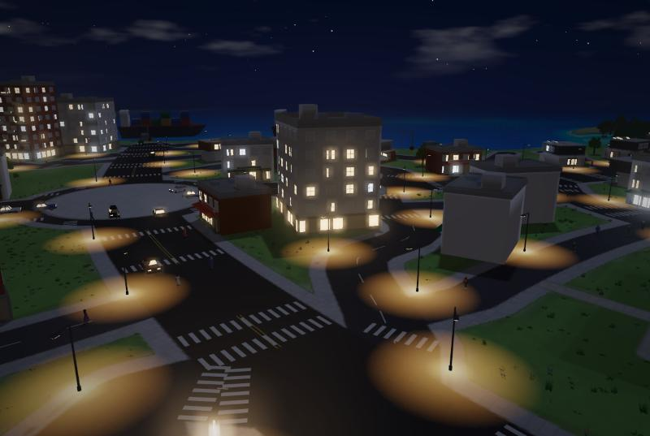

## 3. Arah yang direkomendasikan: *painted diorama*

| Opsi | Isi | Biaya | Risiko |
|---|---|---|---|
| **A. Painted diorama (rekomendasi)** | Meneruskan kekuatan planet mode ke town dan interior. Mid-poly dan tekstur tetap dipakai sebagai metode produksi, tetapi seluruh aset tunduk pada satu kontrak shading dan palet. | Sedang: material bersama, palet, beberapa aset pengganti | Detail dekat lebih sederhana dibanding stylized PBR penuh |
| B. Stylized PBR penuh | Memigrasikan semua pack ke tekstur albedo/normal dengan `MeshStandardMaterial` | Tinggi: re-author town, furnitur, karakter, dan kendaraan; payload dan VRAM naik | Planet mode menjadi beda gaya, kecuali ikut di-rework |
| C. Tetap campuran | Memperbaiki kasus per kasus | Rendah | Kesan berantakan tetap ada |

Lima pilar opsi A:

1. **Siluet dulu.** Bentuk besar harus terbaca dari kamera diorama: kanopi bermassa dan berkelompok (sesuai referensi pohon), atap sebagai massa, landmark yang tinggi. Detail kecil datang dari modulasi tekstur atau vertex, bukan dari geometri kecil yang berkedip.
2. **Satu keluarga shading.** Semua mesh opaque dan cutout memakai ramp toon yang sama plus fill hemisphere. Tekstur hanya menjadi modulasi netral (grayscale) di atas warna palet. Material unlit hanya untuk cahaya dan emisi.
3. **Palet bertingkat.** Permukaan luas (tanah, dinding, jalan) bersaturasi rendah sampai sedang. Atap dan vegetasi sedang. Aksen (faksi, signage, lampu, bunga) tinggi dan jumlahnya sedikit. Nilai gelap-terang jalan, tanah, dan bangunan dibedakan dengan jelas.
4. **Diorama yang rapi.** Densitas mengikuti fungsi: frontage menerus di jalan utama, kebun di belakang, ruang terbuka punya isi. Lebih baik mengurangi elemen kecil daripada menambahnya.
5. **Satu dunia lintas level.** Warna, landmark, dan identitas kota di globe harus dikenali lagi di town dan interior.

## 4. Kontrak visual

### 4.1 Palet

- Satu sumber token (usulan `src/art/palette.js`). Kelompok token: `terrain.*` (dari `TERRAN_PALETTE` dan `look` per planet), `water.*`, `road.*` (aspal, batu, tanah, paving, kerb, marka), `fantasy.wall|roof|trim.*`, `modern.facade|glass|roof.*`, `foliage.*` (per spesies dan musim), `light.*` (jendela hangat/dingin, lampu), `faction.player|system` (harus sama dengan CSS `--color-*`), dan `ui.*`.
- Atap fantasy (usulan awal, diuji di AD-3): satu keluarga warna dominan per kota atau distrik (misalnya terakota dengan tiga tingkat nilai), satu keluarga sekunder dengan porsi maksimal sekitar seperempat, dan biru atau aksen lain hanya untuk landmark dan bangunan faksi.
- Modern: tiga sampai empat keluarga fasad netral hangat/dingin, kaca sebagai satu kelompok token, dan aksen per zona (retail, civic).
- Vegetasi mengambil tint dari tanah di sekitarnya. Sprite rumput tidak boleh lebih jenuh dari tanahnya.
- Material pack menyebut token, bukan RGB (`M_<token>`). Generator Blender membaca palet yang sama, misalnya lewat file JSON yang diekspor dari modul palet.

### 4.2 Shading

- Satu gradient toon (sudah ada: `getToonGradient`). Material glTF dari scenery dikonversi saat dimuat: `map` menjadi modulasi, warna diambil dari token.
- Normal boleh berbeda per kelas (arsitektur boleh faset, vegetasi halus), asalkan ramp dan respons cahayanya sama.
- Intensitas hemisphere, matahari, dan ambient per mode diatur dari satu tabel, seperti `LOOKS` untuk post-processing.
- Emisi dan unlit hanya untuk cahaya, jendela malam, dan UI di dalam dunia.

### 4.3 Kerapatan texel dan skala

- Tekstur detail diukur dalam meter dunia (sudah berlaku untuk jalan). Tetapkan satu target px/m per kelas (arsitektur, jalan, interior) lewat uji visual di AD-2. Interior memakai skala yang sama dengan eksterior.
- Kota besar membutuhkan tile atau decal jalan dekat kamera, bukan hanya paint map ≈0,6 m per texel.
- Pintu dan jendela mengikuti tinggi karakter (sekitar 1,8 m). Landmark boleh dilebih-lebihkan; rumah biasa tidak.

### 4.4 Komposisi

- Lampu hanya berdiri di tepi jalan, plaza, atau jalur taman yang terlihat.
- Taman diisi lebih dulu (pohon, bangku, bunga), baru diberi jalur. Jalur tidak berbentuk poligon abstrak.
- Kepadatan rumput dekoratif mengikuti mask tanah dan turun di dekat jalan serta bangunan.
- Air: gradasi dangkal toska ke dalam, pita pasir basah, dan buih yang tidak seragam (referensi `03-coastal-water.png`).

### 4.5 Aset

- Tidak ada fallback pack planet di town.
- Setiap aset town punya LOD0–2 dengan siluet yang sama, bounds di manifest, dan material bertoken.
- Aset baru diperiksa di galeri harness `living-town.html` dengan lighting game sebelum dipakai.

## 5. Rencana migrasi

| ID | Cakupan | File utama | Bukti selesai |
|---|---|---|---|
| **AD-0** | Keputusan arah, reference board, fixture kamera (seed, planet, kota, pose, jam, tier) | dokumen ini, `tests/browser/living-town.html` | Arah disetujui; delapan screenshot baseline tersimpan |
| **AD-1** | Palet terpusat dan jembatan ke CSS; migrasi `TERRAN_PALETTE`, atap/dinding, jalan, dan air; generator Blender membaca palet yang sama | `src/art/palette.js` (baru), `planetTypes.js`, `townBuilder.js`, `groundPaint.js`, `groundCover.js`, `sky.js`, `tools/blender/*.py` | Literal warna di `modes/town/` turun tajam; screenshot fixture sebelum/sesudah |
| **AD-2** | Satu keluarga material: scenery dijadikan toon, tint `groundCover`/`farTrees` dari tanah, marka dan genangan cahaya diselaraskan | `texturedAssetLibrary.js`, `townBuilder.js`, `groundCover.js`, `farTrees.js`, `streetLighting.js` | Galeri aset: pohon dan rumah terbaca sebagai satu gaya pada siang dan malam |
| **AD-3** | Komposisi town: keluarga atap per distrik, lampu mengikuti jalan, isi taman, densitas rumput | `townPlan.js`, `wards.js`, `townGreenery.js`, `streetLighting.js`, `build_town_space.py` | Overview fixture fantasy dan modern |
| **AD-4** | Air dan pantai | `townBuilder.js` (shader air), `groundPaint.js` | Fixture pelabuhan pada siang dan senja |
| **AD-5** | Celah aset dan artefak: barn/windmill/boat/kapal kontainer/baris ladang skala town, mullion `m_office_v1`, lantai interior, billboard `farTrees`, tabrakan kamera jalan kaki | `build_town_space.py`, `townBuilder.js`, `farTrees.js`, `interior.js`, `TownMode.js` | Town tidak lagi memuat pack planet; artefak §2.7 hilang pada screenshot fixture |
| **AD-6** | Identitas planet ↔ town: pemetaan landmark (CBD kaca + spire, kastil/kuil) dan palet faksi | `townLayout.js`, `planetRenderer.js` | Pasangan screenshot planet dan town untuk kota yang sama |

Setiap langkah diverifikasi dengan fixture yang sama sebelum dan sesudah, pada tier high dan low, siang dan malam, ditambah `npm test` dan `npm run build`. Tanggal atau durasi tidak dijanjikan; urutan di atas adalah urutan dependensi.
