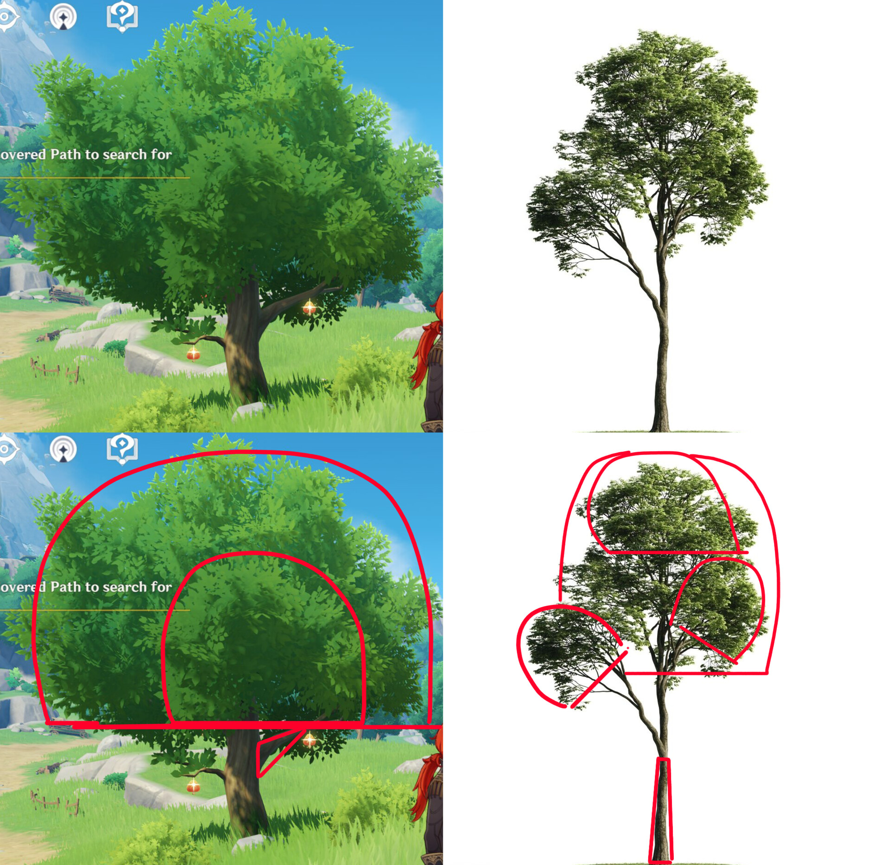
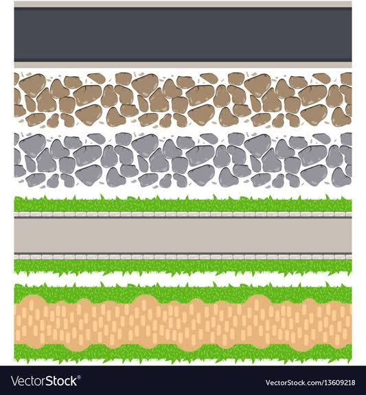
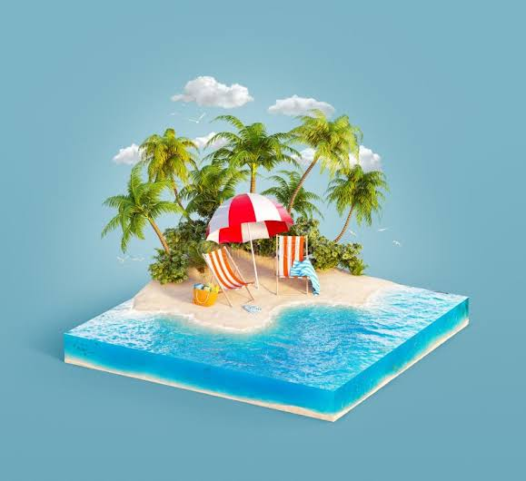

# Globe Universe — plan aset, material, terrain, air, karakter dan musik

Tanggal: **26 September 2026**. Status: **implementasi sebagian; lihat [status aktual](IMPLEMENTATION_STATUS.md)**. Melanjutkan [World Building Roadmap](WORLD_BUILDING_ROADMAP.md) dan [catatan Watabou](WATABOU_WORLD_BUILDING_NOTES.md). Semua budget di sini adalah target awal untuk diuji, bukan ukuran hasil yang dijanjikan.

## 1. Sasaran dan arah visual

Gunakan **stylized mid-poly**: siluet halus, bevel seperlunya, normal yang baik, material bertekstur dan pencahayaan yang menyatukan bentuk. Low-poly tetap berguna untuk LOD jauh; bukan batas kualitas aset dekat. Detail kecil berasal dari texture/normal/mask, sementara bentuk yang memengaruhi siluet tetap geometri.

Efisiensi berarti kecil saat diunduh, hemat RAM/VRAM, cepat dimuat dan murah dirender. Empat metrik ini berbeda: file JPG kecil dapat menjadi texture GPU besar; foliage sedikit triangle dapat mahal karena overdraw; terlalu banyak material dapat lebih mahal daripada mesh yang sedikit lebih detail.

### Referensi pengguna



**Pohon:** massa kanopi bertingkat/asimetris, cabang penopang yang terbaca, rumpun daun dan celah di antara kelompok. Terapkan mesh trunk/branch + volume canopy ringan + leaf cards di area yang perlu siluet detail. Hindari pohon yang seluruhnya tersusun dari bola identik atau satu billboard datar pada jarak dekat. Warna bagian atas lebih terang, bagian dalam lebih gelap, tetapi arah cahaya utama tetap dari lighting runtime.



**Jalan:** keluarga permukaan aspal, batu, paving, tanah dan grass verge. Gunakan material tengah yang tileable dan edge mask/trim terpisah. Junction, lebar dan kurva ditentukan graph jalan, bukan menempelkan strip gambar utuh. Gambar ber-watermark disimpan sebagai referensi komposisi; aset runtime dibuat original.



**Pantai:** gradasi pasir basah → air dangkal terang/toska → air lebih dalam; pantulan lembut, ripple, patch buih dan garis swash tidak seragam. Ambil keterbacaan warna/kedalaman dan kepadatan vegetasi pesisirnya; world Globe tidak harus memakai potongan kubus air seperti gambar.

Ketiga gambar disalin ke `docs/references/asset-direction/`, di luar `public/`, agar bukan bagian payload game. Gambar adalah acuan visual, bukan instruksi tambahan atau texture siap ekspor.

## 2. Audit source dan aset saat perencanaan

Working tree sedang berubah; verifikasi ulang sebelum implementasi. Temuan ini berasal dari pembacaan source, bukan pengujian browser baru.

| Area | Kondisi yang ditemukan | Implikasi |
|---|---|---|
| Loader | `assetLibrary.js:bakeNode` menghapus semua atribut selain position, membuat non-indexed mesh, lalu warna vertex dan flat normals. | Texture, UV, smooth normals dan efisiensi index akan hilang jika pipeline ini tidak diperbarui. |
| Export Blender | `build_town_space.py` masih mendeskripsikan pack tanpa normals/UV; interior atlas terpisah. | Tambahkan export UV/material/normal dan manifest versi; jangan sekadar mengganti file gambar. |
| Kota modern | `townLayout.js:planModern` masih membuat rotated grid sendiri; tersedia `townPlan.js` dengan wards/block/river helpers untuk jalur procedural lain. | Modern harus memakai kontrak lahan/parcel/akses yang sama, dengan grammar kota modern sendiri. |
| Air | `townBuilder.js` sudah punya depth textures, sun/sky uniforms dan shoreline foam. | Perbaiki kualitas, parameter, masks dan pengelompokan waterbody; bukan membangun ulang seluruhnya. |
| Relief kota | `sampleGround` mengurangi gentle/mountain relief dengan faktor town lalu lerp ke tinggi sekitar 1,1. | Penyebab kota cenderung rata; pindahkan aturan relief/pad ke data sebelum layout. |
| NPC | `peopleRig.js` memakai outfit mesh, shared rig dan material toon vertex-color; dekat memakai pool, jauh instanced crowd. | Pertahankan pool/LOD; tambah UV, modular appearance dan expression untuk jarak yang membutuhkan. |
| Musik | `core/audio.js` sudah berisi ambience, pad generatif, radio, volume dan suspend/resume. | Kembangkan komposisi dan transisi dari engine yang ada. |

Snapshot disk perkiraan dari `du`, bukan ukuran network terkompresi: `assets.glb` 288 KiB; `assets_lod0.glb` 332 KiB; `town.glb` 1,9 MiB; `character.glb` 1,3 MiB; `space.glb` 404 KiB; `furniture.glb` 224 KiB; interior atlas 384 KiB; seluruh `public/` sekitar 4,8 MiB. Angka dapat berubah karena ada pekerjaan lain di working tree.

## 3. Daftar texture dan sprite untuk diproduksi lebih dahulu

Daftar ini adalah **inventaris produksi**. Resolusi adalah batas awal per sheet/tile, bukan kewajiban memproduksi semuanya sekaligus. `A` = albedo, `N` = normal, `M` = mask; setiap channel M harus didokumentasikan. Jangan membuat seluruh map PBR jika shading tidak memakainya.

| ID / prioritas | Sheet atau tile yang dibutuhkan | Resolusi awal | Varian dan pemakaian |
|---|---|---|---|
| TX-01 P0 | Ground base: grass, dry grass, dirt, tilled soil | 512² per tile, atlas max 1024² | A + shared detail N; noise warna makro memutus repetisi. |
| TX-02 P0 | Sand dry/wet, gravel, pebble | 512² per tile | A + N bila terlihat; wetness lewat material mask, bukan gambar unik tiap pantai. |
| TX-03 P0 | Rock/cliff strata, rough stone | 512²–1024² | A/N; triplanar selektif pada cliff, moss mask terpisah dari rotasi batu. |
| TX-04 P0 | Road surfaces: asphalt, cobble, paving, dirt path | 512² per tile | A + roughness/detail; tiling mengikuti jarak dunia sepanjang spline. |
| TX-05 P0 | Road trim: curb, verge, worn edge, cracks; lane/crosswalk masks | 1024² sheet | Mask/trim atlas dengan gutter; markings digambar dari graph untuk junction. |
| TX-06 P0 | Broadleaf clusters: oval, serrated, small compound leaf | 1024² RGBA sheet | 4–6 patch dengan edge dilation; tint per species/season, alpha-test. |
| TX-07 P0 | Needles, palm fronds, narrow/cypress leaves | 1024² RGBA sheet | 4–6 patch; shared bent card geometry dan wind weights. |
| TX-08 P0 | Bark: broadleaf, pine, palm; cut wood | 1024² trim sheet | A/N; trunk UV memanjang, branch seam disembunyikan secara wajar. |
| TX-09 P1 | Understory: grass tuft, fern, shrub, flower, reeds | 1024² RGBA sheet | Cards dekat, density/distance culling; collider hanya untuk unsur gameplay. |
| TX-10 P1 | Crop stages: wheat, leafy crop, orchard fruit, stubble | 1024² RGBA sheet | Stage/season dari farm state; furrow material memakai TX-01. |
| TX-11 P0 | Water ripple normals, low-frequency distortion | 256²–512², dua pola | N/M non-color; reusable ocean/river/lake dengan parameter berbeda. |
| TX-12 P0 | Shore foam, wake/splash shapes, caustic pattern | 512² sheet per kebutuhan | Foam scalar/alpha; caustic hanya dangkal dekat dan tier yang mampu. |
| TX-13 P1 | Fantasy building trim: plaster, wood beam, brick, roof tile | 1024²–2048² | A/N + roughness mask opsional; atap dan frontage reusable. |
| TX-14 P0 | Modern trim: concrete, facade panel, glass frame, metal, roof | 1024²–2048² | A/N + roughness; glass/emissive dipisah menurut render state. |
| TX-15 P0 | Harbor trim: weathered timber, quay concrete, rust, rope | 1024² | Gabungkan dengan sheet existing jika texel density tetap cukup. |
| TX-16 P1 | NPC skin/face: brows, eyes, mouth/expression tiles | 1024² | Neutral, smile, concern, surprise + blink; palette/UV region, bukan file per NPC. |
| TX-17 P1 | Hair: scalp, strand clumps, brows/beard | 512²–1024² | Mesh hair caps utama; alpha hair cards hanya jika perlu. |
| TX-18 P1 | Clothing: fabric, denim, leather, seams, buttons, shoe regions | 1024²–2048² | Region tint masks untuk atasan/celana/sepatu; jangan tint seluruh karakter sekaligus. |
| TX-19 P1 | Props/decal: labels, signs, dirt, wear, footprints | 1024² | Culture/job tags; decal near-only; signage informasi tetap terbaca. |
| TX-20 P2 | Far foliage/building impostors | 512²–1024² per keluarga | Bake dari aset final; pilihan yaw terbatas; evaluasi manfaat dibanding mesh LOD2. |
| TX-21 P1 | Interior atlas refresh | Max 2048² | Audit atlas existing: padding/mips/texel density, reuse wood/stone/fabric; tidak otomatis tambah sheet. |
| TX-22 P2 | Snow/ice, lava crust, alien ground/flora | 512²–1024² per keluarga | Load hanya pada biome yang memerlukan; lava tetap material khusus. |

**Batch proof pertama:** satu broadleaf (TX-06/08), satu jalan tanah/batu (TX-04/05), satu facade modern (TX-14), dan satu pantai (TX-02/11/12). Buktikan lighting, repeat, ukuran dan loader lebih dahulu, baru perluas katalog.

## 4. Pipeline model Blender MCP dan integrasi material

Saat perencanaan, tidak ditemukan tool Blender MCP yang callable pada daftar tool sesi. Workflow berikut tetap menargetkan Blender MCP untuk tahap produksi; koneksi scene dan tool perlu diverifikasi saat mulai. Tidak ada aset yang diklaim telah dibuat melalui MCP pada pekerjaan ini.

1. **Manifest terlebih dahulu:** `assetId`, family, generatorVersion, seed, ukuran meter, pivot/front axis, sockets, footprint, collider, LOD, texture set dan usage tags.
2. **Scene kerja khusus di Blender lewat MCP:** inspect scene sebelum mutation; gunakan collection tersendiri, simpan sumber `.blend`, script parameter dan seed. Jangan menjalankan pembersihan scene global pada file kerja pengguna.
3. **Model master mid-poly:** bentuk utama, bevel, smooth/custom normals dan UV konsisten. Modular architecture mengikuti grid/socket; nature boleh asimetris.
4. **Texture:** procedural node materials dibake ke A/N/masks; lukisan raster original bisa dipakai untuk daun/face/decal. Material node arbitrer tidak diasumsikan langsung bekerja di glTF. [Blender glTF manual](https://docs.blender.org/manual/en/5.1/addons/import_export/scene_gltf2.html)
5. **LOD:** LOD0 siluet dekat; LOD1 mengurangi cabang/bevel/detail; LOD2 menyederhanakan massa. Simpan portal/collider terpisah supaya decimation tidak mengubah gameplay.
6. **Export kandidat:** indexed mesh, UV, normals, skinning/animation yang diperlukan; tangents bila shading memerlukan. Bake AO ringan; jangan bake bayangan matahari yang bertentangan dengan day/night.
7. **Optimasi offline:** deduplicate mesh/material, quantize selektif, ukur meshopt vs tanpa compression; KTX2 setelah uji transcode. Sertakan decoder/transcoder pada hitungan payload.
8. **Loader v2:** pertahankan atribut/material; kelompokkan berdasarkan atlas dan render state. Mesh opaque/cutout/glass jangan digabung sembarangan. Pipeline lama tetap sebagai fallback sampai parity terbukti.
9. **QA:** render turnaround di Blender dan scene uji di Three.js dengan lighting game; bandingkan UV, warna, normal, alpha, animasi, ukuran, pivot, collision dan LOD.

`GLTFLoader` menyediakan integrasi KTX2 dan meshopt; verifikasi API pada Three.js yang terpasang, bukan upgrade dependency otomatis. Source `node_modules/three` yang dibaca memiliki `setKTX2Loader`, `setMeshoptDecoder`, dan `KTX2Loader.detectSupport`. [GLTFLoader docs](https://threejs.org/docs/pages/GLTFLoader.html)

Albedo/emissive memakai sRGB; normal/roughness/packed masks memakai non-color. Tingkatkan material family (foliage, architecture, character, water), jangan mengandalkan satu toon material untuk semuanya. [Three.js color management](https://threejs.org/manual/pages/color-management.html)

## 5. Budget geometri, texture, paket dan rendering

| Keluarga | Target LOD0 / LOD1 / LOD2 triangles per aset | Catatan |
|---|---|---|
| Batu | 300–1.500 / 120–500 / 30–100 | Siluet 3D bagus, material shared; hindari simetri yang jelas. |
| Pohon | 2.000–6.000 / 700–2.000 / 100–400 | Hitung alpha overdraw dan shadow cost, bukan triangle saja. |
| Rumah modular lengkap | 4.000–12.000 / 1.500–4.000 / 200–800 | Interior lazy-loaded, belum termasuk furnitur. |
| Modul pelabuhan | 300–4.000 / 100–1.200 / 50–300 | Crane landmark boleh 8–15k dekat; bukan seluruh port satu mesh. |
| NPC dekat lengkap | 6.000–12.000 / 2.000–4.000 / proxy | Satu rig shared; hanya pool dekat memakai ekspresi detail. |
| Furnitur | 200–2.000 / 80–500 / sederhana | Kontak/interaksi membutuhkan bentuk lebih baik daripada dekorasi jauh. |

- **Target payload tambahan per mode:** common material ≤1 MiB; town environment ≤2 MiB; architecture/harbor ≤2 MiB; character appearance ≤1 MiB; interior tambahan ≤1 MiB. Total delta aset visual unik ≤7 MiB pada slice awal; jauhkan optional biome packs dari cold load. Ini ceiling awal, bukan izin menghabiskan semuanya.
- Space cold load tidak menarik pack foliage, interior atau NPC. Pisahkan pack menurut kebutuhan mode; shared texture tidak diembed berulang di setiap GLB. Cache dengan content hash dan referensi resource yang jelas.
- Texture master PNG/lossless di folder authoring; runtime coba KTX2 untuk GPU compression, WebP/PNG fallback terukur. ETC1S kandidat albedo; UASTC kandidat normal/alpha sensitif; pilih berdasarkan hasil artefak/ukuran, bukan aturan mutlak.
- **VRAM:** target tambahan texture resident ≤32 MiB pada mobile referensi dan ≤64 MiB desktop per mode. Satu RGBA8 1024² ~4 MiB, dengan mip chain ~5,33 MiB sebelum GPU compression; 2048² sekitar 4×. Hitung semua maps, atlas, render target dan fallback aktif. [Texture memory](https://threejs.org/manual/pages/textures.html)
- Sheet atlas perlu gutter dan edge dilation per mip, serta preservation alpha coverage. Transparent background berwarna hitam tanpa dilation menghasilkan halo daun.
- Batch static props per material/atlas/LOD/chunk. NPC modular digabung atau dibatch per appearance; jangan menambah 6 draw calls permanen untuk setiap pejalan kaki. Tetapkan baseline draw calls aktual dan target delta ≤25% pada fixture yang sama; bila melampaui, buktikan frame time masih memenuhi budget.
- Ukur p95 frame time, upload/transcode, shader compile, overdraw dan memory setelah mode switch. Size minimum dipilih setelah kualitas minimum lolos; jangan menghapus UV/normal untuk mengejar angka file.

## 6. Pemisahan procedural generation supaya tidak tumpang tindih

Generator terpisah harus membaca **satu spatial plan**, bukan memakai RNG dan occupancy sendiri-sendiri. Pisahkan canonical data dari renderer.

```text
Planet context → terrain height/slope → hydrology graph + waterbody polygons
→ land-use reservations → road/bridge/port graph → parcels + building pads
→ farm estates → forest clusters → props/detail → validation → scene
```

Hydrology menghasilkan `Waterbody {id, kind:ocean|river|lake|pond, polygon/centerline, surfaceHeight, bedHeight, flow, shoreline}`. Ocean memiliki sea level bersama; lake/pond mengikuti basin dan outlet masing-masing; river punya profil turun dan koneksi antarbadan air. Jangan meletakkan semua danau bukit pada satu `WATER_Y` global atau menggambar air di seluruh disc tanpa mask.

Simpan `LandUsePlan` dengan hard exclusion (water/road/building footprint), soft buffer (riverbank/forest edge), allowed overlap tags, stable ID, elevation range dan priority. Gunakan signed distance/spatial index untuk sampling dan exact polygon/OBB checks untuk kandidat final. Persil perlu frontage, waterbody butuh margin tebing, forest cluster memiliki root exclusion, farm memiliki estate polygon dan arah baris.

| Pasangan | Aturan |
|---|---|
| Rumah–air | Dilarang kecuali tipe stilt/overwater yang eksplisit, dengan foundation dan akses valid. |
| Jalan–sungai | Hanya lewat bridge/ford yang tercatat; collider memakai deck elevation. |
| Pohon–bangunan/jalan/farm | Root footprint dan trunk clearance harus kosong; overhang canopy boleh terbatas bila tidak menutup akses. |
| Farm–forest | Plot polygon terpisah; orchard adalah farm bertipe tree-crop, bukan forest kedua. |
| Dermaga–air | Diizinkan melalui port reservation dan navigable-water checks. |
| Detail rumput–jalan | Hanya edge/wear mask yang mengizinkan, bukan seluruh permukaan. |

RNG per domain (`hydrology`, `parcel`, `farm`, `forest`, `dressing`) dan bounded retries. Kegagalan kandidat dicatat; jangan memaksa item masuk karena target jumlah belum terpenuhi. LOD/quality hanya mengurangi dressing visual, bukan mengubah rumah, farm estate atau posisi air.

## 7. Modern city dan pelabuhan

**Modern city:** buat adapter planner modern ke kontrak bersama `townPlan`: coastline/river → street hierarchy → block/parcel → building pad → zoning → facade/props. Pertahankan bentuk grid yang masuk akal, tambahkan residential blocks, mixed-use, warehouse waterfront, civic plaza dan hillside residential. Jangan sekadar memanggil grammar medieval untuk gedung modern. Semua street/sidewalk/vehicle graph memakai data yang sama dan memperhitungkan relief.

**Harbor kit wajib:** quay lurus/sudut/ujung, wooden pier, floating pontoon, piles, ramp/gangway, stairs, bollard, fender, rope coil, mooring sockets, warehouse, crates/barrels, container, small crane, modern cargo crane, breakwater, navigation light dan lighthouse. MVP memprioritaskan quay/pier/piles/ramp/mooring/warehouse/crates; crane besar dan lighthouse tahap berikutnya.

Port blueprint memilih sisi shoreline, kedalaman aman, akses jalan dan area manuver kapal. Dock deck berada di atas water level; piles mencapai dasar; floating pontoon mengikuti perubahan permukaan kecil, warehouse tidak. Orientasi kapal mengikuti berth socket. Sediakan kit fantasy timber/stone dan modern concrete/steel dengan ukuran antarmodul konsisten. Port terlihat dari globe sebagai proxy dari blueprint yang sama, bukan landmark terpisah yang bisa bergeser.

## 8. Variasi batu, vegetasi dan farm

**Batu:** mulai 4–6 master siluet, seeded yaw/pitch/roll sesuai stability, skala terbatas, partial bury dan pilihan sisi. Hitung ulang bounds/collider setelah transform. Material strata/moss memakai orientation/world-up yang tepat: memutar mesh tidak boleh membuat lumut selalu berada di bagian bawah atau lapisan geologi kacau. Non-uniform scale berlebihan dilarang; pilih support contact agar tidak melayang.

**Pohon:** katalog awal broadleaf oak-like, birch/poplar, pine, spruce/cypress, palm, acacia, fruit tree, mangrove. Tiap family memiliki trunk profile, 2–3 canopy arrangements dan leaf family; bukan 8 texture unik besar. Pilih biome/moisture/slope terlebih dahulu, kemudian age/height/crown fullness, twist cabang kecil, tint dan wind phase. Variasi bentuk harus lebih kuat daripada variasi hue acak.

Gunakan normals kanopi yang memberi volume, alpha-test/cutout dengan mips, wind berbasis vertex weight; trunk tetap stabil. Jarak dekat menampilkan branch/leaf detail, jauh memakai cluster mesh/impostor setelah diuji. Hindari transparency blend seluruh pohon karena sorting dan overdraw. Render forest cluster dengan edge irregularity, understory dan clearing; occupancy tetap per trunk plus canopy buffer.

**Farm:** estate polygon → akses kerja → strips → stage tanaman. Rotate satu estate dan barisnya sebagai kesatuan, bukan setiap crop sembarang. Wheat/vegetable/stubble memakai shared atlas. Orchard menggabungkan fruit-tree kit dengan jarak baris dan jalan servis. Musim mengubah stage/tint sesuai state, tidak regenerate tata letak.

## 9. NPC: ekspresi, rambut, baju, celana dan sepatu

Appearance record persisten: `{npcId, bodyPreset, skinPalette, faceVariant, hairMesh, hairPalette, topMesh, topPalette, bottomMesh, bottomPalette, footwearMesh, accessoryIds}`. Expression state terpisah: neutral/happy/concerned/surprised + blink/look. Seed menentukan identitas dasar; event/jadwal menentukan ekspresi, bukan reroll setiap frame atau masuk rumah.

MVP library: 3 body proportions yang rig-compatible; 6 hair silhouettes; 4 tops; 3 bottoms; 3 footwear shapes; 4 face/expression regions dan palette. Texture tidak menggantikan geometri rambut panjang, jaket atau sepatu yang mengubah siluet. Shared bind pose, bone names dan skin weights; compatibility rules mencegah rambut menembus topi, baju menembus badan, dan sepatu salah ukuran.

Dekat: skinned mesh dengan modular parts yang dikonsolidasi/cached, face UV/expression atau sedikit morph targets. Menengah: outfit bake/cache, ekspresi minimum. Jauh: instanced crowd dengan palette dan outline outfit yang konsisten. Pool assignment harus membawa appearance milik NPC, bukan membuat identitas berubah mengikuti slot pool. Collider dan tinggi pandang mengikuti proporsi karakter; gunakan animasi yang sudah tersedia sebelum menambah set rig baru.

## 10. Air dan efek pantai

Mulai dari shader yang sudah ada: kalibrasi depth range dan palette, bed visibility, Fresnel/sky reflection sederhana, dua skala ripple normal, specular sun yang terkendali. Air dekat pantai harus memperlihatkan kedalaman, tidak seluruhnya biru pekat atau putih berbuih.

Pisahkan profil: **ocean** swell pelan + shore waves; **river** flow searah centerline + eddy/foam di halangan; **lake** ripple kecil; **pond** lebih tenang/keruh dengan reeds; **lava** tetap shader khusus. Flow mengikuti river gradient, bukan world UV tetap. Hubungkan foam dengan jarak shoreline dan slope; jangan membuihkan tepi mesh palsu.

Town coastal effects: swash band bergerak, pasir basah, sedikit foam patches, caustics dangkal dekat, boat wake lokal, splash saat player/objek berinteraksi, beach wind dan shore audio. Low tier mempertahankan warna/depth dan foam sederhana; nonaktifkan refraction/caustics dan kurangi particles. Reflection/refraction tambahan hanya setelah budget terbukti; jangan mewajibkan screen-space pass mahal untuk semua waterbody.

Acceptance visual: warna dangkal/dalam jelas siang dan senja; foam tidak membentuk garis seragam; shoreline mesh/depth/collider setuju; tidak ada water plane menembus bangunan/padang rumput; lake bukit berada pada elevasinya sendiri.

## 11. Kota 3D di bukit dan tebing

Relief harus menjadi input planner, bukan dekorasi yang ditambahkan sesudah rumah. Pindahkan canonical `heightAt/slopeAt` ke data terrain yang dapat dipakai layout, collider dan builder. Pertahankan bentuk besar dari planet; tambahkan microrelief seeded dalam envelope agar kontur tampak masuk akal saat berpindah mode.

Pilih archetype bersyarat: plain, rolling, terraced hillside, coastal cliff. **Hillside hanya eligible jika region planet memiliki relief yang cukup**; pilihan seeded menentukan seberapa sering dipakai di lokasi eligible, bukan memaksakan setiap kota berbukit. Save lama tidak otomatis dipindah ke bukit.

- Jalan mengikuti contour dan batas grade; junction/persimpangan diperiksa. Kandidat awal maximum grade 8–12% untuk kendaraan biasa, tergantung kendaraan/physics dan pengujian; jalur pedestrian dapat memakai tangga di bagian lebih curam.
- Parcel dibuat pada area yang bisa diakses. Ambil sample corner/edge footprint, hitung kebutuhan cut/fill; buat pad lokal, retaining wall, foundation/stilts atau tolak lokasi.
- Batasi earthwork; jangan meratakan seluruh district. Rumah tetap tegak, driveway/ramp menghubungkan pintu ke jalan.
- Cliff setback, guardrail dan terrace wall merupakan constraint geometri; gunakan angka awal konservatif lalu uji capsule/vehicle.
- Collision memakai ground/road deck/building pad yang benar. Raycast/surface query memilih permukaan yang tepat pada bridge/overpass; jangan selalu memakai `max(ground, water)` untuk semua tempat.
- Landscape rendering, vegetation exclusion, minimap, NPC nav, vehicle traction, interior portal dan shoreline diperbarui bersama.

Fixture wajib: rumah di lereng dengan pintu di sisi jalan, terrace dua tingkat, coastal cliff town dengan port di bawah, plain modern sebagai kontrol. Tidak boleh ada rumah melayang, pintu tertimbun, jalan vertikal atau sungai naik bukit.

## 12. Musik dan soundscape yang lebih hidup

Kembangkan `core/audio.js` menjadi adaptive music director dengan scene, biome, district, time-of-day, weather, occupancy dan event intensity. Pertahankan Web Audio, kontrol volume dan browser audio unlock yang ada.

| Tempat | Arah komposisi | Ambient kontekstual |
|---|---|---|
| Space | Motif singkat, pad luas, pulse jarang, jeda | Engine, beacon, radio terarah. |
| Planet | Tema eksplorasi, variasi biome, motif penemuan | Wind/terrain, bukan lagu baru pada setiap hover tile. |
| Fantasy town | Pluck/flute/percussion ringan, ritme kerja/pasar | Percakapan samar, roda, pandai besi, pasar sesuai lokasi. |
| Modern town | Keys/synth/bass lembut, ritme aktivitas kota | Traffic, pedestrian crossing, HVAC, keramaian district. |
| Harbor/beach | Motif terbuka dan ringan, ruang untuk ambience | Swash, gull sesekali, rope/wood, boat/port work. |
| Interior/malam | Versi tema yang lebih tipis/intim, frekuensi lembut | Occlusion suara luar, room tone, penghuni/perabot. |

Susun satu motif utama + 3–4 variasi harmoni/arrangement, intro/loop/outro dan event stingers pendek. Jangan selalu reset chord ke awal ketika masuk rumah. Sinkronkan perpindahan layer pada bar/phrase dan equal-power crossfade; bila tempo/key berbeda, pakai bridge/silence transition. Scheduler berbasis AudioContext clock dengan lookahead; tidak mengandalkan timer render frame untuk beat.

Pilihan ukuran: synth/procedural untuk pad/percussion dan beberapa one-shot pendek berkualitas untuk karakter suara. Target bank compressed tambahan ≤1–2 MiB, dengan decoded sample budget awal ≤12 MiB; load sesuai scene dan reuse buffer. Codec harus diuji pada browser target. Loop panjang yang di-decode penuh dapat boros walau file kecil; utamakan motif/layer ringkas. Original composition, bukan ekstraksi soundtrack referensi.

Spatial ambience memakai distance/occlusion sederhana dan cap voice; random interval terkontrol, bukan suara burung tiap frame. Duck musik saat dialog/radio/event, cegah clipping, hormati mute/pause/background dan reduced sensory preference. Tes 10 menit lintas mode: tidak ada click, overlapping chord tak terencana, loop terlalu kentara atau volume melonjak.

## 13. Urutan implementasi dan hubungan roadmap

| ID | Scope | Dependency / kaitan | Bukti selesai |
|---|---|---|---|
| AA-00 | Manifest, audit bytes/VRAM, scene pembanding dan reference board | WB-00 | Ukuran aktual, device/tier, screenshot fixture dan profiling disimpan. |
| AA-01 | Loader/material v2 + satu aset ber-UV + compression trial | AA-00 | Normal/UV/tint/emissive/alpha/LOD tidak hilang; decode & memory terukur. |
| AA-02 | Shared terrain, hydrology dan land-use reservations | WB-02 + AA-00 | Lake/river/road/farm/forest/building tidak saling menimpa; quality tidak mengubah layout. |
| AA-03 | Modern planner parity + relief/pads/access | AA-02, WB-04 | Modern flat dan hillside fixtures valid; nav/vehicle/door terhubung. |
| AA-04 | Harbor kit dan placement | AA-01/02, WB-02 | Fantasy/modern port, pier–water–road alignment, mooring dan collider benar. |
| AA-05 | Vegetation, roads, rocks dan farm texture batches | AA-01/02 | Siluet/variasi bagus, no alpha halo, no repeat mencolok, budget terpenuhi. |
| AA-06 | Water palette/flow/shore effects | AA-02 + TX-02/11/12 | Ocean/river/lake berbeda, beach hidup, low tier stabil. |
| AA-07 | Modular NPC appearance dan expressions | AA-01, WB-01/05 | Identitas bertahan lintas pool/mode, tidak clipping dan draw calls terkendali. |
| AA-08 | Adaptive music + ambient zones | WB-00; occupancy WB-05 jika tersedia | Transisi audio dan 10-minute listening pass lolos. |
| AA-09 | Integrasi, size/performance gate, rollout per-pack | AA-03–08 | Build, gameplay regression, capture 4 level dan quality tiers lolos. |

**Slice visual pertama:** satu modern coastal district, satu harbor, satu hillside residential pocket bila fixture planet mendukung, satu grove, satu farm terpisah, satu rumah enterable dan beberapa NPC. Bandingkan sebelum/sesudah pada seed, camera dan waktu sama. Interior lengkap mengikuti WB-03; visual proof awal boleh memakai interior existing.

AA-08 dapat dikerjakan independen setelah clock policy jelas. Target byte/triangle tidak otomatis memenangkan keputusan: loloskan kualitas visual dan correctness terlebih dahulu, lalu pilih kandidat paling murah yang lolos.

## 14. Checklist validasi dan pelacakan 10 permintaan

- [ ] 1 Modern mapping: AA-03 memakai shared parcels/constraints, bukan rotated grid yang terputus dari terrain.
- [ ] 2 Harbor models: AA-04 memproduksi kit dan metadata, bukan hanya gambar pelabuhan.
- [ ] 3 Generator terpisah: AA-02 punya hydrology/land-use/occupancy bersama dan allowed overlaps yang eksplisit.
- [ ] 4 Mid-poly + texture: AA-01 mempertahankan UV/normals, LOD dekat cukup halus, texture terpakai di runtime.
- [ ] 5 Randomization: batu dan props memakai transform seeded dan bounds yang diperbarui; tidak melayang.
- [ ] 6 Pohon/path/texture: inventaris TX-01–22, canopy masses + leaves, road center/edge/junction, biome rules.
- [ ] 7 Manusia/NPC: AA-07 memisahkan body/hair/top/bottom/shoes/face dan mengunci appearance pada npcId.
- [ ] 8 Musik: AA-08 arrangement, adaptive transitions, ambient zones dan listening QA.
- [ ] 9 Air: AA-06 depth/palette/flow/foam/swash/wet sand, serta efek pantai town. Istilah `swash` berarti sapuan ombak di pantai.
- [ ] 10 Town relief: AA-03 conditional hills, foundation/pads, contour roads dan navigasi 3D dari planet context.

Validasi asset manifest: unique IDs, bounds, UV nondegenerate, no missing maps, material slot counts, atlas gutters, units/pivots/sockets, rig bindings dan LOD silhouette. Validasi spatial: sample seed set WB roadmap ditambah modern/coastal/hillside/lake fixtures. Validasi renderer: orbit/globe/town/interior, day/night, high/low, reload dan 20 mode switches. Jangan klaim optimal hanya dari file kecil atau screenshot Blender.

## 15. File sasaran saat implementasi

Existing: `tools/blender/build_assets.py`, `tools/blender/build_town_space.py`, `src/render/assetLibrary.js`, `src/render/planetRenderer.js`, `src/modes/town/townPlan.js`, `townLayout.js`, `townBuilder.js`, `groundPaint.js`, `peopleRig.js`, `crowd.js`, `interior.js`, `TownMode.js`, `src/core/audio.js`, `src/core/quality.js`, `src/world/planetTypes.js`.

Usulan baru, belum ada kontrak final: `src/world/terrainField.js`, `src/world/landUsePlan.js`, `src/render/materialLibrary.js`, `src/core/musicDirector.js`, asset manifests, build reports dan fixture gallery. Penamaan boleh disesuaikan dengan refactor aktual; semantic boundaries dan acceptance criteria tetap dijaga.
