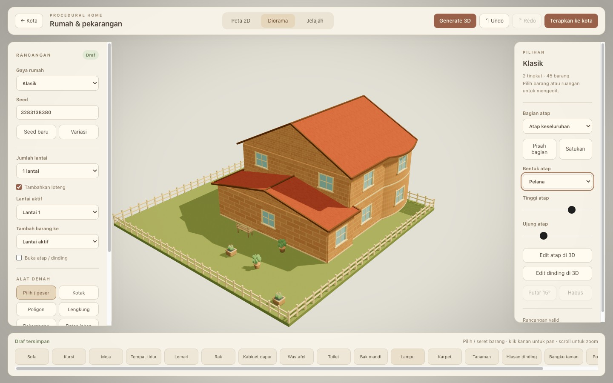
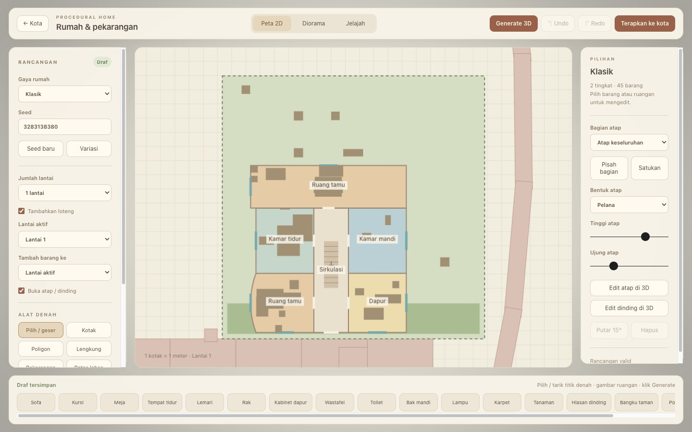
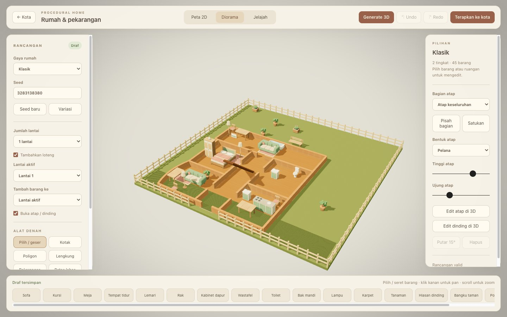

# Procedural Home Building — Implementasi & QA

Tanggal pemeriksaan: 2026-10-04. Implementasi mengikuti [spesifikasi yang disetujui](./PROCEDURAL_HOME_BUILDING_PLAN.md).

## Cara mencoba

Jalankan `npm run dev`, buka kota, tekan **Bangun Rumah** atau **B**, lalu klik rumah. Rumah yang sudah diterapkan juga dapat dimasuki dari pintunya saat berjalan di kota.

1. **Peta 2D** menampilkan seed lengkap, ruangan, barang, pintu, jendela, tangga, pekarangan, serta lahan yang dilindungi. Satu kotak berukuran 1 meter.
2. Pilih gaya **Klasik**, **Cottage**, atau **Modern Tropis**; pilih 1–3 lantai dan loteng. Gambar ruangan dengan Kotak, Poligon, atau Lengkung, dan gunakan Batas lahan / Pekarangan untuk mengubah halaman.
3. **Generate 3D** membuka Diorama dan mengisi ruangan baru. Generate ulang tidak menggandakan barang. Denah dan 3D memakai blueprint yang sama.
4. Dengan cutaway aktif, pilih barang lalu tarik; Putar 15°, Hapus, dan katalog tersedia. Barang mengikuti snap lantai, dinding, atau permukaan meja/rak. Posisi invalid ditampilkan merah dan mempertahankan posisi valid terakhir.
5. Pilih **Edit dinding di 3D** untuk titik sudut, kendali lengkung, dan tinggi lantai. Pilih **Edit atap di 3D** untuk tinggi, bubungan, dan ujung atap. Bagian atap dapat dipisah, disatukan, atau memakai pelana, limas, dan kerucut. Sayap lantai bawah yang terbuka memperoleh atap sendiri.
6. **Jelajah**: WASD, Shift untuk berlari, tarik mouse untuk melihat, Escape kembali ke Diorama. Tangga menghubungkan lantai dan loteng.
7. Draf otomatis tersimpan di browser. **Terapkan ke kota** memvalidasi rancangan, menyimpan hasil, lalu memperbarui rumah dan pekarangan di kota.
8. Seed baru memulai rancangan baru; seed yang diketik menghasilkan rancangan yang dapat direproduksi. **Variasi** menjaga struktur dan barang yang diedit manual. Undo/Redo tersedia, termasuk Ctrl/Cmd Z dan Shift Ctrl/Cmd Z.







## Aset & optimasi

- [Kit rumah](../tools/blender/home/README.md): 21 tipe aset, 63 mesh dengan tiga LOD, atlas painted 1024² embedded, serta source Blender dan master tekstur.
- GLB **3.791.532 byte**. Full kit LOD0/1/2: **47.688 / 22.910 / 7.192 segitiga**. Prop berulang berbagi geometry/material dan atlas. Bath memakai koreksi orientasi sebelum fitting ke kontrak penempatan.
- Shell dinding, trim, kaca, pagar, dan atap digabung menurut material. Model kota memakai LOD tanpa furniture interior. Home GLB baru dimuat saat membuka editor atau saat kota memiliki rumah yang diterapkan.
- Shadow dihitung ulang saat rumah berubah. Peta 2D menghentikan render scene 3D ketika idle. Resolusi mengikuti governor kualitas aplikasi.
- Scheduler 60 FPS engine menjaga interval yang dijadwalkan pada display 60–144 Hz; ini memperbaiki frame cap yang sebelumnya turun berlebihan pada refresh 75/90 Hz.
- Geometri lokal rumah dibuang saat editor ditutup; geometri/atlas asset cache tetap dipakai bersama.

## Hasil verifikasi

| Pemeriksaan | Hasil / batas bukti |
| --- | --- |
| Suite Node proyek | PASS: 115/115 tes; 0 gagal. |
| Build Vite produksi | PASS. |
| Model rumah | Seed deterministik, tiga gaya/bentuk, tingkat+loteng, snap, benturan, lahan dilindungi, Variasi, tombstone barang, edit tinggi, dan ketergantungan struktur. |
| Geometry Three.js aktual | PASS: koordinat lantai, lubang tangga, pintu pada dinding bersama sebagian/penuh, lengkung, penutupan gable, atap sayap bawah, seluruh LOD, cutaway rendah, dan disposal cache. |
| Browser editor | PASS, 10 pemeriksaan; real DOM/controller/raycast, pointer handler sintetis dengan capture di-stub. Bukan bukti pengiriman gesture mouse fisik. |
| Input mouse browser | PASS: drag kursi melalui input browser menghasilkan pointerdown/up trusted dengan pointer capture asli; snap ke grid .25 m, transaksi selesai, klik Undo/Redo memulihkan transform. Titik awal/akhir ditandai sementara untuk otomasi dan seluruh record dipulihkan setelah pemeriksaan. |
| Penyimpanan reload | PASS: blueprint hasil edit tetap identik setelah reload IndexedDB. |
| Apply → kota → pintu rumah | PASS: record, shell, collider, dan portal diperbarui; masuk kembali melalui pintu mengembalikan blueprint identik dan mode Jelajah. Rumah fixture terakhir: 45 barang, satu lantai + loteng dan sayap bawah. |
| Navigasi controller | PASS: 9 fixture, 36 spawn, 54 perjalanan tangga naik/turun, 153 lintasan pintu, 54 benturan barang pekarangan. Berlari tidak menembus dinding pada dt 1/60, .05, .1; diagonal dinormalisasi. |
| Console browser | Tidak ada error pada pemeriksaan akhir. |
| Resource setelah pergantian editor | PASS: lima pergantian Home → Home dengan render penuh tetap 44 geometry, 19 texture, 13 shader program. Ini indikator kestabilan cache, bukan pengukuran seluruh heap. |
| Aset GLB | PASS: UV/normal/index finite, 63 LOD, zero-area triangles=0, atlas embedded, import ulang Blender dan loader web. Khronos validator NOT_RUN karena tidak tersedia. |

Ringkasan hasil aktual tersedia di [home_integration.json](../tools/blender/home/qa/home_integration.json). Regresi browser dapat dijalankan dari tab dev yang sedang membuka HomeMode:

```js
const qa = await import('/tools/qa/home_editor_browser.js');
await qa.runHomeEditorChecks(window.__globe.director.mode);
const profile = await import('/tools/qa/home_profile_browser.js');
await profile.runHomeProfile(window.__globe.director.mode);
```

Regresi editor mengembalikan blueprint, history, kamera, dan record penyimpanan asli setelah selesai. Profil render tidak melakukan commit atau menulis record.

```sh
npm test
npm run build
node tools/qa/home_navigation.mjs
node tools/blender/home/inspect_home.mjs
```

## Profil performa & batasnya

Chrome 154, renderer **ANGLE Metal Apple M1 Pro**, viewport 1440×900, kualitas Auto. Fixture akhir: 3 lantai + loteng, 61 barang interior + 6 halaman, atap penuh, kamera orbit statis, 122 draw calls dan 198.242 segitiga termasuk pass render/post yang dilaporkan renderer. Shadow sudah dihitung pada warmup dan dipakai dari cache selama kamera/rancangan statis.

| Profil | DPR efektif | Frame rata-rata | p95 interval frame | p95 CPU submit | Sampel GPU terbaru |
| --- | --- | --- | --- | --- | --- |
| Rumah akhir, DPR 1 | 1 | 29,69 FPS | 40,9 ms | 3,9 ms | 5,66 ms |
| Rumah akhir, DPR 2 | 2 | 30,08 FPS | 41,1 ms | 5,0 ms | 11,03 ms |

Masing-masing profil memakai 219 interval setelah warmup; FPS dihitung dari total durasi, bukan invers median. GPU adalah rata-rata accumulator terbaru milik governor, bukan seluruh durasi benchmark. Pada sesi yang sama, cadence requestAnimationFrame tanpa render rumah sekitar **30,35 FPS**. Biaya CPU/GPU rumah berada di bawah budget 16,7 ms, tetapi angka frame akhir tidak membuktikan 60 FPS stabil. Profil sebelumnya pada fixture sebelum penambahan jendela fasad mencatat 59,9 FPS pada DPR 1 dan 2; hasil itu juga tidak dijadikan jaminan untuk build akhir. Target 60 FPS tetap perlu diuji dalam sesi browser/perangkat yang menyediakan cadence tersebut.

Profil galeri semua aset LOD0 terpisah mencapai median 16,7 ms, p95 17,8 ms pada 1600×1000 DPR 1; bukti rinci di README kit. Galeri tidak dianggap benchmark rumah penuh.

## Batas implementasi saat ini

- Gaya rumah berbagi kit cozy yang sama, dengan palette dan pengaturan generator berbeda.
- Kavling awal disimpulkan dari bangunan dan ruang kosong di sekitarnya. Validasi tidak mengizinkan jalan, tetangga, air, atau area bersama yang dilindungi. Struktur invalid tetap dapat diperbaiki dalam draf; Apply ditahan sampai valid.
- Collider rumah di kota berupa AABB konservatif dari bentuk yang diputar; bukan collision mesh presisi untuk bangunan cekung. Collider/penempatan dalam editor memakai blueprint.
- Town Planner dikunci bila kota memiliki record rumah agar generator kota tidak menggeser identitas kavling.
- Kembali ke kota memakai kedatangan Diorama biasa; posisi jalan sebelumnya belum dipulihkan. Mode rumah belum memiliki ambience audio khusus.
- Penyimpanan lokal browser; tidak ada sinkronisasi akun atau server. Hasil QA tidak mencakup Safari/Firefox, perangkat mobile, seluruh skenario drag struktur melalui input browser, atau jaminan FPS pada seluruh perangkat.
