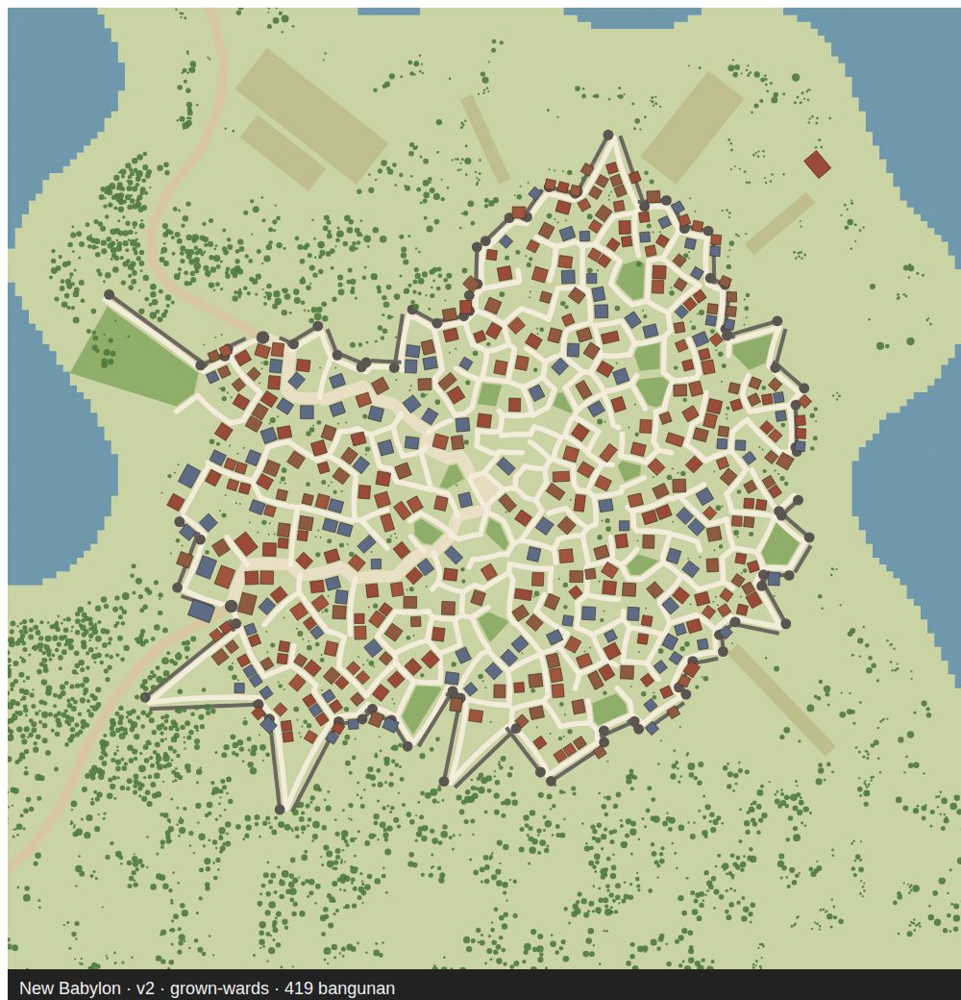
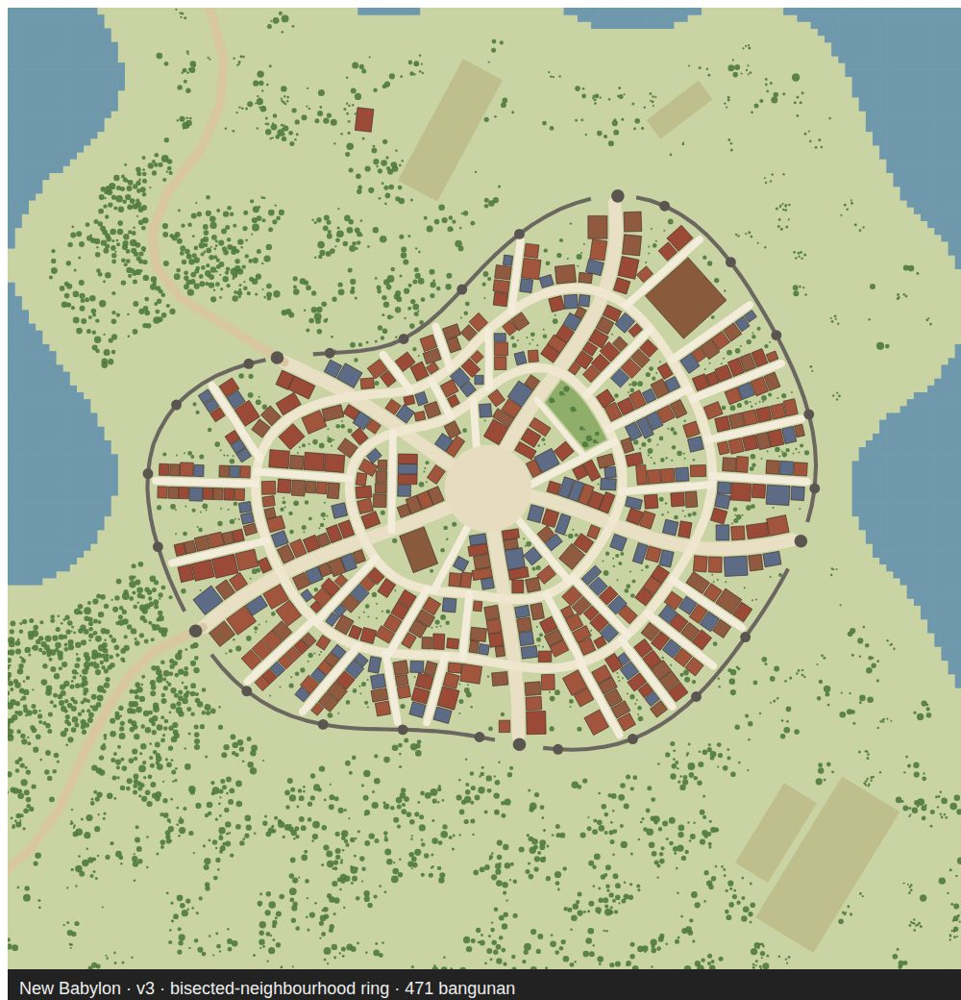
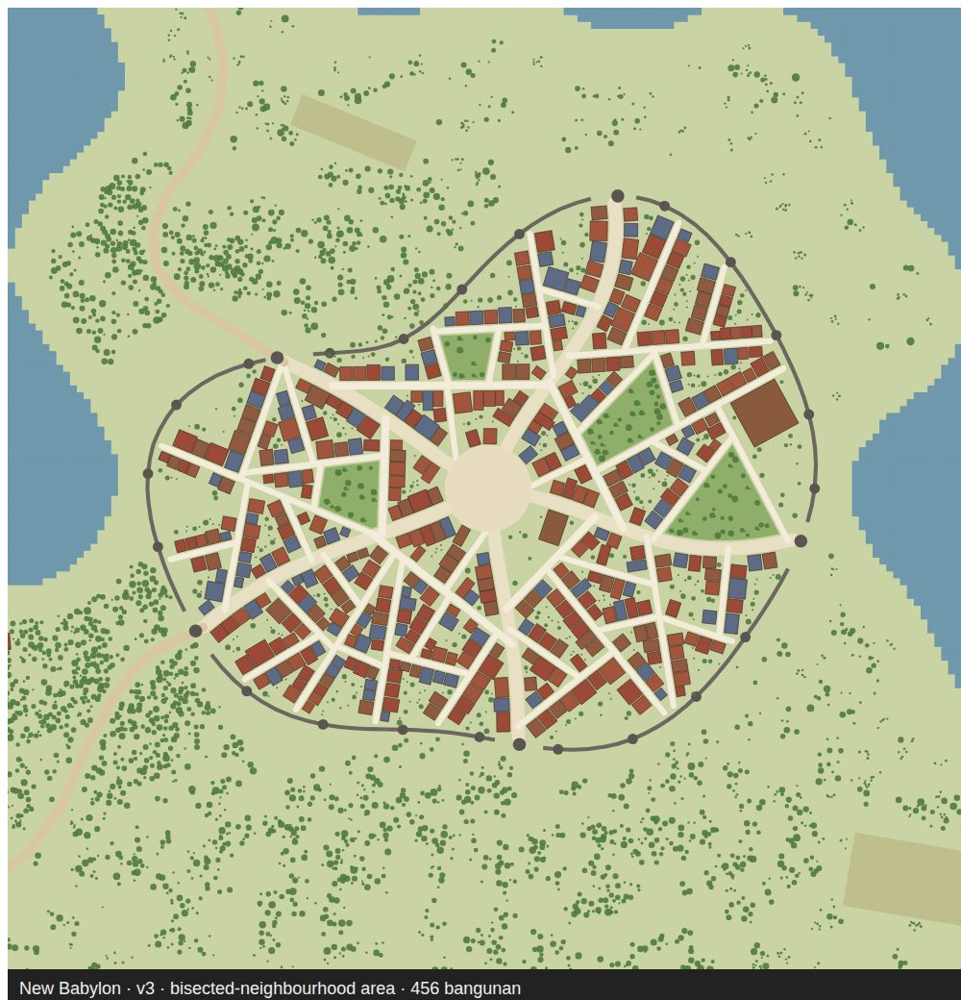
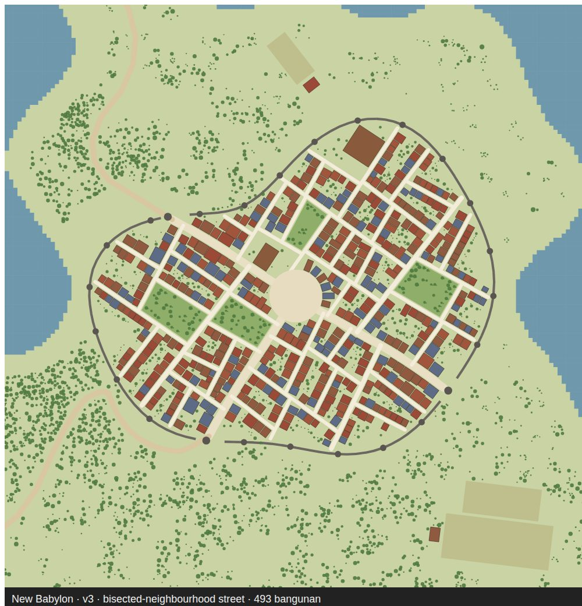
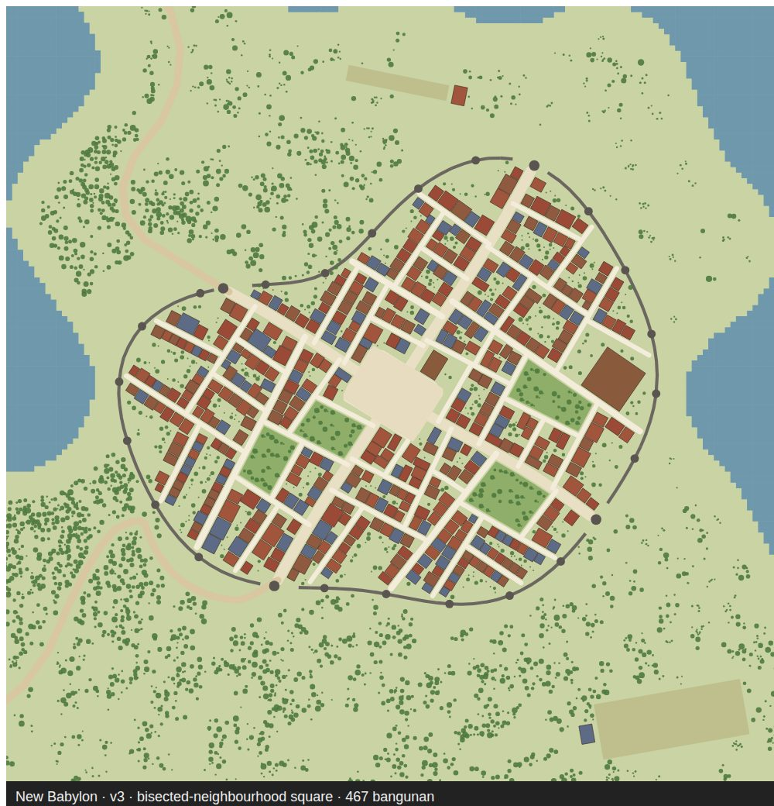
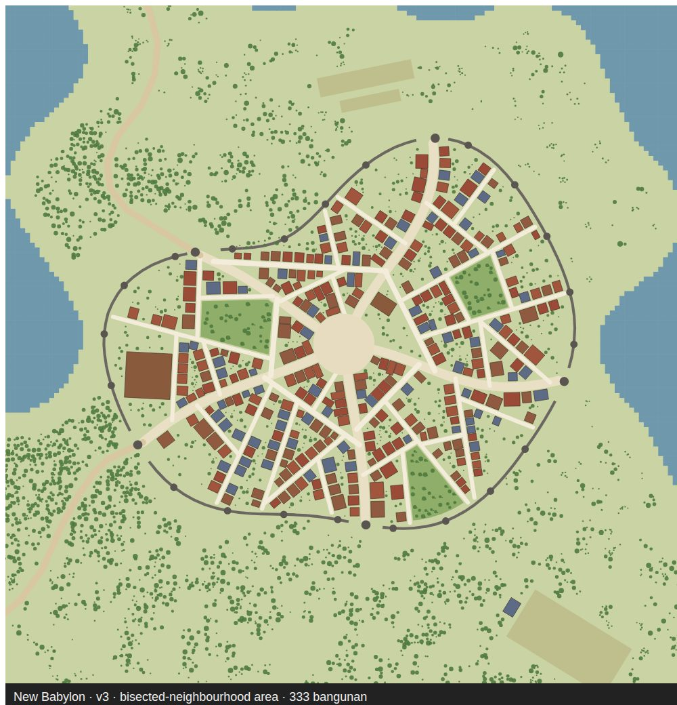
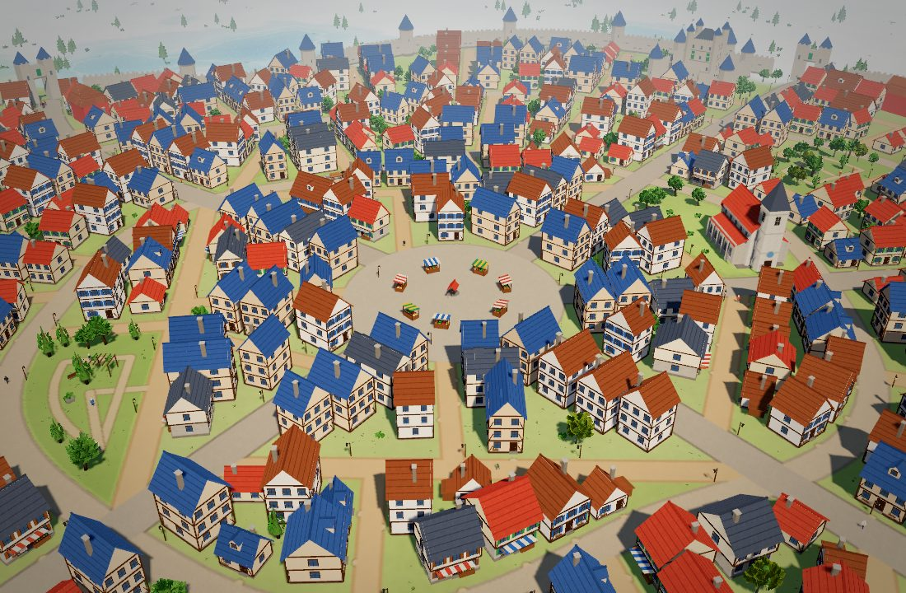
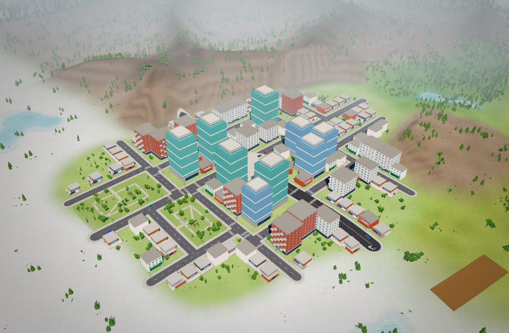

# Tata kota v3: blok dibelah, bukan sel Voronoi — 29 September 2026

Pengganti generator tata kota v2 untuk kota **baru** (fantasy dan modern). Tujuannya menghapus kesan zig-zag: jalan patah-patah, tembok berbentuk bintang, dan rumah yang tercecer tanpa baris. Referensi bentuk: [Neighbourhood Generator](https://watabou.itch.io/neighbourhood) (Tailors Band, Heatherwall Street, East Market). Algoritme di repo adalah implementasi sendiri; bukan port kode Watabou.



## 1. Mengapa v2 terlihat zig-zag

| Gejala | Penyebab di kode v2 (`townPlan.js`) |
|---|---|
| Jalan patah-patah | Setiap jalan adalah rantai sisi sel Voronoi. Situs tidak direlaksasi (sengaja, agar tidak seperti sarang lebah), jadi sudut antarsisi acak. `streetPoints` menambah lengkungan sinus kecil per sisi, yang justru menambah goyangan. |
| Tembok seperti bintang | Tembok mengikuti sisi luar sel kota. Sel pinggir menonjol keluar, jadi tembok berbelok tajam di setiap sudut sel. |
| Rumah tercecer | `fillStreetFronts` berjalan sepanjang jalan dan menaruh rumah di kedua sisi; di belakang rumah tidak ada struktur blok, dan jalan yang patah membuat baris rumah ikut patah. |

## 2. Yang dipelajari dari Neighbourhood

Sumber: halaman generator dan devlog resmi ([1.1.0 templates](https://watabou.itch.io/neighbourhood/devlog/362757/110-templates-large-buildings-and-other-features), [1.2.0](https://watabou.itch.io/neighbourhood/devlog/419786/120-new-template-integration-with-mansions-lots-of-visual-changes), [MFCG 0.5.3](https://watabou.itch.io/medieval-fantasy-city-generator/devlog/34104/053-neighbourhoods-alleys-and-buildings)). Halaman itch.io tidak dapat dibuka dari sesi ini (egress diblokir); ringkasan di bawah berasal dari cuplikan devlog dan pengamatan tiga gambar contoh.

- **Template** menentukan watak lingkungan: *Area* (umum), *Street* (satu jalan utama dan sekitarnya), *Square* (lapangan persegi terencana di tengah), *Ring* (satu atau lebih jalan lingkar konsentris).
- **Pembelahan rekursif** (*recursive bisection*): area dibelah dua berulang kali; garis belahan menjadi jalan. Hasilnya blok yang terasa organik tetapi tetap tertata.
- **Blok diisi dari tepi**: rumah berderet menerus menghadap jalan, sisi belakang dan tengah blok menjadi halaman/kebun berpohon. Lot segitiga yang jelek dikurangi dan rumah dipaskan rapat ke lotnya.
- Pengamatan gambar: jalan panjang berupa lengkung halus atau garis lurus; jalan kecil bertemu jalan induknya sebagai simpang T; tidak ada jalan yang berbelok bolak-balik.

## 3. Pipeline v3 (`src/modes/town/layout/blockPlan.js`)

1. **Garis kota halus.** Radius tepi kota dari medan `city` diambil pada 96 sudut, berhenti di air. Filter minimum lalu enam kali rata-rata bergerak (operasi *opening*): tanpa duri dan tanpa takik.
2. **Template.** `ring` untuk ibu kota fantasy; kota fantasy lain acak di antara keempatnya; kota modern `street` atau `square`. Sumbu template = arah jalan regional pertama.
3. **Arteri.** Dari plaza ke setiap gerbang, kurva halus `θ(t) = a + bend·sin(πt)`. Template `street`/`square` memakai arteri tegak lurus sumbu; jalan regional yang datang dari sudut lain memutar di luar tembok (`exit.via`) ke gerbang terdekat, sehingga grid tidak rusak.
4. **Jalan lingkar.** Template `ring`: 1–2 cincin mengikuti bentuk garis kota (koordinat `t` antara tepi plaza dan tepi kota). Pita luar diberi jalan radial tambahan setiap ±60 m (fantasy).
5. **Region → blok.** Tiap region (antara dua radial dan dua cincin) dibelah dengan garis lurus melintang sumbu panjangnya, dekat tengah, sedikit dimiringkan, lalu ditarik ke arah "serat" template (radial/tangensial untuk ring/area, sumbu untuk street/square). Berhenti saat luas mendekati target blok atau blok terlalu tipis untuk dua baris rumah. Blok di sekitar plaza dibelah sejajar plaza agar muka plaza utuh. `splitPolygon` menangani poligon cekung (sisi cincin).
6. **Fungsi blok.** Fantasy: pedagang di pusat/plaza, dermaga di tepi air, gerbang, satu sektor bangsawan, kampung di pinggir kota besar, sisanya pengrajin. Modern: pusat kota, komersial, perumahan, pinggiran, industri di tepi air. Beberapa blok cembung menjadi taman.
7. **Landmark.** Kuil/menara menghadap plaza (atau arteri pusat bila muka plaza terlalu sempit); kastil ibu kota di blok besar dekat tepi; menara `m_spire` di plaza modern.
8. **Rumah berderet.** Setiap tepi blok yang berjalan sepanjang satu jalan menjadi satu *frontage*. Rumah berdiri berurutan menghadap jalan, lebar/dalam diskalakan 0,84–1,22, dengan celah menurut ward dan kepadatan; sesekali celah kebun. Setiap rumah harus di dalam blok, di luar trotoar semua jalan, tidak tumpang tindih, dan di tanah kering.
9. **Halaman.** Pohon buah/kebun di sisa bagian dalam blok.
10. **Tembok.** Mengikuti garis kota yang sama, 5 m (tembok) atau 3,5 m (palisade) di luarnya; potongan 9 m, menara setiap ±45 m, terbuka ke air dan sungai, gerbang di ujung arteri.
11. **Ladang.** Sel Voronoi hanya di luar kota (dengan cincin situs penahan di tepi kota), dipakai `planSurroundings` seperti sebelumnya.






## 4. Parameter

`generateTownLayout({ ..., plan: { template, density } })`

| Opsi | Nilai | Efek |
|---|---|---|
| `template` | `auto` (default), `area`, `street`, `square`, `ring` | Struktur jalan utama dan arah belahan |
| `density` | `sparse` (Jarang), `normal`, `dense` (Padat) | Ukuran blok ×1,4 / ×1 / ×0,72, celah antarrumah, peluang lot kosong, jumlah pohon halaman |

Nilai per era (`ERA` di `blockPlan.js`): lebar arteri 7–8 m / 14 m, cincin 5,5 / 11 m, gang 4,6→3,6 m / 10→8 m, target blok 1.700 / 3.600 m², tebal blok minimum 27 / 44 m. Jalan modern ≥ 10 m masuk graph kendaraan.

`TownMode` belum mengirim `plan`; kota di game memakai `auto`/`normal`. Panel perencana dapat meneruskan pilihannya ke parameter ini.




## 5. Versi dan save

- `TOWN_LAYOUT_VERSION = 3` (`src/world/townGeneration.js`), juga default `generateTownLayout`.
- Kota yang punya interior tersimpan tetap memakai versinya (1 atau 2), karena ID bangunan berbasis koordinat.
- Kota yang tercatat v2 **tanpa** interior tersimpan naik ke v3 saat dikunjungi lagi; tidak ada ruangan yang yatim.
- v1/v2 tetap ada di kode (`planWards`, `planNeighbourhoods`, `planFantasy`, `planModern`) untuk kota lama.

## 6. Verifikasi

- `npm test`: 28 test lolos, termasuk `tests/town-plan.test.js` baru: pembelahan poligon cekung, tidak ada zig-zag (belokan > 0,2 rad yang langsung berbalik arah), rumah bebas dari badan jalan dan satu sama lain, potongan tembok bertetangga berbelok < 0,3 rad, template/kepadatan deterministik, v2 masih tersedia.
- `GLOBE_SWEEP_SEEDS=30 node --test tests/town-plan.test.js tests/town-generation.test.js tests/walk-network.test.js`: lolos pada 30 seed × 2 era.
- Pembanding pada seed 17 (subdivisi 3): v2 punya 8 titik zig-zag dan 17 tekukan tembok; v3 0 dan 0.
- Browser (Chromium headless, SwiftShader): kota fantasy dan modern v3 dirender di `TownMode` tanpa `engine.lastError`.




Pratinjau 2D untuk iterasi cepat tanpa browser game:

```sh
node tools/plan/preview.mjs --seed 427 --template ring --density normal --out plan.svg
# PNG ikut dibuat bila playwright tersedia (PLAYWRIGHT_MODULE boleh menunjuk instalasi global)
```

## 7. Batas yang diketahui

- Belahan blok selalu garis lurus; lengkungan hanya dari arteri, cincin, dan garis kota.
- Sudut blok belum punya bangunan sudut khusus; baris rumah berhenti sebelum sudut bila tidak muat.
- Sungai yang membelah kota tidak menjadi batas region; gang yang memotong sungai diputus, arteri dan cincin diberi jembatan.
- Kota yang sudah punya interior v2 belum dimigrasikan ke v3 (sama seperti batas v1→v2).

## Integrasi ke cabang lokal (30 September 2026)

Cabang lokal sudah memakai nomor versi 3 untuk lebar jalan praktis, pagar tanaman, dan bunga berkelompok, jadi planner blok ini menjadi **layout versi 4** (`TOWN_LAYOUT_VERSION = 4`). Kota yang tersimpan di versi lama tanpa ruangan tersimpan naik ke versi 4; yang punya ruangan tetap di generatornya.

- `blockPlan.js` pindah ke `src/modes/town/layout/`; dipanggil dari `generateTownLayout` untuk kota dan ibu kota, baik fantasi maupun modern. Desa fantasi kecil (satu tile, bukan ibu kota) tetap memakai `villagePlan.js`.
- Parameter mengikuti planner 2D lokal: `options: { density: 0.75 | 1 | 1.3, template }` dipetakan ke `sparse | normal | dense`. Jalan selalu dipotong untuk kepadatan normal (`streetDensity`), sehingga mengubah kepadatan di planner hanya menjarangkan/memadatkan kavling tanpa menggeser jalan.
- Preview 2D: `node tools/plan/preview.mjs --seed 17 --version 4 [--template ring] [--density dense]`.


## Integrasi bangunan, jalan, dan pelabuhan (v4, 30 September 2026)

- **Pelataran (apron):** setiap bangunan berdiri di atas pelataran selebar tapaknya plus 1,3–2,2 m (paving di kota modern, tanah padat di kota lama, halaman untuk lumbung). Dilukis di tekstur tanah dan mask permukaan; rumput tidak tumbuh di atasnya. Data: `L.aprons`.
- **Akses ke jalan:** bangunan yang pintunya tidak langsung menghadap jalan mendapat jalur siku: keluar lurus dari pintu, lalu belok ke jalan terdekat (≤ 45 m), bebas dari bangunan lain. Masuk `L.paths` (kind `frontage`), jadi pejalan kaki ikut memakainya.
- **Pelabuhan:** dari ujung darat dermaga ada jalan dermaga ke jalan terdekat (lurus, atau keluar dulu ke darat lalu menyilang), bertanda `quay: true`. Mobil dan pejalan kaki bisa mencapai pelabuhan.
- **Jembatan:** ujung jembatan dicari di tanah kering sepanjang jalannya, sehingga dek rata dengan jalan di kedua ujung. Jembatan modern selebar jalan plus trotoarnya, dengan aspal, trotoar yang ditinggikan, pagar besi, gelagar tepi, dan pilar. Jembatan batu melengkung di atas sungai, dengan pagar bertopi batu dan kepala jembatan.
- **Streetscape:** set meja kafe berpayung di depan toko dan kedai. Plaza modern mendapat air mancur, bangku, dan kios. Sepanjang jalan modern ada halte bus, hidran, dan tempat sampah. Semuanya aset proto berwarna (`townBuilder.js` → `protoGeometry`: `g_cafe_a/b`, `g_fountain`, `g_kiosk`, `g_bus_stop`, `g_hydrant`, `g_bin`).
