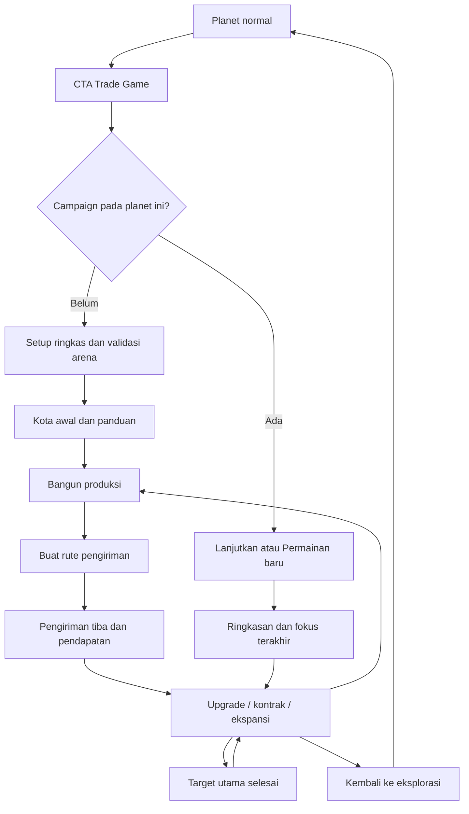

# Trade Game — gameplay, UI, dan rencana implementasi

Tanggal: 9 Oktober 2026. Status: **implementasi v1 terpasang di working tree**. Lihat [sistem aktual dan hasil QA](TRADE_GAME_RUNTIME.md).

Dokumen ini menerjemahkan keputusan wawancara menjadi desain dan urutan kerja yang telah disetujui untuk eksekusi. Keputusan pengguna tercantum di §1. Angka dan target di bawah tetap merupakan acuan desain; nilai runtime berasal dari `src/trade/catalog.js`. Hasil pengujian dan batas implementasi dicatat terpisah di [Trade Game Runtime](TRADE_GAME_RUNTIME.md).

Referensi mekanik: [Let Them Trade di Steam](https://store.steampowered.com/app/1313290/Let_Them_Trade/), terutama kota dengan produksi/kebutuhan dan perdagangan antarkota. Globe mempertahankan diorama planet dan bahasa UI yang sudah ada.

## 1. Keputusan yang sudah disepakati

| Area | Keputusan |
|---|---|
| Pintu masuk | CTA **Trade Game** di planet mode normal membuka mode gameplay tersendiri. |
| Aktivitas | Gabungan pembangunan kota/fasilitas dan pengelolaan logistik. |
| Tantangan | Sedang; masalah dapat dipulihkan. |
| Pembangunan | Pemain menempatkan fasilitas langsung pada tile globe. |
| Logistik | Pemain menentukan asal, tujuan, barang, dan kendaraan; pengiriman berulang otomatis. |
| Permainan baru | 1 kota pemain + 2 kota NPC, modal dan fasilitas dasar; panduan singkat bisa dilewati. |
| Progres | Milestone bertahap; setelah target utama tercapai, pemain bisa terus bermain. |
| Waktu | Ekonomi berjalan selama game terbuka, termasuk saat eksplorasi planet/town; berhenti saat aplikasi ditutup. |
| Arena | Terrain planet aktif; setup procedural memperhitungkan ekonomi dan resource. |
| Penyimpanan | State kota, pembangunan, dan ekonomi Trade Game dipisah dari save eksplorasi. |
| Perangkat v1 | Desktop, keyboard dan mouse. Gameplay mobile menyusul. |
| Sumber fun v1 | Kebutuhan pasokan, kapasitas angkut, peluang harga, kontrak, dan gangguan ringan. |

Implikasi pemisahan mode: UI pengelolaan hanya muncul dalam Trade Game. Ketika kembali ke eksplorasi, simulasi yang sudah dimulai tetap berjalan sebagai service aplikasi. CTA menjadi indikator ringkas untuk kembali; tidak ada panel ekonomi atau pop-up kontrak di town/planet normal.

## 2. Fondasi yang diverifikasi di source

Audit ini membaca working tree saat dokumen dibuat. Beberapa file terkait sedang memiliki perubahan lain; implementasi harus mempertahankannya.

| Fondasi sekarang | Implikasi implementasi |
|---|---|
| `mapGenerator.js` menghasilkan kota, ladang, jalur darat/laut/udara, dan adjacency hex. | Reuse terrain/topologi/pathfinding; tambahkan resource plan dan settlement plan gameplay. |
| `planetRenderer.js` memiliki props, label, route curves, kendaraan, fokus kamera, dan POV. | Reuse renderer melalui adapter; kendaraan Trade Game harus mengikuti shipment. |
| Kendaraan sekarang bergerak berdasarkan waktu animasi dan offset acak. | Visual rute belum merupakan transaksi atau perpindahan stok. |
| `PlanetMode` membungkus renderer dan `MenuController`. | CTA normal bisa kecil; gameplay memakai controller/HUD sendiri. |
| Menu planet mencampur world generation, faksi, daftar kota, dan toggle jalur. | Daftar kota/rute gameplay harus menjadi navigasi utama, bukan submenu Settings. |
| `WorldStateStore` menyediakan IndexedDB dengan journal localStorage. | Reuse mekanisme durable save dengan namespace campaign terpisah. |
| `WorldClock` berjalan real-time/offline dan dipengaruhi tidur. | Trade Game memerlukan clock sendiri sesuai keputusan tidak ada progres offline. |
| Router/Director mengenal space, planet, town, home. | Tambahkan route dan lifecycle `trade`, termasuk sanitization dan deep link. |
| `World.activate()` menulis atribut peta ke hexasphere bersama. | Trade view perlu tile attributes/topologi privat agar tidak mengubah state tile eksplorasi. |
| `PlanetRenderer.setInset()` baru mendukung left/bottom. | Tambahkan right/top secara surgical untuk panel gameplay dan batas kamera. |
| Post-processing memilih preset menurut mode. | `trade` menggunakan look planet secara eksplisit, bukan fallback town. |

Referensi visual lokal yang diperiksa: `public/landing/shots/id/planet-globe.jpg`. Ini screenshot ekspor yang sudah ada, bukan bukti tampilan runtime terbaru. Kontrak visual: [ART_DIRECTION.md](ART_DIRECTION.md).

## 3. Target pengalaman dan scope v1

Pemain melihat peluang di peta, membangun rantai produksi, lalu menyaksikan barangnya sampai ke kota yang membutuhkan. Pertumbuhan membuka keputusan baru: memperluas produksi, memperbaiki jaringan, atau membuka kota baru.

**Loop utama:** kebutuhan/peluang → investasi lokasi → produksi → pengiriman → pendapatan dan pertumbuhan → kebutuhan/peluang berikutnya.

Tiga lapisan keputusan:

1. **Lokasi:** sumber daya, biaya akses, jarak ke pasar, dan ruang ekspansi.
2. **Operasi:** barang yang dikirim, cadangan stok, jumlah kendaraan, dan kapasitas gudang.
3. **Investasi:** fasilitas baru, upgrade, koneksi, atau kota baru.

Pekerjaan berulang ditangani otomatis. Mengirim setiap kendaraan secara manual, mengatur warga satu per satu, dan menyetel puluhan harga bukan aktivitas v1.

### 3.1 Isi versi pertama yang lengkap

- Kota pemain dan NPC, enam komoditas, fasilitas produksi, konsumsi kota, dan pertumbuhan tier.
- Penempatan di hex, konektor lokal, jalan antarkota, pelabuhan, serta rute darat/laut.
- Pembelian/penjualan otomatis melalui rute yang ditetapkan pemain; stok dan anggaran membatasi transaksi.
- Kapasitas kendaraan/gudang, cadangan stok, biaya perjalanan/upkeep, dan panel diagnosis.
- Tutorial, milestone, kontrak opsional, event ringan, recovery ekonomi, dan mode lanjut setelah selesai.
- Pause/1×/2×/4×, background simulation, save/resume, integrasi CTA dan route.
- Desktop HUD, input keyboard/mouse, i18n ID/EN, dan QA regresi eksplorasi.

### 3.2 Pengembangan setelah v1

Gameplay mobile; pembangunan rinci di TownMode; representasi kota Trade Game dalam town; udara/antarplanet; perang, bandit dengan pertempuran, atau perusahaan pesaing; depletion resource; multiplayer/cloud save. Kota baru Trade Game belum menjadi kota yang bisa didarati lewat route TownMode eksplorasi.

Ekonomi resource diterapkan pada data planet landable. Skenario pertama dijalankan pada planet Terran yang lolos validasi; Ocean/Desert menyusul melalui profil skenario. Ice/Lava/Barren membutuhkan rantai ekonomi khusus. CTA pada arena yang belum didukung memberi alasan dan aksi memilih planet yang didukung, tanpa mengganti planet diam-diam.

## 4. Flow mulai bermain sampai kembali lagi



### 4.1 CTA pada planet normal

- Tombol berlabel **Trade Game**, dengan identitas visual mengikuti pill yang ada. Pada overview normal, tempatkan CTA ringkas di kanan bawah di atas hint eksplorasi; topbar normal yang sudah padat tetap mempertahankan susunannya.
- Sebelum ada campaign: membuka setup, tidak langsung membuat save.
- Setelah ada campaign: **Trade Game · Lanjutkan**; dot/angka kecil hanya jika ada masalah yang perlu ditinjau.
- Ketersediaan ditentukan tipe planet dan validasi arena. Loading, unavailable, dan storage failure punya penjelasan yang dapat dibaca.
- CTA mengikuti safe area info card dan hint; disembunyikan ketika POV/flight normal aktif agar tidak bertabrakan dengan HUD kendaraan. Kembali ke overview memunculkannya lagi. Uji posisi ketika inspector normal terbuka.
- CTA menampilkan status campaign planet yang sedang dilihat. Jika campaign aktif berada di planet lain, tooltip/menu CTA memberi akses kembali ke campaign aktif.

### 4.2 Setup pertama

Panel setup menampilkan nama planet, tipe, ringkasan potensi resource, **Tantangan sedang**, dan pilihan **Panduan aktif**. Seed dan konfigurasi procedural disimpan di Advanced, tidak wajib diisi untuk mulai.

CTA utama **Mulai Trade Game**; aksi sekunder **Kembali**. Setelah validasi, tampilkan loading dengan tahapan yang nyata: menyiapkan arena, settlement, ekonomi, lalu aset. Modal belum dapat diklik berulang saat pembuatan save berlangsung.

Campaign menggunakan terrain aktif dan tiga settlement gameplay yang ditempatkan deterministik. Kota, ladang, ownership, dan jalan normal tidak disalin sebagai ekonomi siap pakai. Normal settlement tetap berada dalam map eksplorasi; Trade view memakai overlay settlement sendiri.

### 4.3 Sepuluh menit pertama — target desain

| Tahap | Yang pemain lakukan | UI/hasil yang terlihat |
|---|---|---|
| Orientasi | Kamera fokus ke kota pemain; melihat dua calon mitra. | Kartu tujuan pertama; label kota menunjukkan produksi dan kebutuhan. Simulasi awal pause. |
| Produksi | Memilih Bakery, melihat tile valid, lalu menempatkannya. | Preview biaya dan input/output; gandum dari ladang awal berubah menjadi roti. |
| Peluang | Memilih NPC yang membutuhkan roti. | Permintaan, harga beli, kapasitas, dan estimasi pengiriman. |
| Rute pertama | Asal kota pemain, tujuan NPC, roti, satu karavan; cadangan awal diberi preset. | Path preview, biaya, waktu pulang-pergi, dan estimasi margin sebelum konfirmasi. |
| Hasil pertama | Menjalankan waktu, mengikuti atau menyorot karavan. | Muatan tiba; pemasukan masuk ledger; milestone tercapai sekali. |
| Keputusan baru | Memilih logging untuk ekspansi atau menambah angkut untuk penjualan. | UI menjelaskan bottleneck: produksi, gudang, permintaan, atau kendaraan. |
| Menutup rantai | Membeli tools dari NPC industri melalui rute balik terjadwal. | Satu perjalanan bisa menjual roti dan membeli tools; pembangunan lanjutan terbuka. |

Fasilitas awal: city core, pasar, gudang dasar, satu ladang gandum; resource konstruksi, makanan, dan kendaraan tersedia untuk menyelesaikan tutorial. Bakery merupakan pembangunan pertama. Persediaan awal membiayai setidaknya satu jalur yang berhasil; tidak ada keharusan membuat tools sebelum bisa mendirikan fasilitas untuk menghasilkan tools.

Tutorial merespons aksi pemain, bukan timer. Bisa dilewati atau dibuka ulang. Mengubah urutan, membeli fasilitas berbeda, atau kembali setelah reload tidak membuat tutorial buntu. Bantuan menyorot tombol/area tanpa menutupi tempat klik.

### 4.4 Sesi selanjutnya

- **Lanjutkan** mengembalikan selection, kamera, tab panel, milestone, dan speed; masuk dalam keadaan pause sampai pemain memilih Jalankan.
- Ringkasan menampilkan kondisi save terakhir: saldo, produksi terhenti, rute bermasalah, kontrak aktif, dan langkah yang bisa dipilih.
- Tidak menampilkan pendapatan selama offline. Waktu kontrak/event memakai simulation time sehingga tidak kedaluwarsa ketika game ditutup.
- Keluar melalui **Kembali ke eksplorasi** menyimpan state dan kamera, lalu mengembalikan planet normal dan fokus sebelumnya. Ekonomi terus berjalan bila tidak dipause.

## 5. Layout desktop dan hierarki UI

Gunakan concrete/iron, aksen hijau pemain, hairline, dan diorama yang sudah ada. NPC menggunakan identitas mitra yang netral; warna merah hanya untuk masalah. Angka uang/stok memakai digit tabular dan font sistem agar mudah dibandingkan. Display font dipakai untuk judul.

### 5.1 Wireframe utama — target 1440 × 900

```text
┌─────────────────────────────────────────────────────────────────────────────┐
│ ← Eksplorasi  TRADE GAME · Planet    Kas  Arus kas  Kota     Pause 1× 2× 4× ⚙ │
├─────┬──────────────────────────────────────────────────────────┬────────────┤
│ 🏙  │ Tujuan aktif: pengiriman pertama                          │ KONTEKS    │
│ ⇄   │ [progress + Lihat lokasi]                                │ Kota/rute/ │
│ 📦  │                                                          │ fasilitas  │
│ ◇   │                    GLOBE / REGION                         │ yang dipilih│
│ !   │          kota, resource, jalur, kendaraan                  │            │
│     │          route terpilih dan ghost pembangunan             │ Ringkasan  │
│     │                                                          │ Diagnosis  │
│     │                                                          │ Aksi       │
├─────┴──────────────────────────────────────────────────────────┴────────────┤
│ [Bangun B] [Rute R] [Ekspansi]   Overlay: Resource / Pasokan / Rute   Status  │
└─────────────────────────────────────────────────────────────────────────────┘
```

- **Topbar** sekitar 64 px: identitas, kas, arus kas rolling, jumlah kota, clock, menu. Stok enam barang tidak dijejalkan di sini karena stok berada per kota.
- **Rail kiri** sekitar 56 px: Kota, Rute, Kontrak, Milestone, Notifikasi. Ikon memiliki label/tooltip dan focus state.
- **Panel konteks kanan** 320–360 px: satu panel besar pada satu waktu. Daftar kota/rute memakai panel yang sama; memilih item membuka detail dengan breadcrumb kembali.
- **Kartu tujuan** ringkas di kiri atas area dunia, bisa diciutkan; bukan panel kedua sepanjang layar.
- **Dock bawah** sekitar 64 px: aksi gameplay dan overlay. Status save berada di sini/area status, bukan toast berkala.
- **Globe** menggunakan area yang tersisa; insets kamera mengikuti ukuran panel sebenarnya. Target sekitar 70% lebar tersedia ketika satu inspector terbuka.

Pada 1280 × 720, panel 320 px, label sekunder dikurangi, kartu tujuan diciutkan bila perlu; CTA utama tetap terlihat. Panel memiliki scroll sendiri dan action footer tetap terlihat. Di 1024 × 768 gunakan panel sekitar 300 px dan dock ringkas. Layar desktop yang sangat sempit mendapat layout ringkas/pesan ukuran layar; bukan klaim dukungan mobile.

### 5.2 Mode kamera dan keterbacaan

- **Overview:** melihat planet dan ringkasan kota; badge resource digabung pada zoom jauh.
- **Region:** fokus kota dan hinterland untuk pembangunan; local resource dan koneksi terlihat jelas.
- **Follow shipment:** opsional untuk menikmati perjalanan; panel menunjukkan muatan/status dan tombol kembali.
- Auto-rotate dimatikan di Trade Game; drag tetap tersedia. Mengaktifkan build membawa kamera ke region pada zoom yang dapat digunakan.
- Tile di sisi belakang globe tidak bisa dipilih. Daftar kota/rute selalu bisa membawa kamera ke objek yang tidak terlihat.
- Pilihan kota tidak tiba-tiba berubah menjadi tile karena label/mesh tumpang tindih; aturan hit testing mendahulukan objek aktif dan mengikuti tool yang dipilih.
- Rute/fasilitas dibedakan dengan bentuk dan label; status tidak mengandalkan warna saja.

### 5.3 Isi setiap panel

| Panel | Informasi utama | Aksi utama |
|---|---|---|
| Kota | Tier/populasi, kebutuhan, persediaan dan coverage, produksi/konsumsi, rute masuk/keluar. | Bangun, buat rute, fokus pasokan bermasalah, upgrade core. |
| Fasilitas | Recipe, output aktual vs kapasitas, input buffer, koneksi gudang, upkeep, alasan terhenti. | Upgrade, pause/resume, lihat pemasok, bongkar. |
| Tile/resource | Bioma, fertility/deposit, fasilitas yang sesuai, jangkauan kota, akses dan biaya. | Bangun fasilitas sesuai resource. |
| Rute | Asal/tujuan, manifest dua arah, kapasitas, perjalanan, cadangan stok, biaya/hasil aktual, bottleneck. | Tambah kendaraan, edit, pause setelah trip, tutup setelah muatan selesai. |
| Shipment | Barang, jumlah, tujuan, waktu tiba, nilai transaksi terkunci, kendaraan. | Sorot/ikuti; akses rute. |
| Kontrak | Kebutuhan, jumlah terkirim, reward, sisa simulation time, kapasitas yang dibutuhkan. | Terima, sorot buyer, buat rute. |
| Notifikasi | Masalah aktif dengan alasan dan lokasi; riwayat hasil disimpan terpisah. | Lihat penyebab, tindakan yang relevan, dismiss riwayat. |

Contoh diagnosis: **“Bakery berhenti: gandum habis. Ladang menghasilkan 2/min, Bakery membutuhkan 3/min.”** Aksi: **Lihat ladang**, **Bangun ladang**, **Impor gandum**. Jangan menawarkan “Tambah karavan” untuk masalah produksi.

### 5.4 Input dan state UI

State utama: `overview`, `inspect`, `buildCatalog`, `buildPlacement`, `routeOrigin`, `routeDestination`, `routeConfigure`, `shipmentFollow`, `dialog`.

- Klik: pilih/konfirmasi placement; drag: orbit; scroll: zoom; movement threshold mencegah drag dianggap build click.
- `B`: catalog; `R`: buat rute; `Space`: pause ekonomi; `1/2/4`: speed; `F`: fokus selection; `Esc`: batal tool atau kembali satu level. Pause menu aplikasi dibuka saat tidak ada tool/dialog yang perlu ditutup.
- Shortcut tidak aktif saat mengetik di input/select atau modal lain; tidak mengambil kontrol TownMode ketika Trade view sudah keluar.
- Satu tool aktif. Memilih rute ketika sedang build harus membatalkan ghost dan melepaskan handler sebelumnya.
- Klik UI tidak menembus canvas. Tooltip tidak menutupi tile placement atau action utama. Keyboard focus pulih setelah modal ditutup.
- Catalog/modal keputusan dapat meminta pause sementara. Setelah tutup, restore speed/pause sebelumnya; tidak otomatis menjalankan game yang sudah dipause manual.

## 6. Flow pembangunan, pengiriman, dan ekspansi

### 6.1 Bangun fasilitas

`Bangun → kategori → fasilitas → pilih kota pengelola → tile valid → preview → konfirmasi → konstruksi → produksi`.

Kategori awal: Pangan, Bahan, Industri, Infrastruktur. Item catalog menampilkan fungsi, biaya uang/resource, upkeep, dan persyaratan unlock. Locked item menjelaskan milestone yang membukanya.

Placement menampilkan ghost, batas catchment kota, yield, biaya konektor lokal, dan alasan tile tidak valid. Biaya konektor termasuk preview total. Pada biaya rendah satu klik placement cukup; pembangunan mahal/kota baru memakai konfirmasi ringkas. Tidak ada biaya untuk ghost atau klik invalid.

Validator memakai lahan kering aktual/footprint, adjacency pentagon maupun hex, occupancy, resource access, catchment, dan koneksi gudang. Mine dibangun pada akses darat di sisi deposit gunung; tidak memaksa jalan melewati tile gunung yang impassable.

Material konstruksi ditarik dari gudang kota pengelola yang sudah tersedia, bukan dari stok kota lain tanpa pengiriman. Output fasilitas masuk buffer, lalu konektor lokal mengirimnya ke gudang secara agregat; pemain mengatur logistik antarkota. Fasilitas disconnected tidak menghasilkan barang langsung di gudang.

Bangunan punya durasi konstruksi singkat dan status yang terlihat. Pause/resume produksi tidak membatalkan konstruksi. Bongkar memberi refund parsial yang dinyatakan sebelum konfirmasi; tidak membuat loop beli-bongkar menguntungkan. Pembatalan konstruksi mengembalikan bagian yang belum dipakai.

### 6.2 Buat rute

`Rute → kota asal → kota tujuan → jenis transport → manifest → kendaraan → reserve stock → preview → aktifkan`.

UI menyorot calon tujuan yang reachable. Preview menunjukkan path, biaya pembangunan koneksi jika dibutuhkan, trip time, round-trip capacity, estimasi pengiriman/menit, harga, dan **estimasi** margin setelah biaya. Estimasi berdasarkan keadaan sekarang, bukan jaminan untung.

Manifest mendukung muatan pergi dan muatan balik. Rute pertama memakai satu barang; muatan balik diperkenalkan setelah pengiriman pertama. Sistem memilih quantity aktual dari stok tersedia, buyer demand, kapasitas gudang, budget, dan reserve stock.

Transport darat dibuka dahulu. Rute laut memerlukan port pada kedua ujung dan path air yang valid; pelabuhan dibangun di coastal dry tile dengan akses air. Port membuka keuntungan kapasitas/jangkauan, bukan sekadar model dekorasi. Upgrade jalan meningkatkan kapasitas/waktu tempuh. Jalan dibuat sebagai koneksi A* dengan preview biaya; road painting manual per tile bukan syarat rute pertama.

Koneksi bersama memiliki throughput dan antrean departure; port juga memiliki kapasitas loading. Penjadwalan bergiliran yang adil mencegah satu rute mengambil semua slot. Congestion berarti antrean/waktu loading yang meningkat, bukan tabrakan mesh kendaraan. Prioritas rute dapat mengubah pembagian kapasitas tanpa membuat rute prioritas rendah menunggu selamanya.

Pemain menetapkan cadangan yang harus ditinggalkan di kota asal. Preset awal melindungi pangan dan bahan konstruksi; Advanced bisa diubah. Reserve diperiksa saat dispatch, bukan hanya saat membuat rute.

Pause route menyelesaikan trip yang sedang berjalan dan menghentikan dispatch baru. Edit manifest berlaku pada keberangkatan berikutnya. Penutupan rute menunggu penyelesaian/return cargo; barang dalam transit tidak hilang. Koneksi yang sedang dipakai shipment tidak bisa dibongkar sampai trip selesai.

### 6.3 Ekspansi

City core baru dibuka setelah dua rute produktif dan pasokan dasar stabil. Preview settlement menunjukkan keunggulan resource, kebutuhan yang belum tersedia, biaya pembangunan, radius kerja, serta koneksi ke jaringan lama.

Setiap kota memiliki inventory sendiri. Transfer antarkota pemain tetap membutuhkan kendaraan; uang perusahaan dipakai bersama. Pemain bisa berinvestasi pada kota spesialis yang belum mandiri selama jaringan memasok kebutuhannya.

Pertumbuhan tier berlangsung saat kebutuhan terlayani dan player melakukan upgrade core. Upgrade meningkatkan kapasitas/populasi serta kebutuhan; panel menunjukkan tambahan konsumsi sebelum konfirmasi. Rumah bertambah sebagai visual city footprint, tanpa tata jalan rumah-per-rumah.

## 7. Resource dan generator planet yang ekonomis

### 7.1 Enam komoditas awal

| Barang | Sumber/recipe | Kegunaan |
|---|---|---|
| Gandum | Farm pada tanah subur | Pangan dasar, input Bakery. |
| Roti | Bakery: gandum | Pangan berkualitas, pertumbuhan, penjualan/kontrak. |
| Kayu | Logging pada akses hutan | Konstruksi, input Tools Workshop. |
| Batu | Quarry pada deposit yang bisa diakses | Infrastruktur, upgrade, city core baru. |
| Bijih | Mine pada akses deposit gunung | Input Tools Workshop. |
| Tools | Workshop: bijih + kayu | Konstruksi lanjut dan industri. |

Fasilitas nonproduksi: city core/market, gudang, road connection, depot, port. Gudang/depot memengaruhi kapasitas; tidak memproduksi pemasukan sendiri. Resource renewables tidak habis pada v1; output dibatasi yield/capacity. Deposit bijih/batu juga belum memiliki depletion.

### 7.2 Pipeline procedural

1. Terrain, hydrology, moisture, biome dari generator yang ada.
2. `resourcePlan` menggunakan RNG bernamespace sendiri: fertility gandum, potensi kayu, stone/ore deposit, dan coastal access.
3. Site scoring memakai resource catchment, footprint kering, ruang berkembang, serta akses darat/laut.
4. Untuk dunia baru, lokasi settlement normal boleh mempertimbangkan score ekonomi; versioning menjaga save lama. Tidak menambah panggilan RNG ke stream dekorasi/terrain yang lama.
5. `tradeScenario` menempatkan satu kota pemain dan dua NPC dengan spesialisasi saling melengkapi pada terrain aktif.
6. Connectivity validation memakai path cost yang sama dengan gameplay. Jarak angular saja tidak cukup untuk menyatakan reachable.
7. Bootstrap validation menghitung kemampuan membangun Bakery, menjual roti, membeli tools, dan melanjutkan konstruksi dari modal awal.
8. Simulasi otomatis bootstrap menguji supply/demand dan budget beberapa menit, lalu menghasilkan laporan validasi dengan alasan jika gagal.

Resource plan merupakan data dasar bersama; jumlah inventory, progress konstruksi, occupancy gameplay, dan shipment merupakan state campaign. Resource overlay detail muncul di Trade Game; normal planet dapat menampilkan potensi pada tile inspector tanpa membuka HUD ekonomi.

### 7.3 Kriteria arena yang bisa dimainkan

- Starter bisa mengakses pangan, kayu, dan lokasi fasilitas; ada jalur mendapatkan batu/tools.
- Minimal satu pembeli awal reachable dan memiliki demand/budget untuk pengiriman pertama.
- Ketiga settlement memiliki footprint kering; akses tambang/port terhubung ke kota.
- Spesialisasi menawarkan efisiensi yang berbeda sehingga perdagangan berguna; tidak semua kota diberi seluruh resource unggulan.
- Jaringan memiliki peluang ekspansi dan pilihan koneksi, tidak seluruh perdagangan berada di satu dead-end.
- Biaya/trip time awal sesuai target onboarding; modal tidak habis sebelum satu siklus penjualan selesai.

Jika satu kandidat gagal, coba kandidat settlement lain pada terrain yang sama dengan batas jumlah percobaan. Jika tetap gagal, tampilkan alasan dan aksi memilih planet/world lain. Jangan mengubah seed atau menyisipkan deposit di terrain lama diam-diam. Dunia baru dapat memakai bounded generation attempts sebelum ditampilkan, dengan seed final dicatat.

### 7.4 Save planet lama

`resourcePlan` ditambahkan sebagai field top-level versioned karena packing tile saat ini tidak menyimpan field tile sembarang. Derive dari seed, parameter/topologi, dan terrain tersimpan; simpan hasil migrasinya. Migrasi tidak mengacak ulang terrain, kota, interior, atau rumah.

Campaign menyimpan terrain snapshot/fingerprint dan resource generator version. Update generator tidak memindahkan resource/fasilitas dalam campaign yang sedang dimainkan. Snapshot juga mencegah hilangnya arena ketika cache map planet non-home di-evict.

## 8. Ekonomi, transaksi, dan kapasitas

### 8.1 Model anggaran

- **Kas perusahaan pemain** membayar konstruksi, pembelian dari NPC, kendaraan, dan upkeep; menerima penjualan ke NPC, pendapatan warga, dan reward kontrak.
- Kota pemain memiliki inventory dan laporan arus barang sendiri; kas perusahaan dipakai bersama untuk mengurangi transfer uang internal yang tidak menarik.
- NPC memiliki inventory, production/consumption, anggaran pasar, dan quotes sendiri. Anggaran replenishment berasal dari ekonomi warga yang dimodelkan sebagai sumber eksternal terjadwal dalam ledger; bukan saldo tak terbatas yang disembunyikan.
- Warga kota pemain mengonsumsi pangan dan menghasilkan pendapatan domestik/tax sesuai tier dan keterlayanan. Pendapatan ini adalah sumber eksternal yang dicatat; jangan sekaligus mengakuinya sebagai pendapatan penjualan inventory yang sama.
- Transfer antar kota sendiri tidak dicatat sebagai laba perdagangan. Penjualan resource dan keuntungan bersih juga dibedakan dari reward/subsidi.

Ini adaptasi gabungan pengelola kota dan logistik. Anggaran kota pemain terpisah seperti reference game bisa ditambahkan kemudian bila memberi keputusan yang lebih menarik.

### 8.2 Aturan produksi dan perdagangan

Fasilitas menghasilkan output bila input tersedia, buffer/gudang tidak penuh, dan akses lokal valid. Kota mengonsumsi pangan pada simulation tick. Jika pangan berkualitas habis, pangan dasar menjaga kebutuhan dengan pertumbuhan lebih rendah. Kekurangan menghentikan pertumbuhan terlebih dahulu; bukan kematian massal mendadak.

Kota NPC menerbitkan buy/sell quotes berdasarkan stok target, konsumsi, dan budget. Harga mempunyai batas bawah/atas serta smoothing. Pemain memilih rute; kota membeli/menjual otomatis hanya melalui koneksi yang tersedia. Tidak ada perpindahan resource antarkota tanpa shipment.

Pada dispatch, hitung quantity dari: stok tak ter-reserve, reserve stock, kapasitas angkut, ruang tujuan, buyer demand, dan dana. Barang serta transaksi di-reserve secara atomik. Harga untuk shipment dikunci pada dispatch; preview route menggunakan harga indikatif.

Pembelian dari NPC mengurangi kas pemain dan memasukkan uang ke seller saat barang berangkat. Penjualan ke NPC mereserve budget buyer dalam escrow, lalu membayar pemain saat barang tiba. Pengiriman milik pemain ke kota sendiri hanya memindahkan inventory dan menanggung biaya angkut. Kontrak memiliki reservasi/progress terpisah agar satu barang tidak memenuhi dua pesanan.

Barang transit memiliki owner, origin, destination, quantity, nilai transaksi, dan shipment ID. Arrival menambahkan stok/menyelesaikan transaksi tepat sekali. Ledger membedakan kas tersedia, escrow, stok gudang, stok di-reserve, dan stok transit. Uang disimpan dalam integer unit kecil; perhitungan produksi memakai fixed-point atau accumulator deterministik agar tidak drift.

### 8.3 Bottleneck yang bisa dipahami

| Gejala | Diagnosis | Tindakan |
|---|---|---|
| Gudang asal penuh | Produksi melebihi penjualan/angkutan | Rute baru, kendaraan, gudang, atau kurangi produksi. |
| Kendaraan sering kosong | Produksi kurang atau reserve terlalu besar | Tambah produksi atau ubah aturan muatan. |
| Gudang tujuan penuh | Konsumsi/demand kecil atau kapasitas kurang | Kurangi kiriman, pilih buyer lain, upgrade gudang kota sendiri. |
| Rute menunggu | Dana buyer, stok, akses, atau kendaraan | Tampilkan satu alasan paling menentukan beserta angka. |
| Kota kekurangan pangan | Konsumsi melebihi pasokan yang akan tiba | Tambah farm, alihkan kiriman, atau impor. |
| Penjualan tinggi tetapi kas turun | Upkeep dan investasi melebihi pemasukan | Breakdown biaya, pause fasilitas/route tidak produktif. |

### 8.4 Parameter awal untuk balancing

Target awal: pengiriman pertama dalam 3–5 menit; trip pergi awal sekitar 30–60 detik pada 1×; satu fasilitas belum memenuhi seluruh demand kedua NPC; satu kendaraan bisa memulai perdagangan tetapi perlu upgrade saat produksi naik. Kontrak pertama diberikan setelah ada rute berhasil, bukan sebelum pemain memiliki kapasitas.

Tentukan semua recipes, construction cost, base price, initial inventory/cash, yield, capacity, upkeep, demand curve, dan milestone reward dalam catalog data. Target bootstrap: modal cukup untuk Bakery + koneksi awal + biaya operasi beberapa round trip, dan kebutuhan produksi antar fasilitas tidak membentuk deadlock.

Baseline fixture berikut merupakan titik mulai tuning, bukan harga atau balancing yang sudah disetujui:

| Parameter fixture | Nilai awal yang diuji |
|---|---|
| Kas awal | 1.000 kredit. |
| Inventory awal | 20 gandum, 20 roti, 30 kayu, 20 batu, 8 tools; total 98 dari kapasitas gudang 120. |
| Farm tier 1 | 8 gandum per simulation minute pada yield standar. |
| Bakery tier 1 | Konsumsi 6 gandum → 4 roti per simulation minute; upkeep 3 kredit/min. |
| Konstruksi Bakery | 160 kredit + 8 kayu + 4 batu + 1 tools; sekitar 15 simulation seconds. |
| Konsumsi kota tier 1 | 2 roti/min; jika roti kurang, kebutuhan yang belum terpenuhi memakai gandum dengan efisiensi lebih rendah. |
| Karavan awal | 1 tersedia; kapasitas 8 unit, upkeep 2 kredit/min, biaya trip tercatat terpisah. |
| Cadangan pangan | Preset 2 menit konsumsi; dispatch hanya mengambil surplus di atas reserve. |
| Buyer roti NPC awal | Demand sampai 6 roti/min; harga indikatif 9–12 kredit/unit, dibatasi budget pasar. |
| Kontrak pertama | 8 roti dalam 5 simulation minutes; feasibility dihitung sebelum ditawarkan. |

Dengan baseline ini, kapasitas Bakery setelah pangan warga sekitar 2 roti/min untuk ekspor. Menambah karavan tidak menyelesaikan bottleneck produksi tersebut; pemain dapat meningkatkan Farm/Bakery atau menambah produk dagang. Sebaliknya, saat produksi dinaikkan, kapasitas rute menjadi keputusan berikutnya. Tutorial pengiriman pertama harus mensyaratkan roti yang diproduksi setelah start, agar sekadar menjual stok awal tidak dianggap menyelesaikan seluruh loop.

Parameter baru dianggap layak setelah ada contoh ledger dan playable scenario pada seed tetap. Jangan mengunci angka hanya dari spreadsheet atau rumus margin.

## 9. Progres dan sumber fun

| Milestone | Bukti selesai | Peluang yang dibuka |
|---|---|---|
| M1 Produksi pertama | Bakery memproduksi roti dari input nyata | Panduan route dan opportunity buyer. |
| M2 Perdagangan pertama | Shipment tiba dan transaksi selesai | Kontrak pertama, muatan balik, diagnosis arus kas. |
| M3 Jaringan stabil | Dua rute memenuhi target barang selama beberapa tick | Upgrade gudang/depot dan core ekspansi. |
| M4 Kota spesialis | Kota kedua punya produksi dan pasokan dasar | Port/rute laut dan Tools Workshop. |
| M5 Jaringan berkembang | Tiga kota pemain dengan rantai produksi terhubung, service kebutuhan stabil, dan arus kas bersih positif selama window tertentu | Target utama selesai; bebas lanjut. |

Kondisi milestone memakai simulation state/ledger, bukan klik tombol. Reward idempotent setelah reload. Unlock bersifat peluang; tutorial tidak memaksa satu solusi untuk semua masalah.

Kontrak opsional meminta barang ke buyer tertentu dengan kuota dan simulation deadline. UI menunjukkan feasibility dari stok/transit/capacity, lalu reward dan risikonya. Decline tidak menghukum. Gagal kontrak kehilangan kesempatan/reward atau penalti kecil yang dinyatakan, tanpa soft-lock.

Event awal: lonjakan demand, maintenance lambat pada satu koneksi, atau penurunan yield sementara. Event punya durasi, alasan, lokasi, dan solusi. Pertama terjadi setelah pemain mendapat satu keberhasilan. Satu tekanan besar per waktu pada early game; RNG deterministik dan cooldown tersimpan.

Gangguan memperlambat/meningkatkan biaya, tidak menghapus muatan secara acak pada v1. Recovery: pause operasi mahal, jual surplus, bongkar dengan refund parsial, dan kontrak bantuan kecil. Jika kas kritis, tawarkan bantuan terbatas dengan kondisi jelas; jangan memberi uang otomatis berulang yang bisa dieksploitasi. Sandbox lanjut tetap menampilkan peluang dan statistik jaringan.

## 10. Waktu, background simulation, dan save

### 10.1 TradeSession pada tingkat aplikasi

Satu campaign aktif disimulasikan pada satu waktu di v1. Campaign lain boleh tersimpan dan dapat dipilih untuk resume; tidak seluruh planet disimulasikan sekaligus. Saat mengganti campaign, simpan dan hentikan yang lama terlebih dahulu.

`TradeSession` dibuat pada app shell dan diberikan ke Director context. Masa hidupnya tidak mengikuti `TradeMode.enter/exit`. State ekonomi tidak memakai scene, mesh visibility, atau render timestamp sebagai sumber kebenaran.

Clock simulation menggunakan session elapsed time dan speed 1×/2×/4×. Tick awal 1 simulation second, dengan production accumulator untuk rate per menit. Service memiliki monotonic checkpoint agar frame/timer/visibility event tidak memproses waktu dua kali. Rendering hanya menginterpolasi progress antar snapshot.

Pada tab background yang masih terbuka, browser bisa menunda timer. Catch-up hanya untuk session yang sama dan dikerjakan dalam chunk terbatas; renderer tidak diperlukan. Beri progress jika backlog besar, jangan membekukan UI atau diam-diam membuang waktu. Pause/speed changes menyelesaikan checkpoint waktu lama sebelum memakai state waktu baru. Setelah reload/start baru, rebase ke simulation time tersimpan: durasi tutup aplikasi tidak ditambahkan. Sleep di rumah normal tidak menambah waktu ekonomi.

Pause ekonomi berlaku di semua mode. Pause menu aplikasi juga membekukan ekonomi tanpa mengubah manual pause/speed. Setelah menu ditutup, restore state sebelumnya. Modal setup atau load belum membuat campaign berjalan. Transisi route normal tidak menghentikan session; regenerasi dunia mengarsipkan/mem-pause campaign lama. Save campaign tidak dihapus; v1 resume melalui CTA memerlukan world/planet fingerprint yang cocok. UI archive menyediakan export dan menjelaskan seed/parameter dunia asal, tanpa mereset dunia baru otomatis.

### 10.2 Save dan identitas

Identitas: base world seed + planet seed/index + subdivision + fingerprint terrain/options + campaign ID. Tile IDs stabil dalam snapshot. Entity kota/fasilitas/rute/shipment memakai ID tersimpan, bukan index renderer atau urutan array.

Snapshot berisi schema/generator versions, terrain/resource plan, ekonomi, RNG, clock/speed/pause, unlocks, goals, event/contract state, ledger ringkas, dan UI bookmark. Topologi derived bisa dibangun ulang; mutable tile attributes gameplay berasal dari campaign.

Save lewat store ber-namespace `trade:<campaignId>`, terpisah dari record town/home normal. Terrain/resource base immutable dipersist sekali dan direferensikan oleh checkpoint ekonomi yang lebih kecil; tidak menyalin seluruh 10.242 tile ke journal pada setiap save. Gunakan snapshot transaksi yang konsisten agar inventory, escrow, dan ledger tidak tersimpan dari tick berbeda. Persist pada action penting, interval berkala yang dibatch, pause/exit, dan page lifecycle. Journal melindungi action terbaru; browser close mendadak tidak dijanjikan menyimpan tick yang belum sempat dipersist.

Satu tab menjadi pemilik write/simulation campaign melalui lease dengan dukungan Web Locks dan fallback koordinasi tab. Tab kedua tidak menghasilkan dispatch atau reward ganda; tampilkan status view-only/takeover ketika lease lama berakhir. Takeover dilakukan dengan fencing/checkpoint revision agar writer lama tidak menimpa state baru.

Quota/IndexedDB failure menampilkan **Belum tersimpan** dan recovery/export lokal, bukan badge sukses. Export/import menggunakan JSON versioned dengan validasi ukuran/schema/ID/nilai. New Game membuat slot baru; menghapus save atau menimpa slot membutuhkan konfirmasi yang menyebut campaign-nya.

## 11. Integrasi dan pembagian modul

```text
src/trade/
  catalog.js                  recipes, costs, prices, capacities, scenario presets
  resources.js                resource plan dan site scoring deterministik
  scenario.js                 bootstrap settlement dan validation report
  state.js / commands.js      data canonical dan action yang divalidasi
  simulation.js               fixed ticks: produksi, konsumsi, dispatch, arrival
  markets.js / ledger.js      quotes, escrow, uang, transaksi
  routing.js                  konektivitas, path, throughput, local connectors
  progression.js / events.js  milestone, kontrak, event, recovery
  session.js / storage.js     clock, background lifecycle, save, lease/migration
src/modes/trade/
  TradeMode.js                lifecycle scene dan adapter ke PlanetRenderer
  render.js                   gameplay props, resource overlay, shipment view
  controls.js                 tool state, selection, placement, route picking
  ui/hud.js                   shell, panel, catalog, route wizard, onboarding
  ui/trade.css                style hanya pada trade UI
```

Nama modul adalah usulan pembagian tanggung jawab; pecah hanya saat ukurannya membutuhkan. Data/simulation bisa dijalankan tanpa DOM/Three.js di Node tests. Commands menghasilkan event/change set; UI mengonsumsi snapshot dan tidak mengubah state langsung.

| File sekarang | Perubahan yang dibutuhkan |
|---|---|
| `src/main.js` | Membuat TradeSession setelah store siap; lifecycle dan dev QA handle. |
| `src/core/router.js`, `director.js` | `#/trade/<planet>/<campaignId>`; validate ID/campaign/planet; safe fallback dan route round-trip. |
| `src/core/engine.js`, `pauseMenu.js` | App-service update/pause hooks; tidak bergantung mode aktif, early return, atau throttle gambar. |
| `src/modes/planet/PlanetMode.js`, `play/index.html` | CTA normal dan restore eksplorasi; trade root tersendiri, cleanup listeners. |
| `src/map/mapGenerator.js`, `src/world/identity.js` | Resource metadata top-level, scoring ekonomi, versi/migrasi; preserve saved terrain. |
| `src/world/world.js`, `stateStore.js` | Campaign namespace dan snapshot; hook pergantian world. Jangan menjadikan cache planet sebagai storage campaign. |
| `src/render/planetRenderer.js` | Adapter settlement/movers, resource hit testing, incremental updates, inset top/right. |
| `src/core/post.js`, `src/core/audio.js`, tips/loading | Trade look = planet; ambience dan strings eksplisit, default tips eksplorasi tidak muncul di Trade. |
| i18n ID/EN | CTA, panel, action, kondisi invalid, resource, contract, tutorial, status save. |
| `docs/ARCHITECTURE.md`, `ASSETS.md`, `IMPLEMENTATION_STATUS.md` | Perbarui pada milestone yang benar-benar selesai, bukan menyatakan plan sudah tersedia. |

Trade renderer memiliki tile attributes privat dengan topology/IDs yang sama dengan snapshot terrain. Tidak memanggil `world.activate(campaignMap)` pada hexasphere normal. Reuse satu WebGLRenderer dan asset library; scene yang tidak ditampilkan disuspend/dispose. Jangan memuat renderer normal kedua untuk menjalankan ekonomi background.

Incremental render: perubahan stok hanya memperbarui panel/badge; perubahan bangunan mengubah chunk terkait; perubahan rute mengubah route group; tick tidak memanggil `buildPlanet()` berulang. Mover gameplay berasal dari shipment ID/progress, bukan spawn dekoratif. LOD/culling/overlay visibility tidak memengaruhi arrival dan ledger.

Trade UI memakai root/class terpisah untuk menghindari selector normal seperti `.has-card`, `.is-pov`, dan shortcut normal bocor. Asset awal reuse farm, bakery proxy yang sesuai, house, warehouse, mine/quarry, port, caravan, ship. Aset yang belum mewakili fasilitas diberi rencana produksi dan viewer QA; jangan mengklaim seluruh catalog sudah ada dalam pack.

## 12. Tahapan implementasi dan acceptance gate

| Tahap | Deliverable | Syarat selesai |
|---|---|---|
| TG-0: desain UI | Mock state normal CTA, setup, overview, city, build placement, route wizard, shortage, resume. UI prototype memakai data demo berlabel. | Flow klik bisa ditinjau pada 1440×900 dan 1280×720; tidak ada panel/aksi yang tersembunyi. |
| TG-1: data/generator | Catalog, resource plan, scenario bootstrap, migration, validator. | Seed deterministik; contoh arena playable; save planet lama tetap identik untuk terrain/settlement. |
| TG-2: sim/headless | Commands, production/consumption, budget, dispatch/arrival, ledger. | Satu loop produksi–jual–beli tools berhasil; invariant resource/uang dan reload lulus. |
| TG-3: session/entry | TradeSession, storage/lease, route, CTA, enter/exit, background update. | Ekonomi berlanjut planet→town→trade; tidak ada progres offline; planet normal pulih tepat. |
| TG-4: playable pertama | HUD, facility placement, jalan, wizard darat, city/resource panels, shipment visuals. | Pemain dapat menyelesaikan tutorial dan rute pertama menggunakan UI nyata. |
| TG-5: jaringan penuh | Return cargo, gudang/upgrade, kota kedua, port dan laut, bottleneck diagnosis. | Produksi dan logistik sama-sama memerlukan keputusan; semua enam barang dapat dipakai. |
| TG-6: progres/fun | Milestone, kontrak, event, recovery, completion dan continue. | Skenario utama dapat selesai tanpa soft-lock; kontrak tidak wajib dan recovery bekerja. |
| TG-7: polish/release | i18n, edge states, audio/feedback, performance, lifecycle, docs, screenshot QA. | Acceptance suite lengkap dan review runtime; baru setelah itu siap untuk deploy terpisah. |

Kerjakan satu vertical slice sampai playable dahulu: **Bakery → roti → karavan → NPC buyer → pemasukan**. Tambah enam barang, pelabuhan, dan event setelah slice ini menunjukkan loop menyenangkan. UI dan simulation dihubungkan sejak slice pertama; jangan menunda pengujian pengalaman bermain sampai semua sistem selesai.

Estimasi effort baru dibuat setelah TG-0/TG-1 menunjukkan kebutuhan aset dan biaya perubahan renderer. Urutan dan acceptance gate di atas adalah komitmen scope; belum merupakan estimasi tanggal rilis.

## 13. Rencana verifikasi

### 13.1 Unit/integration yang diperlukan

- Determinisme resource/scenario dan fingerprint; existing RNG terrain tidak berubah karena resource RNG.
- Generator sweep pada subdivision 2–5 dan kandidat start; setiap arena yang ditandai playable benar-benar dapat menjalankan bootstrap.
- Packing/migration menyimpan metadata resource dan tidak mengubah terrain/town/home lama.
- Command menolak tile invalid, dana/resource kurang, ID/path salah, serta duplicate command; tidak ada biaya parsial.
- Produksi mengikuti recipe; stok/escrow/uang tidak negatif; ledger balance setelah transaksi, refund, dan bantuan.
- Dua rute tidak mereserve barang/demand/uang yang sama; gudang penuh dan stock reserve tidak menyebabkan duplication.
- Arrival/reward tepat sekali setelah save/reload; shipment yang belum selesai tetap memiliki muatan.
- Fixed tick setara untuk frame rate berbeda, 4×, delayed timers, dan scene transitions; close/reopen tidak menambahkan downtime.
- Pause menu, manual pause, catalog pause, sleep normal, dan resume tidak saling menimpa state waktu.
- Multiple tab lease/takeover mencegah double tick/dispatch/reward; migration/corrupt save memberi recovery yang jelas.
- Router parse/format/sanitize untuk trade dan semua route lama.

### 13.2 Browser/visual QA wajib

1. Planet normal sebelum/sesudah Trade: kota, map flags, POV, flight, land-to-town, settings, screenshot, dan route lama tetap bekerja.
2. CTA→setup→start→build→route→arrival→upgrade→new city→port→contract→target selesai→continue.
3. Trade→planet normal→town/interior/home/space→Trade; ekonomi berubah sesuai waktu tanpa perubahan city identity normal.
4. Build drag/click, pentagon, coastal clipped corners, side belakang globe, low zoom, klik label/vehicle, dan UI click-through.
5. City name panjang, nol stok, angka besar, seluruh route paused, locked facilities, failed paths, NPC budget kosong, input tanpa stok, dan contract deadline.
6. Storage unavailable/quota, reload di wizard/placement/in-transit, multi-tab, rapid entry/exit, malformed deep link, generator update, dan regenerasi world.
7. 1440×900, 1280×720, 1024×768, 200% text/zoom, keyboard focus, contrast, reduced motion, dan ID/EN.
8. Minimal enam pergantian scene setelah warmup; geometries/textures/listeners tidak tumbuh terus. Periksa `engine.lastError`, bukan console saja.

### 13.3 Performa dan tuning pengalaman

Budget awal: hingga 12 kota, 24 rute, 64 kendaraan aktif; fasilitas memakai batching/LOD. Angka ini merupakan target fixture awal, bukan batas permanen sandbox. Jika pemain mencapai batas tervalidasi, UI menjelaskan kapasitas v1 alih-alih mengizinkan state yang tidak teruji.

Target simulation rata-rata <2 ms/tick dan p95 <5 ms pada mesin uji yang dicatat. Target render 60 FPS ketika scene planet baseline mendukungnya; jangan menjanjikan FPS dari source review. Ukur normal vs Trade pada seed, viewport, quality, dan hardware sama, termasuk 4×. DOM counter update sekitar 4 Hz; graph history diringkas; pathfinding hanya saat topology/route berubah.

Playtest menilai waktu pengiriman pertama, frekuensi keputusan yang berarti, alasan waiting, kejelasan bottleneck, dan kemampuan pulih. Kriteria fun: setelah satu rute berhasil, pemain dapat menjelaskan minimal dua pilihan investasi berikutnya dan konsekuensinya. Jika semua masalah selesai dengan spam fasilitas atau tambah kendaraan, revisi supply/demand/capacity sebelum menambah konten.

## 14. Risiko utama dan keputusan mitigasi

| Risiko | Mitigasi |
|---|---|
| Background economy ikut mati saat keluar Trade | Service pada app shell; lifecycle dan time tests lintas mode. |
| Globe eksplorasi memakai city/road dari campaign | Tile attributes privat, normal map immutable, restore dan snapshot regression. |
| Clock normal menambah progres offline/tidur | Trade clock sendiri; rebase setiap session baru. |
| Seed indah tetapi tidak playable | Site scoring, connectivity/bootstrap validation, unavailable flow yang jelas. |
| Kota game didarati sebagai kota normal dengan index sama | Kota Trade memiliki namespace ID; v1 kembali ke eksplorasi sebelum TownMode. |
| Banyak tombol tetapi pemain tidak tahu langkah berikut | Tujuan aktif, panel diagnosis, aksi relevan, satu inspector besar. |
| Angka pendapatan terlihat untung tetapi dihitung dua kali | Ledger/escrow, internal transfer bukan laba, pisahkan sales/tax/reward/subsidi. |
| Perubahan shared renderer merusak POV/flight normal | Adapter opt-in, tests dan browser fixtures dua mode, perubahan surgical. |
| Tick/save berulang membuat game stutter | Dirty change sets, batched save, HUD throttle, bounded catch-up. |
| Banyak perubahan unrelated dalam working tree | Audit diff sebelum edit, stage hanya file milik scope, tidak commit/push sebagai bagian planning. |

## 15. Hasil yang harus bisa direview sebelum pelaksanaan penuh

Plan ini menetapkan arah gameplay dan integrasi. TG-0 menghasilkan wireframe/mock state yang bisa diklik. TG-1/TG-2 menghasilkan seed fixture, catalog balancing awal, dan trace satu loop ekonomi. TG-4 menghasilkan playable slice untuk menilai apakah kombinasi pembangunan/logistik terasa seru.

Scope tambahan dari review dimasukkan ke dokumen ini sebelum produksi besar. Status selesai setiap milestone dicatat pada [IMPLEMENTATION_STATUS.md](IMPLEMENTATION_STATUS.md) setelah verifikasi aktual. Tidak ada pekerjaan implementasi gameplay, build runtime, atau deployment yang dilakukan hanya karena plan sudah ditulis.
