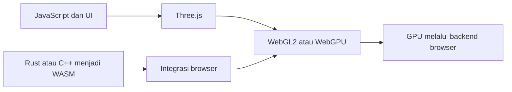

# Analisis performa webgame untuk komputer dengan sumber daya terbatas

Tanggal analisis: 9 Oktober 2026. Cakupan: Globe pada checkout yang sedang dikerjakan, dengan Town sebagai studi utama dan implikasi untuk Space, Planet, Home, interior, Skirmish, dan Farm.

Pilihan paling masuk akal untuk memperluas jumlah komputer yang bisa menjalankan Globe adalah mempertahankan Three.js dan WebGL2 sebagai jalur dasar, menyediakan paket aset serta rendering yang benar-benar ringan, lalu menambahkan WASM dan WebGPU pada bagian yang terbukti membutuhkan keduanya. Rewrite penuh ke Rust dan WebGPU layak menjadi eksperimen lanjutan, tetapi belum memiliki bukti penghematan CPU, GPU, RAM, atau energi pada game ini.

Sasaran awal yang diusulkan adalah laptop dengan GPU terintegrasi, RAM sistem 8 GB, dan 30 FPS stabil. Ini asumsi perencanaan sampai target perangkat dipilih, bukan spesifikasi minimum yang sudah terbukti. Laptop 4 GB memerlukan evaluasi tersendiri dan kemungkinan kompromi visual lebih besar.

## Arti performa yang lebih baik

Game yang lebih hemat menyelesaikan pengalaman bermain yang sama dengan pekerjaan dan data lebih sedikit. Mengejar FPS maksimum dapat meningkatkan penggunaan daya karena perangkat terus menghasilkan lebih banyak frame.

| Dimensi | Pengaruh pada pemain | Ukuran keberhasilan |
|---|---|---|
| CPU | Respons input, simulasi, generasi dunia, pemanasan laptop | Waktu update dan submission render, long tasks, waktu generasi |
| GPU | Kelancaran, panas, daya baterai | GPU time ketika tersedia, jumlah pass, pixel dan triangle yang diproses |
| RAM | Kemampuan berjalan bersama OS dan tab lain | Memori proses tab, heap JS, ArrayBuffer, puncak saat loading |
| Memori GPU | Kemampuan menampung texture, geometry, shadow dan render target | Estimasi byte resource resident dan pola alokasi |
| Unduhan | Waktu masuk dan pemakaian kuota | Transfer aktual sebelum bisa bermain dan saat berganti mode |
| Loading | Lamanya layar tunggu dan freeze saat perpindahan | Cold start, warm start, waktu masuk kota dan interior |
| Stabilitas | Stutter dan masalah setelah bermain lama | Frame p95/p99, stall, context loss, pertumbuhan memori |
| Energi | Baterai, kipas, thermal throttling | Energi atau daya selama skenario yang sama pada perangkat yang sama |
| Kompatibilitas | Komputer yang dapat masuk dan bermain | Pengujian perangkat, browser, driver dan jalur fallback |

Pada iGPU, memori grafis menggunakan sumber daya memori sistem. Angka CPU dan GPU dapat bertumpang tindih dalam telemetry; jangan menjumlahkan keduanya tanpa mengetahui metode pengukuran. Heap JS bukan seluruh RAM tab, dan counter jumlah texture bukan ukuran VRAM.

## WASM Vulkan WebGPU dan Three.js

WASM menjalankan kode CPU yang dikompilasi. WebGL dan WebGPU menyediakan akses grafis browser. Three.js mengelola scene, material dan pengiriman pekerjaan melalui API grafis tersebut. Vulkan adalah API grafis native, bukan API yang dapat dipanggil langsung oleh modul WASM di browser biasa.

Library Rust wgpu menargetkan WebGPU atau WebGL2 pada browser dan Vulkan, Metal atau DirectX 12 pada native. Backend browser mengikuti implementasi dan platform; WebGPU di macOS tidak berarti memakai Vulkan. [Dokumentasi wgpu](https://wgpu.rs/)

Mengganti bahasa CPU tidak otomatis mengurangi biaya shader, jumlah data texture, atau pixel yang dirender. WebGPU membuka mekanisme compute dan pengiriman kerja yang berbeda, tetapi tetap memakai GPU yang tersedia. [Overview WebGPU](https://developer.chrome.com/docs/web-platform/webgpu/overview)

## Bukti dari Globe

Inventaris file dan build produksi dilakukan pada 9 Oktober 2026. [Snapshot audit](qa/webgame-performance/resource-audit-2026-10-09.json) mencatat byte file, dimensi PNG, dan ukuran beberapa chunk. Build dihasilkan di direktori sementara dengan perintah npm run build -- --outDir /tmp/globe-webgame-performance-20261009 --emptyOutDir dan berhasil. Angka runtime CPU, GPU, RAM, VRAM, serta energi untuk checkout ini belum diukur.

### Paket aset lebih besar daripada chunk engine

| Cakupan yang diinventarisasi | Byte di disk | MiB |
|---|---:|---:|
| 27 file dalam ASSET_FILES | 55.754.488 | 53,17 |
| File yang teridentifikasi dari dependency pemuatan Town | 38.077.199 | 36,31 |
| Chunk Three.js hasil build | 667.246 | 0,64 |
| Chunk TownMode hasil build | 328.009 | 0,31 |
| Chunk game entry hasil build | 177.062 | 0,17 |

MiB menggunakan 1.048.576 byte. File di disk bukan transfer jaringan, ukuran setelah decode, atau memori resident. Dependency Town dapat sudah berada di cache; daftar tersebut juga belum mencakup URL tambahan di dalam GLB dan loader lainnya. Total manifest mencakup mode lain dan bukan payload awal setiap pemain.

Ukuran ini memberi alasan untuk mengaudit aset sebelum mengganti engine. Pengurangan ukuran JavaScript tetap berguna untuk startup, tetapi tidak menghilangkan puluhan MiB aset. Director sudah menggunakan dynamic import per mode dan build memisahkan Three.js ke chunk tersendiri: optimasi berikutnya perlu memeriksa dependency yang benar-benar dibutuhkan di jalur masuk, bukan sekadar menambahkan code splitting yang sudah ada. [Director](../src/core/director.js), [manifest](../src/render/assetManifest.js), [konfigurasi build](../vite.config.js).

### Low belum menjadi paket aset ringan

Town memulai beberapa pemuatan melalui Promise.all: pack planet, Town, karakter, furniture, atlas interior, scenery, environment, dan painted surfaces. Furniture serta atlas interior ikut ditunggu sebelum pemain masuk Town. [Pemuatan Town](../src/modes/town/TownMode.js).

Karakter Town menggunakan template lengkap v5 pria dan wanita, empat atlas PNG 2048×2048, serta dua file animasi jalan. Jumlah orang berkurang dari 13 pada High menjadi 5 pada Low, tetapi jalur pemuatan template tetap sama. Crowd instanced tersembunyi menyediakan data gerakan; karakter yang terlihat memakai model rigged. Karena itu memindahkan perhitungan pose Crowd ke WASM saja belum tentu menyasar biaya visual karakter yang dominan. [Template karakter](../src/modes/town/people/skirmishPeople.js), [TownMode](../src/modes/town/TownMode.js).

Dengan asumsi RGBA8, empat atlas 2048×2048 memerlukan 64 MiB untuk base level saja; mip lengkap menambah sekitar sepertiga bila dibuat. Ini perhitungan format, bukan pengukuran VRAM aktual. PNG kecil di jaringan tidak berarti kecil setelah decode.

Asset library juga mengubah geometry menjadi non-indexed, membuat atribut warna serta atribut lain, lalu menghitung normals saat loading. Audit berikutnya perlu mengukur memori geometry hasil proses dan objek sementara, serta membandingkan baking atribut saat produksi aset. Cache pack bersifat global sepanjang sesi dan sengaja berbagi geometry; pembatasan cache harus memakai kepemilikan dan referensi agar resource yang masih dipakai tidak ikut dibuang. [Asset library](../src/render/assetLibrary.js).

### Pixel mengurangi pixel gambar tetapi belum mengubah seluruh biaya

Pada viewport CSS 1280×800, Pixel membuat scene target 640×400. Normal dengan DPR 2 memakai drawing buffer 2560×1600: jumlah pixel pada scene target Pixel adalah seperenam belas ukuran itu. Presentasi layar penuh, shadow, geometry, simulasi dan pemuatan aset masih memiliki biaya. Perbandingan ini bukan klaim performa atau energi 16 kali lebih baik. [PixelRenderer](../src/modes/town/render/pixelRenderer.js), [pixelConfig](../src/modes/town/render/pixelConfig.js).

Pixel sekarang adalah rendering scene 3D beresolusi rendah. Ia belum sama dengan game 2D yang hanya menyimpan sprite. Paket aset Low, kebijakan shadow, dan resource resident tetap perlu diatur tersendiri.

### Texture prosedural dan render target perlu budget memori

Town membuat ground paint near 4096 pada High, 2048 pada Medium, dan 1536 pada Low. Satu texture RGBA8 4096×4096 setara 64 MiB base level; 2048×2048 setara 16 MiB. GroundPaint membuat beberapa canvas/layer, sehingga angka satu texture ini bukan totalnya. Painted surfaces sudah diperkecil dari layer 512 ke 256 saat runtime, tetapi sumber besar tetap perlu diunduh dan diproses. [TownBuilder](../src/modes/town/render/townBuilder.js), [GroundPaint](../src/modes/town/render/groundPaint.js), [paintedStyle](../src/modes/town/render/paintedStyle.js).

Post memakai HalfFloat scene target, MSAA sesuai tier, serta bloom. Sebagai ilustrasi RGBA16F, attachment warna 2560×1600 memerlukan sekitar 31,25 MiB sebelum depth, MSAA, dan target bloom. Total alokasi berbeda menurut format serta implementasi. Mengurangi DPR dari 2 ke 1 mengurangi jumlah pixel 75%; penghematan seluruh game tidak otomatis 75%. [Post](../src/core/post.js), [Quality](../src/core/quality.js).

### Benchmark lama belum membuktikan kompatibilitas komputer lemah

[Laporan 7 Oktober](TOWN_GRAPHICS_LOD_QA.md) mencatat M1 Pro, seed 427, buffer 2560×1600, 470 bangunan dan 8.336 pohon. Kamera walk menghasilkan rata-rata hampir 60 FPS, frame p95 sekitar 22–23 ms, CPU update plus submission render p50 3,7–3,9 ms, sekitar 626–629 draw calls dan 2,47 juta triangle seluruh pass.

Grass yang dikirim sekitar 4.406 instance, bukan semua 72.000 instance yang dibuat. Auto mencapai rata-rata sekitar 60 FPS pada skenario berat dengan buffer dan detail berbeda. Hasil itu bukan perbandingan kualitas sama dan bukan bukti bahwa semua komputer iGPU mampu menjalankannya. File JSON benchmark yang dirujuk laporan tidak ditemukan pada lokasi tautannya dalam audit ini; angka tabel diperlakukan sebagai catatan historis, bukan hasil yang direproduksi.

## Pilihan teknologi dan komprominya

Penilaian berikut adalah kecocokan terhadap tujuan Globe, bukan ranking hasil benchmark engine.

| Pilihan | Manfaat yang dicari | Biaya atau batas | Kecocokan untuk Globe |
|---|---|---|---|
| Three.js dan WebGL2 yang dioptimalkan | Aset kecil, shader sederhana, resident memory rendah | Tetap perlu disiplin content dan lifecycle | Jalur dasar yang direkomendasikan |
| Three.js dan WASM selektif | Perhitungan batch CPU dan generasi dunia | Module, linear memory, interop serta copy data tambahan | Dipilih setelah profiling hotspot |
| Three.js dan WebGPU | Compute, render bundles dan jalur submission baru | Dukungan perangkat serta port material dan post | Jalur opsional untuk perangkat yang cocok |
| Rust atau C++ WASM dan renderer khusus | Kontrol data, pipeline serta ownership lebih besar | Rewrite tinggi, dua backend bila menjaga fallback | Eksperimen Town terisolasi |
| PlayCanvas atau Babylon.js | Tooling engine dan sistem scene lain | Port gameplay/material dan evaluasi aset tetap perlu | Alternatif jika kebutuhan tooling berubah |
| Unity atau Godot web export | Workflow editor dan engine lengkap | Runtime serta kebutuhan platform harus diukur | Tidak dipilih hanya demi hemat resource |
| PixiJS atau renderer sprite 2D | Mengurangi kebutuhan scene 3D untuk view terbatas | Kamera, depth dan pipeline aset berubah | Opsi bila perubahan presentasi disetujui |
| Canvas 2D | View sederhana dengan sedikit sprite atau UI | Banyak sprite/efek juga bisa berat | Cocok untuk planner, menu, atau game lebih sederhana |

PlayCanvas menyediakan batching, pengaturan aset, dan render on demand; fitur tersebut tidak otomatis membuat port Globe lebih hemat. [Panduan PlayCanvas](https://developer.playcanvas.com/user-manual/optimization/guidelines/). PixiJS menyarankan spritesheet dan texture beresolusi rendah untuk perangkat lama; culling pun memiliki biaya CPU dan perlu dipilih sesuai bottleneck. [Panduan PixiJS](https://pixijs.com/8.x/guides/concepts/performance-tips).

Unity web menjalankan kode CPU melalui WASM dan tetap menekankan pembatasan draw calls. Dokumentasi stable Godot yang diakses 9 Oktober menyebut jalur WebGL2 Compatibility untuk web export. Tidak ada dasar dari dokumen tersebut untuk menyatakan port salah satunya pasti lebih hemat daripada Globe. [Unity Web](https://docs.unity.com/en-us/engine/6000.6/manual/platform-specific/webgl/develop/performance), [Godot Web](https://docs.godotengine.org/en/stable/tutorials/export/exporting_for_web.html).

Native Vulkan/Metal memerlukan distribusi aplikasi, sehingga tidak memenuhi sasaran webgame sebagai satu-satunya solusi. Cloud streaming memindahkan beban rendering ke server dan menambah ketergantungan jaringan serta biaya layanan; ia bukan pengurangan resource keseluruhan game.

## Arsitektur yang direkomendasikan

Pertahankan data dunia, save dan aturan gameplay. Pisahkan representasi visual dari data tersebut sehingga satu kota bisa tampil menggunakan resource berbeda tanpa mengubah pintu, jalan, collision atau hasil simulasi penting.

| Profil | Rendering dan content | Sasaran |
|---|---|---|
| Hemat | WebGL2, 30 FPS, resolusi internal dibatasi, material ringan, paket texture kecil, shadow sederhana | Laptop iGPU dan RAM terbatas |
| Seimbang | WebGL2 atau WebGPU yang sudah diuji, 60 FPS bila mampu, detail dan shadow adaptif | Laptop kelas menengah |
| Tinggi | Jalur yang tercepat pada perangkat tersebut, texture dan detail lebih besar sesuai budget | Perangkat dengan headroom |
| Presentasi 2D opsional | Sprite atau impostor dari data dunia yang sama | Perangkat lebih lemah bila perubahan view diterima |

WebGPU tidak dijadikan syarat masuk. Feature detection harus mencakup adapter, limits, format dan fitur yang dipakai; nama browser saja tidak cukup. Jika memakai compute pada jalur WebGPU, fallback WebGL2 membutuhkan implementasi alternatif untuk tugas tersebut.

Three.js WebGPURenderer tidak mendukung ShaderMaterial, RawShaderMaterial dan onBeforeCompile seperti jalur lama. Material painted, water, Pixel dan post khusus Globe memerlukan port; fallback WebGL2 renderer baru tidak otomatis menjadikan shader lama kompatibel. [Dokumentasi WebGPURenderer](https://threejs.org/manual/pages/webgpurenderer).

## Urutan optimasi untuk penghematan resource

| Prioritas | Perubahan yang diusulkan | Resource yang disasar | Bukti yang harus dihasilkan |
|---|---|---|---|
| P0 | Profil Hemat dengan jalur aset sendiri | RAM, GPU memory, transfer dan loading | Perbandingan Low lama vs Hemat pada iGPU |
| P0 | Furniture/interior dimuat ketika dibutuhkan, prefetch terukur | Transfer dan peak memory masuk kota | Town playable lebih awal; pintu tetap responsif |
| P0 | Texture karakter kecil dan opsi geometry ringan | Decode memory, VRAM, skinning | Visual dekat diterima dan kebutuhan memori turun |
| P0 | Batas texture prosedural dan buffer menurut budget | RAM, VRAM, bandwidth GPU | Byte alokasi dan peak transisi lebih kecil |
| P1 | Cache resource terbatas dengan ownership yang jelas | Resident memory sesi panjang | Plateau setelah pergantian kota/interior |
| P1 | Baking geometry serta atribut saat produksi aset | CPU loading dan geometry sementara | Loading serta peak RAM turun |
| P1 | Shadow, material dan transparansi disederhanakan pada Hemat | GPU dan bandwidth | GPU/frame time turun pada kualitas yang disepakati |
| P1 | Spatial grid untuk pencarian kendaraan | CPU ketika traffic bertambah | Biaya update pada jumlah kendaraan bertingkat |
| P1 | Update visual jauh lebih jarang, UI saat nilai berubah | CPU dan upload buffer | Respons gameplay tetap benar |
| P2 | Worker untuk generasi/baking yang memang memblokir | Main-thread responsiveness | Long tasks turun tanpa peak memory berlebih |
| P2 | WASM pada hotspot batch | CPU tertentu | Menang dibanding JS yang sudah dioptimalkan |
| P3 | Prototype WebGPU atau renderer Rust khusus | Submission CPU dan workload yang cocok | Menang pada resource dan frame time di perangkat target |

Pengaturan ukuran back buffer, batching, budget texture serta pelepasan resource merupakan teknik yang berlaku pada WebGL sekarang; manfaatnya tidak menunggu rewrite. [WebGL best practices](https://developer.mozilla.org/en-US/docs/Web/API/WebGL_API/WebGL_best_practices).

Untuk texture statis, evaluasi KTX2/Basis dengan format kompresi yang didukung GPU. KTX2 dapat mengurangi transfer dan menyimpan texture dalam format GPU terkompresi; JPEG/PNG biasa hanya mengompresi file distribusi. Transcoding tetap memiliki biaya startup dan peak memory, serta kualitas gambar perlu diperiksa. Texture prosedural dinamis tidak otomatis mendapat manfaat yang sama. [Khronos KTX](https://www.khronos.org/ktx/), [Three.js KTX2Loader](https://threejs.org/docs/pages/KTX2Loader.html).

Geometry compression seperti meshopt terutama membantu distribusi; decode tetap menghasilkan geometry runtime. Pengurangan vertex, quantization dan indexing perlu dievaluasi tersendiri untuk mengurangi resident data. Flat shading, material boundaries dan atribut Globe dapat membatasi vertex yang bisa berbagi indeks. [Dokumentasi meshoptimizer](https://github.com/zeux/meshoptimizer/blob/master/README.md).

Traffic sekarang memeriksa kendaraan lain untuk setiap kendaraan traffic. Pada jumlah besar, biaya dapat mendekati O(n²). Spatial grid menyasar pertumbuhan biaya tersebut; menerjemahkan loop yang sama ke WASM mempertahankan pola pertumbuhannya. [Fleet](../src/modes/town/vehicles/fleet.js).

Render culling tidak sama dengan menghentikan gameplay. Collision dekat, akses pintu, kendaraan yang dikendarai dan state ekonomi tetap harus benar. Untuk objek jauh, gunakan update berfrekuensi rendah atau simulasi agregat hanya bila perilakunya bisa dipertahankan.

Profil Hemat perlu membatasi cadence sesuai target 30 FPS dan menurunkan aktivitas visual saat pause atau tab tersembunyi. Browser memang mengubah scheduling tab tersembunyi; aplikasi tetap perlu mengatur worker serta pekerjaan miliknya. State penting sebaiknya mengikuti elapsed time dan aturan sistem, bukan memerlukan semua animasi terus berjalan. [Page Visibility API](https://developer.mozilla.org/en-US/docs/Web/API/Page_Visibility_API).

## Kapan WASM dan WebGPU layak dipakai

WASM layak diuji untuk noise, pembuatan mesh, pathfinding besar, collision batch atau traffic yang terbukti memakan CPU. Gunakan buffer bertipe dengan batch besar, hindari konversi object per entitas, dan hitung biaya module, linear memory, serta salinan JS dan WASM. Memori yang dibebaskan allocator belum tentu langsung menurunkan footprint backing memory; ukur puncak dan gunakan kembali buffer. Pertumbuhan WebAssembly.Memory juga memerlukan penanganan ulang view buffer pada memory non-shared. [WebAssembly.Memory.grow](https://developer.mozilla.org/en-US/docs/WebAssembly/Reference/JavaScript_interface/Memory/grow).

Worker memindahkan pekerjaan dari main thread; ia tidak otomatis mengurangi total kerja atau daya. Pilih jumlah worker konservatif untuk laptop dengan core sedikit, gunakan transferable ArrayBuffer bila cocok, dan batasi umur/cache worker. Shared memory multithread memerlukan konfigurasi cross-origin isolation serta audit dependency deployment. Mulai dengan satu worker dan transfer sebelum menambah kompleksitas tersebut. [Web Workers](https://developer.mozilla.org/en-US/docs/Web/API/Web_Workers_API/Using_web_workers), [pola performa WASM](https://web.dev/articles/webassembly-performance-patterns-for-web-apps). OffscreenCanvas dapat membantu pekerjaan rendering/canvas di worker, dengan adaptasi terhadap API DOM yang sekarang digunakan. [OffscreenCanvas](https://developer.mozilla.org/en-US/docs/Web/API/OffscreenCanvas).

WebGPU layak diuji untuk compute culling, instance data di GPU, animasi visual batch dan render bundles pada command sequence yang cocok untuk dipakai ulang. Memindahkan tugas CPU ke GPU bisa merugikan iGPU yang sudah penuh atau berbagi bandwidth dengan CPU. Prototype perlu mengukur kedua sisi, tidak hanya waktu fungsi CPU. [GPURenderBundle](https://developer.mozilla.org/en-US/docs/Web/API/GPURenderBundle).

Renderer Rust dan wgpu khusus memberi kontrol besar, tetapi tetap memerlukan asset loader, material, lighting, shadow, water, post, input, audio, perpindahan mode dan pemulihan resource. Pilot pertama cukup Town dengan satu seed dan kamera; UI web serta save tetap memakai lapisan yang ada. Kemampuan fallback WebGL2 pada library perlu diuji terhadap fitur renderer yang benar-benar dipakai.

## Budget awal dan rencana pengujian

Semua angka berikut adalah target awal yang diusulkan, belum hasil pengukuran atau janji minimum hardware.

| Dimensi | Target awal profil Hemat |
|---|---|
| Perangkat referensi | Laptop RAM 8 GB dan iGPU nyata, browser WebGL2 yang didukung |
| Presentasi | 30 FPS pada internal buffer maksimum sekitar 1280×720; aspect ratio tetap |
| Waktu frame | p95 ≤40 ms dan p99 ≤50 ms setelah warm-up pada traversal |
| Respons | Stall lebih dari 100 ms ditelusuri; target maksimal satu per menit di traversal biasa |
| RAM proses tab | Steady ≤500 MiB dan peak loading ≤750 MiB, memakai alat/metode yang konsisten |
| Resource GPU terestimasi | Steady ≤160 MiB dan peak ≤256 MiB, mencakup texture/geometry/target yang dimiliki game |
| Transfer awal sebelum playable | ≤10 MiB terkompresi aktual |
| Transfer tambahan masuk Town | ≤15 MiB pada cache kosong untuk jalur Hemat |
| Durasi sesi | 30 menit traversal serta 20 perpindahan mode tanpa pertumbuhan memori terus-menerus |
| Energi | Bandingkan pada cadence 30 FPS, brightness dan kondisi mesin yang sama; target numerik setelah baseline |

Memori proses GPU/browser yang dibagi antar-tab dicatat terpisah. Resource GPU terestimasi bukan pengukuran VRAM fisik. GPU timer dapat tidak tersedia; laporkan N/A dan gunakan frame timing serta variasi workload, bukan mengarang angka. Target transfer dihitung per rute; total aset seluruh game tetap dilaporkan terpisah.

Uji sekurangnya satu iGPU Intel/AMD kelas lama, satu laptop iGPU lebih baru, dan M1 Pro sebagai pembanding. Jalankan browser utama yang benar-benar dipakai pemain pada masing-masing OS. CPU throttling DevTools berguna sebagai diagnosis, tetapi tidak menggantikan perangkat dengan GPU dan memori terbatas.

Skenario wajib meliputi cold/warm start, Space ke Planet ke Town, fantasy dan modern, diorama/walk/drive, siang/malam, masuk/keluar interior, Home Apply, kembali ke kota, serta Pixel dan Low. Jalur Trade dan Farm diuji terpisah karena asset graph serta gameplay berbeda. Beri seed tetap, viewport tetap, waktu dunia tetap untuk pasangan pengukuran, warm-up, dan setidaknya tiga pengulangan.

Laporkan CPU update terpisah dari submission render dan GPU. Bandingkan rendering pada visual yang setara untuk menilai backend; bandingkan profil Hemat terhadap Low lama untuk menilai kompromi content yang sengaja dibuat. Catat loading peak, decode/transcode, geometry sementara, resource yang masih resident dan recovery setelah pergantian mode.

Lanjutkan optimasi dasar bila transfer atau memori melampaui budget meskipun FPS sudah cukup. WASM diterima bila hotspot membaik tanpa menaikkan peak memori/loading melewati budget. WebGPU diterima sebagai jalur default hanya pada kelas perangkat yang terbukti menang dan fallback tetap lulus. Rewrite renderer penuh baru layak diperluas setelah pilot memberi penghematan yang berarti pada beberapa metrik penting, misalnya sedikitnya 25% pada CPU kritis atau resident memory, tanpa regresi loading, visual, gameplay dan kompatibilitas. Angka 25% adalah ambang keputusan proyek, bukan perkiraan percepatan.

## Keputusan yang disarankan

Untuk mempertahankan pengalaman 3D Globe sekaligus menjangkau komputer lemah, kerjakan profil Hemat dengan paket aset terpisah, texture kecil, pemuatan bertahap dan cache berbatas terlebih dahulu. Pertahankan WebGL2 sebagai baseline. Tambahkan WASM untuk hotspot terukur dan WebGPU untuk perangkat yang terbukti mendapat manfaat.

Jika prioritasnya menjangkau perangkat yang jauh lebih lemah dan perubahan presentasi diperbolehkan, evaluasi sprite 2D atau impostor dengan kamera terbatas. Pilihan itu bisa menghapus lebih banyak pekerjaan 3D daripada mengganti bahasa CPU, tetapi konsekuensinya adalah perubahan visual, navigasi dan pipeline aset.

Tidak ada klaim persentase penghematan aktual untuk rewrite pada tahap ini. Hasil audit menunjukkan beberapa titik yang konkret untuk diuji; spesifikasi minimum dan pilihan backend akhir ditetapkan setelah pengukuran pada perangkat target.

