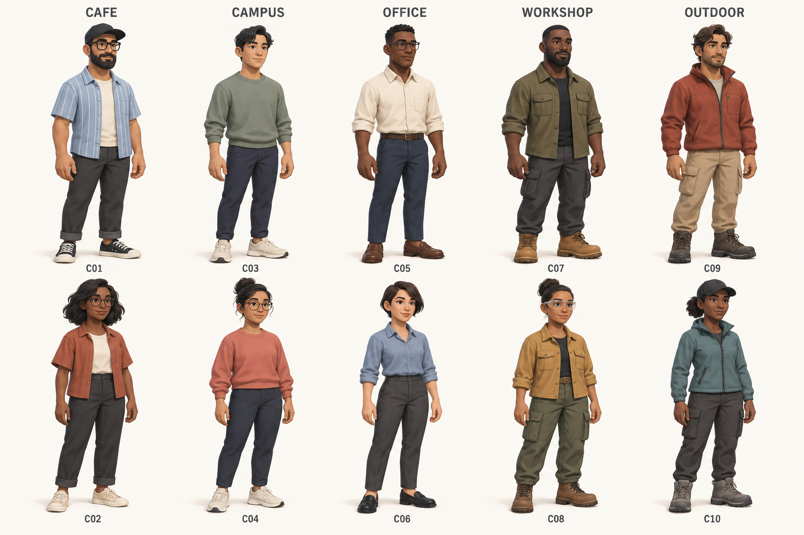

# NPC modular — art direction v1

Paket referensi 2D untuk NPC dewasa stylized dengan permukaan planar, geometri mid-poly, dan animasi tubuh natural. Tanggal: 29 September 2026.

**Update 30 September 2026:** C01 dimodelkan ulang dari gaya chibi/kotak (`c01_overcooked`) ke low-poly faceted yang mengikuti acuan pengguna: proporsi dewasa sekitar 6,5 kepala, 1,76 m sampai topi, setiap bagian berupa convex hull beberapa penampang dengan flat shading (rahang kotak, hidung wedge, alis tebal, kacamata persegi tebal, jenggot dengan garis pipi diagonal, kemeja terbuka dengan kerah, celana cuffed, sneaker platform). Sumber `blender/c01_faceted.py`, ekspor `blender/c01_faceted.glb` → `public/models/npc.glb`, preview `blender/preview_c01_faceted_*.png`. Kontrak runtime tetap sama (18 pivot, nama material/slot, nama piece); crown rambut kini dimodelkan (`hair_R04_crown`), mulut di atas jenggot ikut tersembunyi bersama jenggot. Sekitar 2.400 segitiga per orang.

Rebuild: `Blender -b --factory-startup --python blender/c01_faceted.py -- <out.glb>`; preview + sheet ekspresi: `Blender -b --factory-startup --python blender/render_previews.py -- <dir>`.

Ekspresi (30 September 2026): mesh `expr_<fitur>_<varian>` — mata `open/closed/wide/squint`, alis `neutral/raised/worried/angry`, mulut `neutral/smile/open/frown/grin` (+ gigi). Game menampilkan satu varian per fitur lewat uniform `uExpr`; preset `neutral, smile, laugh, curious, worried, scared, focused, angry, content, asleep` ada di `FACES` (`chunkyPeople.js`). Mulut digeser ke permukaan jenggot saat jenggot dipakai. Kedip otomatis tiap 2–6 detik, lirikan penasaran saat idle, wajah fokus saat lari, takut saat panik, tidur saat berbaring. Lihat [sheet ekspresi](blender/preview_c01_expressions.png).

Gerak (update): 23 pivot — tambahan `chest` (torso dipecah pinggang/dada, saling tumpang tindih), `clavicle_L/R` (bahu ikut maju-mundur dengan ayunan lengan dan naik saat bernapas/lari), `toe_L/R` (sepatu dipecah di pangkal jari, ujungnya menekuk saat tumit terangkat). Siklus kaki memakai kinematika: pinggul dihitung supaya sol kaki tumpu tetap di tanah (±2 cm), panjang langkah diambil dari laju sapuan kaki tumpu sehingga kaki tidak meluncur, fase tumpu memendek dan ada fase melayang saat lari. Irama terukur: jalan 1,4 m/s ≈ 2 langkah/detik, lari 4,2 m/s ≈ 3,2 langkah/detik.

Gerak: 18 pivot kini semua bergerak — siklus langkah (heel strike, roll, toe-off, lutut menekuk saat ayun), panggul naik-turun/miring/berputar, bahu berputar berlawanan, lengan berayun terlambat dengan siku dan pergelangan lentur, kepala stabil dan menoleh-noleh, napas dan pergeseran berat saat diam, condong saat belok, pose lompat, duduk, dan tidur. Variasi per orang (panjang langkah, ayunan lengan, pantulan, postur) dari identitas. Pemain memakai model yang sama (tampilan hero C01, kemeja warna faksi).

**Update 29 September 2026:** C01 (`blender/c01_overcooked.glb`) sudah dipakai game sebagai `public/models/npc.glb`. `src/modes/town/people/chunkyPeople.js` menggabungkan 36 part kaku menjadi satu SkinnedMesh rigid (18 bone = pivot), memberi warna per orang lewat 7 slot palet (kulit, rambut, atasan, dalaman, celana, sepatu, topi), menyalakan/mematikan kacamata, janggut, topi, dan cup, serta menambah crown rambut bila topi dilepas (R04 hanya pinggiran di bawah topi). Jalan, lari, idle, dan panik dipose dari kode. C02–C10 belum dimodelkan.

**Status:** 4 concept sheets selesai; 10 resep karakter dan spesifikasi produksi tersedia. Model Blender, skin weights, animation clips, ekspor GLB, dan integrasi game belum dibuat dalam paket ini. Blender MCP tidak tersedia dalam tool sesi ini. Tulisan seperti “production ready”, “same topology”, atau “fits all heads” di gambar adalah aspirasi desain hasil generasi, bukan hasil pengujian.

## Referensi visual

1. [Lineup: 10 karakter, 5 tema](references/01-cast-lineup.png).
2. [Kepala, rambut, ekspresi, kacamata, janggut, topi](references/02-head-face-library.png).
3. [Pakaian dan sepatu modular](references/03-wardrobe-library.png).
4. [Turnaround C01 dan studi gerak](references/04-hero-turnaround.png).
5. [Gambar acuan dari pengguna](references/00-user-reference.png).

Gambar adalah lembar konsep raster, bukan potongan tekstur siap pakai atau blueprint ortografis terukur. Ukuran empat sheet final 1536 × 1024 px. Untuk modeling gunakan crop/zoom sebagai panduan bentuk; tetapkan ukuran sebenarnya di Blender. Tampak samping dan belakang saat ini lengkap untuk C01, sebagian pakaian, dan kepala. Rambut/aksesori serta seluruh karakter lainnya masih perlu validasi volume belakang dalam tahap 3D.

## Bahasa bentuk

- Pertahankan ciri gambar pengguna: kepala sedikit besar, alis tebal, hidung geometris, pipi/rahang tegas, tangan jelas, sepatu cukup besar, warna tenang.
- Target proporsi dasar sekitar 6,25 kepala dengan tinggi acuan 1,75 m; ini keputusan awal untuk blockout, bukan ukuran yang diekstrak persis dari gambar.
- Siluet tetap faceted. Area siku, bahu, selangkangan, lutut, buku jari, dan pergelangan perlu topology halus agar deformasi tidak patah.
- Lineup lebih lembut daripada acuan awal. Gunakan gambar asli dan turnaround sebagai jangkar tingkat faceting; gunakan lineup untuk kombinasi, siluet, dan warna.
- Detail kain dibatasi pada kerah, tepi lengan, saku, jahitan utama dan lipatan besar. Jangan memahat banyak kerutan mikro pada semua NPC.
- Kulit dan kain matte; bevel kecil pada bingkai kacamata dan sepatu. Pertahankan bidang gelap/terang saat diperiksa dengan material toon game.

## Inventaris piece

| Slot | Isi |
|---|---|
| Kepala | H01 angular, H02 round, H03 oval, H04 broad-square |
| Rambut | R01 side part, R02 bob, R03 bun, R04 crop, R05 wavy |
| Kacamata | G01 rectangle tebal, G02 round tipis, G03 safety; G00 tanpa |
| Variasi tambahan | G04 rectangle tipis dari G01 untuk C05; belum sheet tersendiri |
| Facial hair | B01 stubble, B02 full beard; B03 short beard dari B02 untuk C07 |
| Topi | A01 baseball cap; A00 tanpa |
| Atasan | T01 overshirt + undershirt, T02 sweatshirt, T03 collared shirt, T04 utility, T05 outdoor jacket |
| Celana | P01 cuffed, P02 tapered chino, P03 straight, P04 cargo |
| Sepatu | S01 canvas, S02 running, S03 loafer, S04 work boot, S05 hiking |
| Ekspresi | E01 neutral, E02 smile, E03 curious, E04 worried, E05 focused, E06 blink |

T01 terdiri dari overshirt dan undershirt sebagai satu modul outfit berlapis untuk tahap pertama. Bisa dipecah kemudian setelah jarak antarlapis tervalidasi. Stripe/solid dan warna adalah varian material. P04 muncul dua kali pada sheet untuk menunjukkan varian warna, bukan dua mesh baru.

Bentuk kepala bebas dipakai pada berbagai presentasi karakter. Body fit standard/slim/broad/soft perlu varian pakaian yang sesuai. Volume tubuh berubah melalui bentuk mesh yang dikontrol, bukan scaling tulang sembarang.

## Sepuluh kombinasi terkurasi

ID dan daftar piece yang dapat dibaca mesin ada di [catalog.json](catalog.json).

| ID | Tema | Identitas visual |
|---|---|---|
| C01 | Café | Cap, rectangular glasses, full beard, blue stripe, charcoal cuffs, black canvas |
| C02 | Café | Bob, round glasses, terracotta overshirt, charcoal cuffs, cream canvas |
| C03 | Kampus | Side part, sage sweatshirt, navy chinos, cream runners |
| C04 | Kampus | Bun, round glasses, coral sweatshirt, dark chinos, cream runners |
| C05 | Kantor santai | Crop, thin rectangle glasses, cream shirt, navy trousers, brown loafers |
| C06 | Kantor santai | Short side part, blue shirt, charcoal trousers, black loafers |
| C07 | Workshop | Crop, short beard, olive utility, dark cargo, tan work boots |
| C08 | Workshop | Bun, safety glasses, ochre utility, olive cargo, brown work boots |
| C09 | Outdoor | Wavy hair, stubble, rust jacket, sand cargo, hiking boots |
| C10 | Outdoor | Cap + low bun, teal jacket, charcoal cargo, gray hiking boots |

## Aturan randomisasi

1. Buat identitas deterministik dari worldSeed + npcId, lalu simpan hasil pemilihannya.
2. Untuk menjamin minimal 10 kombinasi, bagikan C01–C10 melalui shuffled bag tanpa pengulangan pada 10 spawn pertama. Sampling acak biasa tidak menjamin keunikan.
3. Setelah baseline itu, pilih tema sesuai lokasi/kegiatan. Kafe cenderung café, kampus cenderung campus; pengunjung boleh lintas tema.
4. Pilih pakaian dari whitelist tema di catalog. Skin tone, bentuk kepala, dan presentasi gender tidak dikunci berdasarkan pekerjaan.
5. Pilih fit kepala/tubuh, lalu hanya ambil rambut, kacamata, janggut, dan pakaian dengan varian fit yang cocok.
6. A01 memerlukan R04_cap atau R03_cap yang memang dibuat untuk topi. P04 + boots memerlukan hem khusus agar kain tidak menembus sepatu.
7. Gunakan satu warna utama, satu warna pendamping, dan warna netral. Warna kulit/tangan/leher harus sama; alis dan janggut mengikuti keluarga warna rambut.
8. Tolak signature identik dalam kelompok tetangga sampai pool valid habis. Gunakan preset terkurasi sebagai fallback, jangan retry tak terbatas.
9. Saat pergantian LOD atau pemakaian ulang rig pool, identitas yang sama harus tetap memakai recipe yang sama.

## Kontrak modular untuk Blender

- Satu rest skeleton dan bind pose yang sama untuk seluruh modul; origin di tanah di antara kaki. Satuan authoring meter.
- Authoring Blender Z-up, front -Y; verifikasi ekspor ke game Y-up/front +Z dengan marker forward dan mesh tinggi 1,75 m.
- Modul skinned: body, head, top, pants, shoes. Modul rigid pada socket kepala: rambut pendek, topi, kacamata. Janggut perlu mengikuti rahang/ekspresi bila melewati bibir.
- Head socket, neckline, wrist boundary, waist dan ankle memakai posisi sambungan baku. Tepi kulit yang bersentuhan harus berbagi bobot dan normal yang sesuai.
- Gunakan body-hide regions untuk torso, upper arms, forearms, pelvis, thighs, calves, feet sesuai coverage pakaian. Mask tidak boleh menghilangkan kulit yang terlihat saat pose ekstrem.
- Fit rambut/kacamata/janggut harus diuji untuk H01–H04; kesamaan socket tidak otomatis mencegah clipping di pipi dan telinga.
- Simpan object naming seperti head_H01, hair_R03_cap, top_T01_standard, pants_P04_boot, shoes_S05. Pisahkan collection SOURCE, RIG, EXPORT, REFERENCES.
- Anggaran awal, perlu profiling: assembled LOD0 30–50k triangles, LOD1 12–20k, LOD2 3–6k. High-poly sculpt opsional untuk baking, bukan untuk seluruh crowd.
- Uji dahulu satu hero C01 dan satu siluet berbeda C08 sebelum memperbanyak seluruh piece. Target material/draw-call ditetapkan setelah prototipe dalam game, bukan dari jumlah polygon saja.

## Rig dan animasi natural

Kerangka deformasi yang direncanakan: root → pelvis → spine_01 → spine_02 → chest → neck → head; clavicle → upper_arm → forearm → hand pada kedua sisi; thigh → shin → foot → toe pada kedua sisi. Tambahkan upper-arm/forearm twist dan deform support sesuai kebutuhan. Masing-masing tangan punya ibu jari 3 tulang dan empat jari masing-masing 3 tulang.

Kontrol authoring: IK/FK tangan, IK kaki dengan pole target lutut, heel/ball/toe roll, kontrol pelvis, arah pandang kepala/mata, serta clavicle. Bake kontrol ke deform bones untuk export; constraint Blender sendiri bukan animasi runtime.

Ekspresi menggunakan morph target yang sama namanya pada semua kepala: blink_L/R, smile_L/R, browInnerUp, browDown_L/R, eyeWide_L/R, mouthFrown_L/R dan jawOpen. Enam ekspresi di sheet adalah kombinasi kontrol, bukan enam kepala terpisah. Blink berlangsung sementara. Rambut dan beard perlu corrective shape bila mengganggu alis/bibir.

| Clip rencana | Perilaku yang harus terlihat |
|---|---|
| idle_relaxed | Napas kecil di dada, perpindahan berat halus, jari rileks |
| idle_look | Mata mengarah lalu kepala mengikuti, tubuh tidak berputar serentak |
| walk | Heel contact → plant → toe-off, pelvis bergeser ke kaki tumpu, tangan berlawanan dengan kaki |
| run | Dorongan kaki dan fase melayang, torso condong sewajarnya |
| turn_left/right | Langkah pivot dan putaran pelvis, kaki tidak terseret |
| wave | Bahu/clavicle ikut mengangkat, siku dan pergelangan membentuk arc |
| reach / hold_cup | Jari menggenggam, siku menyesuaikan, target tangan stabil |
| sit_down / sit_idle / stand_up | Pusat berat bergerak sebelum kaki mendorong, lutut tidak runtuh |
| drive / sleep / panic | Disiapkan untuk kebutuhan state game yang sudah ada |

Naturalitas berasal dari timing, perpindahan berat, kontak kaki, gerak lanjutan dan pose asimetris; kepadatan mesh saja tidak menjaminnya. Hindari noise acak per sendi tiap frame. Variasi NPC sebaiknya berupa fase idle, ritme langkah yang sesuai kecepatan, postur ringan, blink dan target pandang. Gunakan crossfade yang diuji sekitar 0,15–0,3 detik sebagai titik awal.

Locomotion in-place harus mempunyai stride/speed metadata agar kecepatan clip mengikuti perpindahan NPC. Foot IK runtime diperlukan untuk tanah tidak rata; foot planting di Blender tidak otomatis bertahan pada terrain game.

## Penerimaan 3D dan integrasi berikutnya

- Periksa front/side/back setiap modul dan seluruh 10 kombinasi dalam lighting yang sama.
- Pose uji: bahu overhead, siku 130°, lutut 120°, squat, langkah lebar, genggaman cup, jari terbuka, head turn, blink + smile.
- Pastikan tidak ada kulit menembus kain, waist/neck seam terbuka, heel melayang saat plant, lutut terbalik, atau frame loop yang meloncat.
- Putar export GLB di game dengan material aktual; bandingkan siluet/faceting terhadap C01 dan acuan pengguna.
- Ukur frame time dan draw calls dengan jumlah NPC dekat kamera yang representatif, lalu tentukan batas pool/LOD.
- Loader saat inspeksi: src/modes/town/people/peopleRig.js menyisakan satu mesh dengan nama outfit. Loader modular perlu memilih satu set mesh sesuai recipe dan skeleton bersama.
- Appearance saat inspeksi: src/modes/town/people/peopleAppearance.js memakai palet vertex color dan plane wajah. Kepala ekspresif baru memerlukan material/morph animation yang sesuai.
- Pertahankan kontrak clip idle/walk/run/sit/sleep/drive/panic atau sediakan mapping; kode saat ini mensyaratkan idle dan walk.
- Buat pack baru dengan nama versi untuk QA sebelum mengganti public/models/character.glb. Perubahan runtime belum dilakukan pada tahap referensi ini.

## Asal dan verifikasi

Dibuat menggunakan built-in image_gen.imagegen. [PROMPTS.md](PROMPTS.md) menyimpan seluruh prompt dan revisi kontras untuk reproduksi. Gambar telah diperiksa visual: lineup berisi 10 karakter lengkap, 4 tipe kepala, 6 ekspresi, 5 tema pakaian, serta turnaround C01. Sheet kepala/pakaian direvisi agar latar dan label terbaca.

Turnaround adalah panduan visual: A-pose terlihat lebih sempit dari target 35° dan label studi foot-roll bukan data kontak terukur. Tetapkan rest pose dan key pose kaki ulang di Blender. Varian G04/B03 dan fitting tubuh/rambut bertopi tercatat di catalog, tetapi belum punya sheet detail tersendiri.

