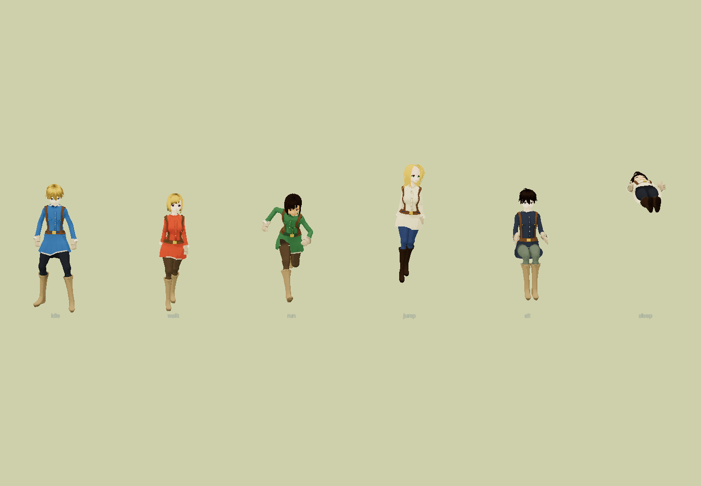
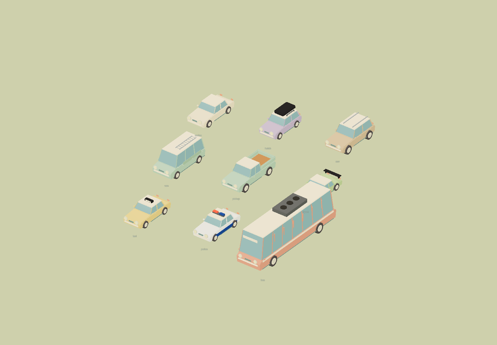

# Karakter skirmish dan kendaraan town

Revisi 8 Oktober 2026 mengikuti arahan terakhir: town memakai langsung model skirmish v5 yang sudah berhasil, menggantikan desain chibi percobaan sebelumnya. Badan laki-laki/perempuan, bentuk rambut, wajah bertekstur, seragam, dan shader berasal dari aset skirmish aktual. Pemain, NPC dekat dan penghuni interior memakai model yang sama, dengan warna baju town dan tanpa senjata/kit tempur. Pack karakter skirmish tidak diekspor ulang.





## Implementasi

- [skirmishPeople.js](../../../src/modes/town/people/skirmishPeople.js) memakai template/factory [vcSoldiers.js](../../../src/skirmish/units/vcSoldiers.js). Town memuat langsung kedua GLB v5 dan empat atlas existing, tanpa memuat pack NPC/character legacy.
- Jalan santai sekarang memakai UAL `Walk_Loop` yang di-retarget lewat retargeter v5, menggantikan pose kaki prosedural. Fase mengikuti jarak aktual dan ground speed klip; transisi idle/jalan/lari dinormalisasi. Lari dan idle memakai klip skirmish. Overlay belokan, lompat, duduk/tidur dipulihkan sebelum frame berikutnya agar rotasi tidak menumpuk. Duduk/tidur memiliki blend masuk/keluar.
- NPC dibatasi 12/8/4 sesuai kualitas; semuanya memakai badan v5 lengkap beserta LOD humanoidnya. Crowd hanya menyimpan data simulasi dan tidak dirender sebagai karakter kotak. Palet baju/rambut mengikuti seed yang sama.
- [Pedestrians](../../../src/modes/town/navigation/pedestrianRoutes.js) tidak memiliki threat/flee/startle lagi. Kendaraan tidak membuat NPC berlari panik. Traffic tidak mengerem untuk orang; player berjalan tidak didorong collider kendaraan. Collision dengan bangunan, medan dan kendaraan lain tetap mengikuti sistem existing. Reaksi driver melarikan diri saat kendaraan diambil juga dihapus; event checklist eksplorasi tetap dipertahankan saat masuk kendaraan traffic.
- [cozy_vehicles.py](../../../tools/blender/town/cozy_vehicles.py) membangun kabin meruncing, windshield miring, pilar/jendela, wheel arch yang terbuka, lampu, handle dan cermin. Kit/roda/aksesorinya tetap mengikuti recipe existing. Mobil, pickup, van, SUV, sport dan bus memiliki siluet masing-masing.

## Sumber dan ekspor

Sumber editable kendaraan: [cozy_actors.blend](../../../tools/blender/cozy_actors.blend). Generator [build_cozy_actors.py](../../../tools/blender/build_cozy_actors.py) sekarang hanya mengganti 15 root kendaraan dalam [town.glb](../../../public/models/town.glb), mempertahankan payload 92 root lain byte-for-byte. Tidak mengubah GLB karakter. `GLOBE_ROOT` opsional menunjuk checkout lain.

```sh
blender --background --python tools/blender/build_cozy_actors.py
blender --background --python tools/blender/town/audit_cozy_actors.py
npm test
npm run build
```

Satuan meter, runtime +Y atas/+Z depan. Pivot body di dasar tengah; roda radius unit, sumbu X. Axle, socket aksesori, recipe type dan collider tetap existing. Metadata `layoutFootprint` menjaga ukuran layout lama agar kota tersimpan tidak berubah karena bentuk visual. Setiap part kendaraan memiliki tiga LOD; smoothing hanya diterapkan pada root kendaraan.

Galeri memakai aset ekspor, material dan animasi game. Dari console dev pada `/play/`:

```js
const qa = await import('/tools/qa/cozy_actors.js');
await qa.cozyActorGallery({ kind: 'people', motion: true });
// kind vehicles / carts / people; lod 0 / 1 / 2
// people: angle front / side / back
window.__cozyGallery.restore();
```

## Bukti verifikasi final

| Pemeriksaan | Hasil |
|---|---|
| Impor ulang Blender | [round-trip.json](round-trip.json): 0 segitiga aktor berluas nol, semua posisi finite |
| Preservasi town | [manifest.json](manifest.json): seluruh 107 root tersedia; 92 root lain identik |
| Validator glTF | [gltf-validation.json](gltf-validation.json): town dan dua GLB v5 0 error. GLB v5 existing memiliki masing-masing 2 warning skin non-root dan 4 info UV; UV dipakai shader runtime |
| Kontrak / animasi / regresi | 164/164 tes; deformasi finite untuk dua badan, pose duduk/tidur benar, bobot blend berjumlah 1, fase jalan/lari konsisten, tanpa piece senjata/kit pada warga; footprint/axle/socket/LOD terjaga |
| Gameplay | [browser.json](browser.json): kota modern/fantasy, walking/driving, siang/malam, interior dengan avatar dan resident v5, lompat/mendarat (puncak 0,77 m), 0 engine/page/console error |
| Kendaraan menembus orang | Fixture pickup dan cart melewati karakter stasioner sampai jarak pusat minimum 0,003/0,008 m; karakter tidak bergeser, mobil/kereta tetap bergerak. Tes navigasi membuktikan threat kendaraan tidak mengubah rute/kecepatan walker |
| Regresi skirmish | 14 prajurit tetap membawa senjata; ready/walk/run/aim/crouch-aim dijalankan tanpa error; [preview](skirmish-regression.png) |
| Performa lokal | Chrome desktop 1440×1000 DPR 1, seed 427, 60 frame tiap walking fixture: sekitar 60 fps. Detail CPU/frame/LOD ada di browser report; bukan pengukuran mobile |
| Build | `npm run build` dan `git diff --check` lulus |

Pengujian meliputi galeri depan/samping/belakang, LOD kendaraan 0/1/2, dua kota desktop dan interior. Hardware mobile, semua seed dan transfer antarkota tidak diuji ulang pada revisi ini.

Polish lanjutan HUD, landing, langkah karakter dan kaki kuda: [QA town-polish](../town-polish/README.md).
