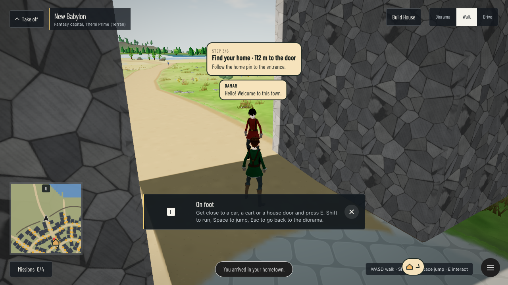

# Living-World Proofs Capture Report (M3-Q1 Proofs)

**Tanggal:** 2026-10-10 (WIB, UTC+7)  
**Target Server:** `http://localhost:5235` (Production preview build, snapshot `9ec11fd`)  
**Browser / Runtime:** Chrome Headless (`154.0.8037.98`, Metal WebGL)  
**Tangkapan Layar:** [`damar-greeting.png`](damar-greeting.png)  
**Status Error:** `engine.lastError = null`  

---

## 1. Tangkapan Layar Interaksi: Damar Menyapa Pemain

Pemain berdiri di depan warga bernama **Damar** di jalan dekat rumah awal. Damar menoleh menghadap pemain, mengangkat tangan menyapa, dan memunculkan speech bubble ucapan.

---

## 2. Tabel Metrik Living-World Proofs (`qa.proofs()`)

| Proof | Deskripsi Fitur | Status Aktif | Rincian Kunci / Metrik Telemetri |
|---|---|---|---|
| **1. Grass (`grass`)** | Kontak rumput melengkung saat terinjak | ✅ AKTIF | Slots: `6`, Active pushers: `1`, Contacts: `1`, Peak: `2` |
| **2. Greet (`greet`)** | Warga bernama (Damar) menyapa pemain | ✅ AKTIF | Nama: **Damar** (`damar:1:0:u673sx`), State: `talk`, Jarak: `2.2 m`, Bubble: `Tampil` |
| **3. Night (`night`)** | Palet malam hangat & pencahayaan terarah | ✅ AKTIF | Night factor: `-`, Hemi intensity: `1.15`, Sun/Moon: `#f2f4ff` |
| **4. Beacon (`beacon`)** | Beacon pintu rumah & panah pemandu HUD | ✅ AKTIF | Target: `(-24.8, -15.9)`, Visible: `true`, On-screen: `-` |
| **5. Lazy Interior (`lazy`)** | Furniture interior dimuat secara bertahap | ✅ AKTIF | State: `ready`, Prefetch: `On-demand dekat pintu` |
| **6. Resource Bytes (`bytes`)** | Tracking byte resource & preset hemat | ✅ AKTIF | Preset: `auto` (Tier: `high`), Total fetched: `-` |

---

## 3. Catatan Integritas Runtime

- Seluruh 6 modul proof terdaftar dan merespons pembacaan tanpa throw.
- `window.__globe.engine.lastError` tetap `null` selama proses interaksi dan kalkulasi fisik rumput/karakter.
