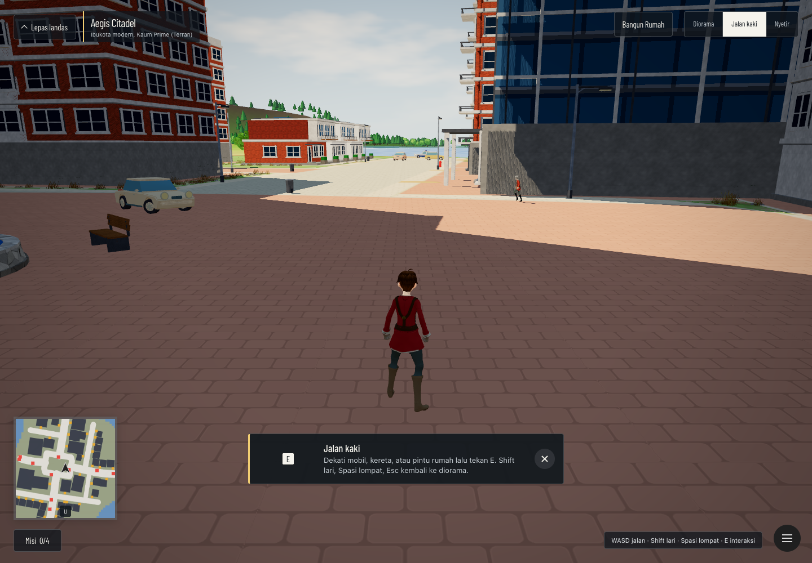
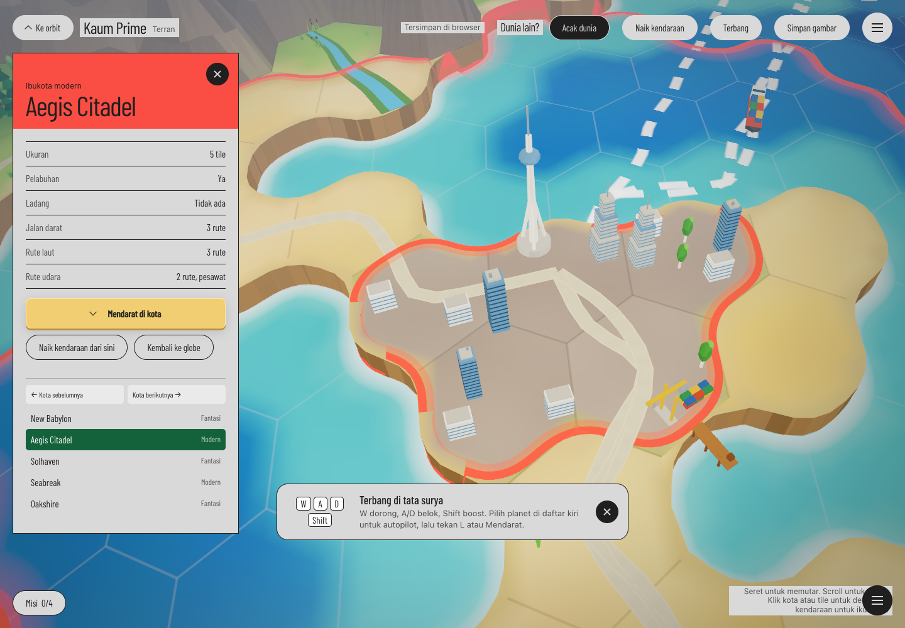
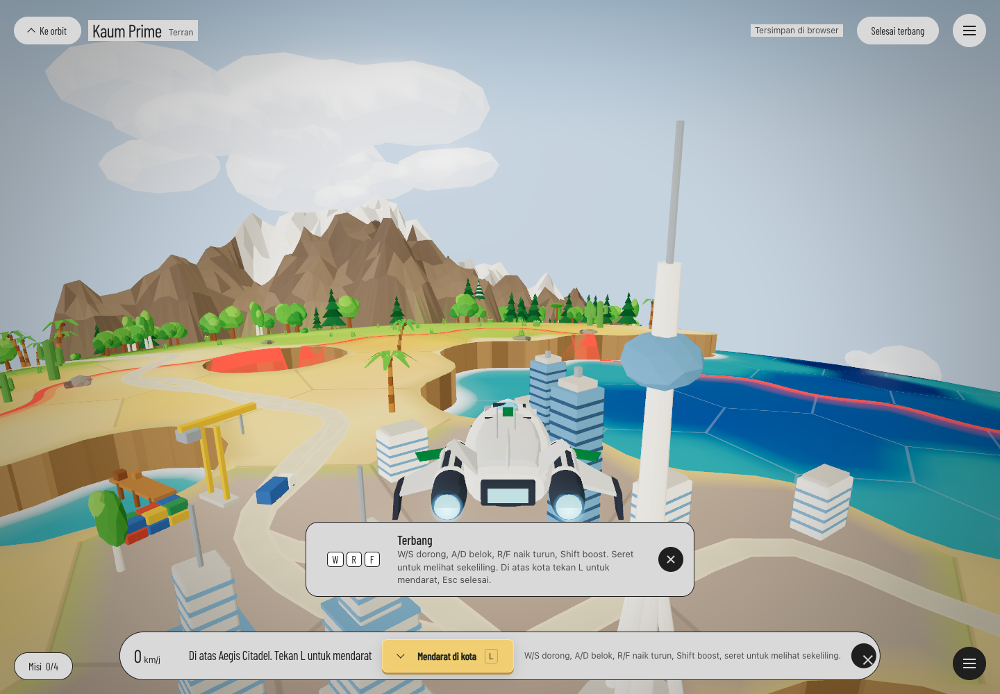

# Polish landing, walk HUD, locomotion dan kereta

8 Oktober 2026. Karakter tetap memakai badan, wajah, rambut dan shader Skirmish v5 yang sudah ada. Tidak mengganti desain karakter.

- Landing pada kartu space dan kartu kota menjadi CTA emas selebar kartu. Flight HUD juga menyediakan tombol klik saat kota dapat didarati; shortcut **L** tetap berfungsi.
- Walk mode memakai panel gelap transparan, nama lokasi ringkas, minimap **kotak dengan border transparan**, dan prompt interaksi persegi. Minimap di kiri bawah desktop, di kanan bawah layar kecil agar tidak menutupi joystick. Marker pintu/kendaraan dan penanda utara mengikuti batas kotak saat peta berputar.
- Gerak kaki prosedural dihapus. `Walk_Loop` dari Quaternius UAL (CC0) di-retarget memakai retargeter Skirmish v5 ke kedua rig. Ground speed klip mengatur fase berdasarkan jarak; idle/jalan/lari diblend. Jalan biasa 1,7 m/s; dalam rumah 1,5 m/s. Sprint tetap tersedia lewat Shift.
- Kuda mempunyai 8 daerah kaki (paha/betis × 4), langkah diagonal dan tekukan lutut yang mengikuti jarak kereta. Material warna, normal dan kedua pass bayangan memakai pose kaki yang sama. Kuda parkir berdiri diam. Roda tetap berputar sesuai jarak. Geometry/paint/animasi tetap instanced pada seluruh LOD.
- NPC dibatasi **12 / 8 / 4** untuk high / medium / low. Semua warga yang dirender memakai model v5 lengkap. Crowd hanya menyediakan data simulasi, tanpa model kotak pengganti. Kendaraan tetap menembus orang sesuai revisi sebelumnya.

## Preview

[Video animasi aktual](locomotion.mp4): 3 detik pose karakter dari samping, lalu 3 detik kereta. Dirender dari galeri game dengan langkah waktu 1/30 detik; 180 frame, H.264 1280×720, 30 fps. File lolos `ffprobe` dan decode penuh FFmpeg.







Preview tambahan: [space landing](space-landing.png), [HUD layar sentuh](walk-touch-clean.png), [bantuan layar sentuh](walk-touch-help.png), [nama kota panjang](walk-mobile-long-name.png), [kereta malam](cart-drive-night.png).

## Verifikasi

- `npm test`: **164/164** lulus, termasuk kedua badan dengan klip jalan baru, bobot/fase locomotion, pose istirahat, fleet LOD, pose bayangan, berhenti dan navigasi tanpa flee.
- `npm run build` dan `git diff --check` lulus.
- [Validator GLB](gltf-validation.json): town dan kedua pack walk **0 error / 0 warning**.
- [Round-trip Blender](../cozy-actors/round-trip.json): 0 triangle aktor berluas nol; posisi finite.
- [Manifest kendaraan](../cozy-actors/manifest.json): seluruh 107 root tersedia; payload 92 root selain kendaraan terjaga identik.
- [Flow browser](flows.json): klik landing space → planet, kartu kota → town, flight → town dan keyboard L berjalan; kota modern/fantasy, walk/drive malam, nama panjang dan ukuran 390×844 diperiksa. **0 page/console/engine error**. Wagon bergerak 0,85 m pada fixture malam; kedua kuda memiliki fase langkah aktif.
- [Profil awal](report.json): seed 427, Chrome desktop 1440×1000 DPR 1, 60 frame per kota: 59,71 / 60,05 fps pada kota modern/fantasy. Kedua kota menggunakan 12 NPC v5 dan tidak menyertakan Crowd di scene. Bukan pengukuran hardware ponsel.
- [Layar sentuh dan tier](touch-and-tiers.json): emulasi coarse pointer, joystick dan minimap tidak bertumpuk; batas NPC diperiksa saat memuat ulang kota di preset high/medium/low.

## Source dan ekspor ulang

Pack runtime: `public/models/town_walk_m.glb` dan `town_walk_f.glb`, sekitar 54 KB masing-masing, berisi animasi tanpa duplikasi mesh atau tekstur. Source editable: `tools/blender/town_walk_m.blend` dan `town_walk_f.blend`, masing-masing sekitar 204 KB, hanya rig dan action. Source kendaraan: `tools/blender/cozy_actors.blend`.

```sh
blender -b --python tools/blender/build_town_walk.py
blender -b --python tools/blender/build_cozy_actors.py
blender -b --python tools/blender/town/audit_cozy_actors.py
npm test
npm run build
```

Untuk retarget baru dari source v5: tambahkan `-- --source <folder soldier_v5_m/f.blend> --ual <UAL.glb>` pada generator walk. Ekspor ulang normal sudah memakai source yang disimpan di repo.

Galeri browser dev: `await (await import('/tools/qa/cozy_actors.js')).cozyActorGallery({kind:'people', angle:'side', motion:true})`, atau `kind:'carts'`; tutup dengan `window.__cozyGallery.restore()`.

Belum menguji hardware ponsel, seluruh seed atau transfer kendaraan antarkota pada revisi ini.
