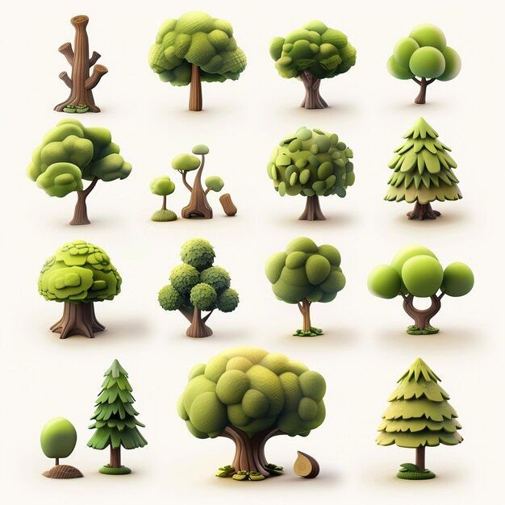
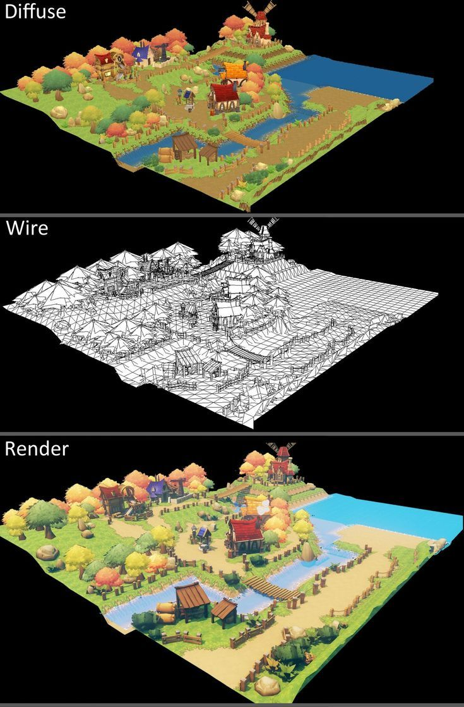
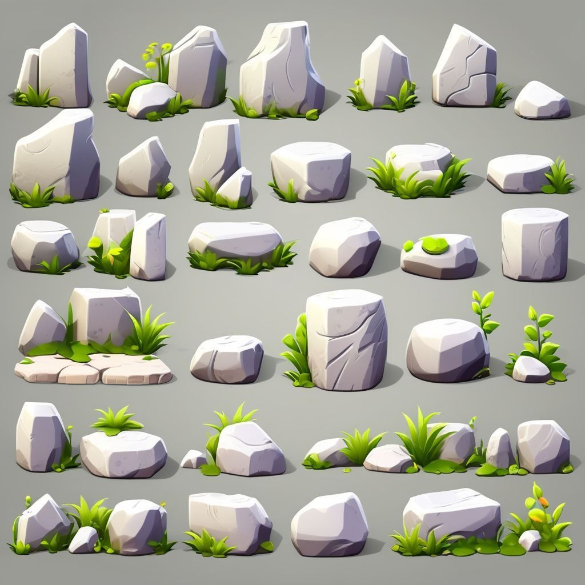
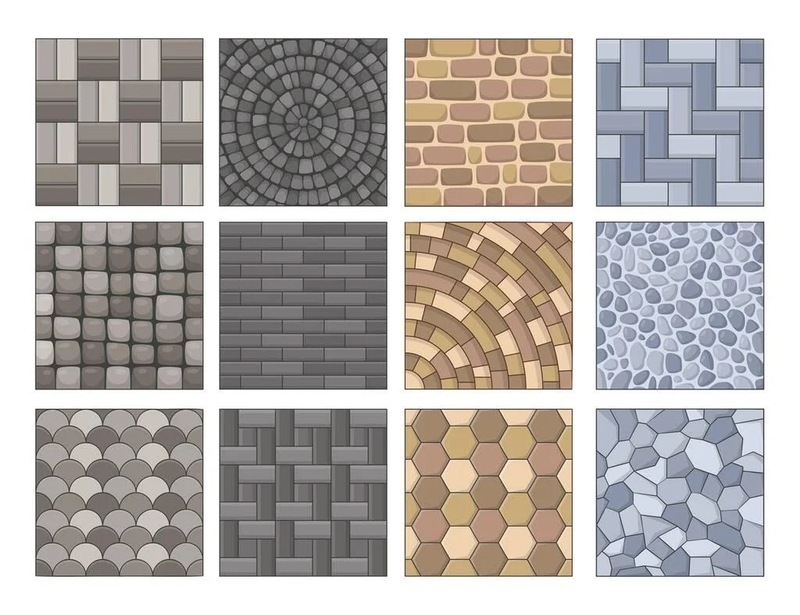
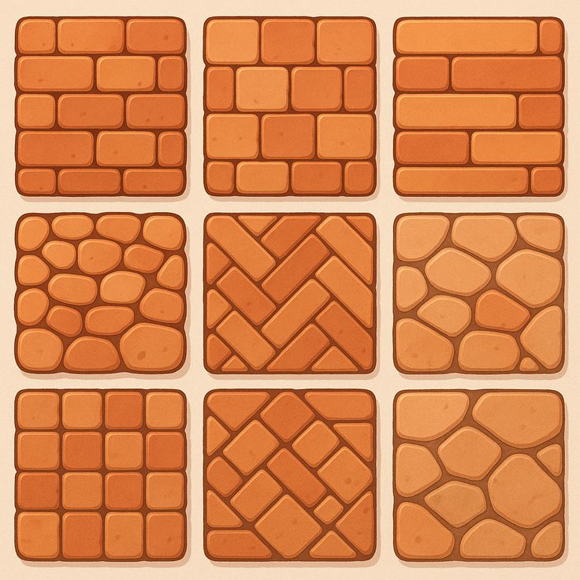
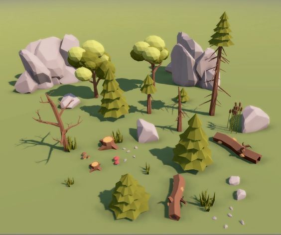
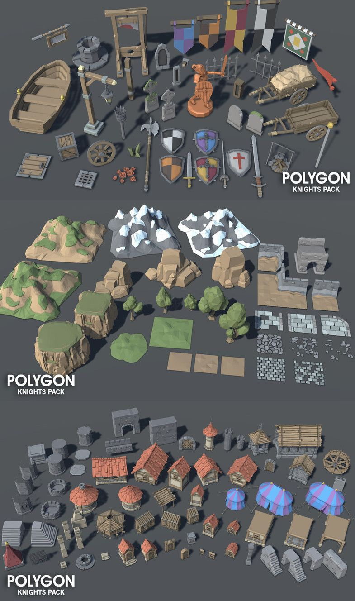

# Environment reference board

Tujuh gambar pengguna, disalin 29 September 2026 dari cache ke proyek. Semua adalah **referensi visual**, bukan instruksi, file texture tileable, atau model 3D. Hash dan lokasi asal ada di [references.json](references.json). Asal pembuat/lisensi asli belum ditetapkan; penggunaan paket ini adalah acuan desain original, bukan redistribusi asset pack ke runtime.

## REF-01

Grouped asymmetric tree canopy; avoid sponge noise and identical spheres.

## REF-02

Village composition, paths and river; not a texture or measured topology.

## REF-03

Rock planes and silhouette; plants must be separate variants.

## REF-04

Paving pattern families; circular motifs are decals or dedicated plaza modules.

## REF-05

Rounded edges and readable joints; orange hue not universal; grid image is not seamless.

## REF-06

Forest ecosystem inventory and density hierarchy; refine near-camera faceting.

## REF-07

Modular kit coverage, architecture and terrain; branded third-party presentation reference only.

Lihat [style guide](../../art-direction/environment-v1/STYLE_GUIDE.md) untuk keputusan adaptasi dan [production plan](../../art-direction/environment-v1/PRODUCTION_PLAN.md) untuk tahap authoring.

