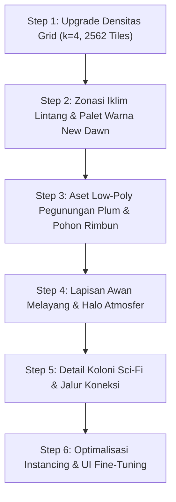

# 📋 Plan Fine-Tuning & Asset Roadmap: Planet Globe 3D

**Plan aset tambahan:** [Asset, Art & Audio Plan](docs/ASSET_ART_AUDIO_PLAN.md) menjadi acuan produksi model mid-poly, texture/sprite, modern mapping, pelabuhan, vegetasi, NPC, air, relief kota dan musik; masih berupa rencana dengan acceptance criteria.

> **Pembaruan arah, 26 September 2026:** rencana visual di bawah merupakan konteks historis 14 September. Untuk pengembangan prosedural lintas level, gunakan [World Building Roadmap](docs/WORLD_BUILDING_ROADMAP.md) dan [catatan Watabou](docs/WATABOU_WORLD_BUILDING_NOTES.md). Prioritas baru: stable IDs dan persistence → kontrak planet/town/building → interior mengikuti footprint → distrik dan rutinitas → POI → perdagangan antariksa. Semua milestone baru masih usulan. Default konstruktor `World` kini subdivision 5; periksa map tersimpan sebelum merencanakan peningkatan densitas.

> **Referensi Visual**: *New Dawn Protocol* (`Screenshot 2026-09-14 at 12.29.11.png`)  
> **Target**: Mengubah planet globe dari visual dasar (642 tiles) menjadi dunia heksagon berdensitas tinggi (~2.562 tiles) dengan bioma kaya, atmosfer awan melayang, kota sci-fi futuristik, dan border bercahaya neon.

---

## 🔍 1. Analisis Perbandingan: Eksisting vs Referensi

| Aspek Visual | Kondisi Saat Ini (v1.0) | Referensi Target (*New Dawn Protocol*) |
| :--- | :--- | :--- |
| **Kepadatan Tile** | Subdivisi $k=3$ (642 tile, ~18 tile horizontal) | **Subdivisi $k=4$ (2.562 tile, ~35–40 tile horizontal)** |
| **Palet Warna Pegunungan** | Abu-abu batu standar (`#73695f`) | **Burgundy/Plum kemerahan eksotis (`#6b3b52` s/d `#8c4b62`)** dengan salju di kutub |
| **Bentuk Pohon / Hutan** | Kerucut pinus sederhana | **Gugusan kanopi rimbun membulat (*puffy low-poly clusters*)** yang padat |
| **Transisi Iklim (Zonasi)** | Campuran acak elevasi/moisture | **Gradien Garis Lintang**: Salju Kutub $\to$ Tundra $\to$ Hutan Temprat $\to$ Sabana Emas/Gurun |
| **Grid Garis Heksagon** | Celah inset sederhana | **Garis kontur heksagon gelap tegas (*dark crisp border lines*)** khas *tabletop sci-fi* |
| **Atmosfer & Awan** | Lingkaran Fresnel statis | **Lapisan awan semi-transparan (*cloud layer*)** berputar independen di atas daratan |
| **Kota & Wilayah Civ** | 1 Benteng silinder kecil | **Pusat Koloni Sci-Fi Modular**: Kubah energi, cincin konsentris, jalan penghubung distrik |
| **Elemen Luar Angkasa** | Partikel bintang acak | **Satelit orbit mini & stasiun luar angkasa** melayang di sekitar planet |

---

## 🛠️ 2. Arsitektur Teknis Peningkatan Densitas (2.562 Tiles)

### A. Peningkatan Subdivisi Icosphere ke Level 4
- Mengubah parameter subdivisi `hexasphere.js` dari $k=3$ ke $k=4$:
  $$\text{Jumlah Tile} = 10 \times 4^k + 2;\quad k=4 \Rightarrow 2.562 \text{ tile (2.550 heksagon + 12 pentagon)}$$
- **Rasio Ukuran Tile**: Radius heksagon menyusut menjadi $\approx 0.35$ unit (dari sebelumnya $\approx 0.75$).
- **Performa 60 FPS**:
  - Menggunakan `THREE.InstancedMesh` atau penggabungan geometri (*Merged BufferGeometry*) untuk tile daratan, pohon, dan puncak gunung.
  - Memisahkan material hanya berdasarkan tipe render (*opaque land*, *translucent ocean*, *glowing borders*).

### B. Rumus Kamera & Skala Horizon 75%
- Dengan radius planet $R = 10$ dan target diameter mengisi 75% lebar layar 16:9:
  $$D = \frac{4 \cdot R}{3 \cdot \text{Aspect} \cdot \tan(\text{vFOV}/2)} \approx 18.1$$
- Karena densitas tile 4x lipat lebih rapat, kelengkungan bumi tampak jauh lebih megah dan masif pada jarak pandang yang sama persis.

---

## 🎨 3. Daftar Kebutuhan Aset & Spesifikasi 3D (Asset List)

### 1. Kategori Terrain & Bioma
- [x] **ASSET-01: Low-Poly Craggy Mountain Range (Burgundy/Plum)** (✅ Selesai)
  - *Bentuk*: Gugusan batu bersudut tajam (*faceted low-poly*) berbaris mengikuti punggungan tektonik.
  - *Warna*: `#5a2d42` (dasar bayangan), `#783f59` (batu utama), `#9c5b76` (highlight cahaya).
  - *Variasi Salju*: Puncak putih `#f0f4f8` jika latitude $> 55^\circ$ utara/selatan.
- [x] **ASSET-02: Puffy Canopy Tree Clump (Hutan Rimbun)** (✅ Selesai)
  - *Bentuk*: Sekumpulan bola/polyhedron kanopi rimbun bertingkat (3–7 kanopi per tile).
  - *Warna*: `#1d4a2c` (deep evergreen) dan `#2e693b` (temperate forest).
- [x] **ASSET-03: Arid Savannah & Desert Hexagon** (✅ Selesai)
  - *Bentuk*: Permukaan heksagon sedikit bergelombang gurun dengan tekstur retakan halus.
  - *Warna*: Gradasi kuning jerami `#caa663` ke cokelat tanah `#8d6c3c`.
- [x] **ASSET-04: Polar Ice Cap & Frozen Tundra** (✅ Selesai)
  - *Bentuk*: Permukaan gletser datar dengan rekahan kristal es.
  - *Warna*: Putih es `#e8f1f5` dengan celah toska `#a8d5e5`.
- [x] **ASSET-05: Deep & Coastal Ocean Shader** (✅ Selesai)
  - *Bentuk*: Bola samudra dengan *specular map* tinggi dan gradasi warna dari biru gelap samudra dalam (`#091b33`) ke toska dangkal (`#126b82`) di pesisir pantai.

### 2. Kategori Koloni Sci-Fi & Kota (*Civilization*)
- [x] **ASSET-06: Modular Capital Core (Pusat Koloni Pemain)** (✅ Selesai)
  - *Bentuk*: Kubah heksagonal tengah (*central biodome*), diapit cincin konsentris, menara komunikasi, dan pilar cahaya energi vertikal.
  - *Bahan*: Logam titanium putih-abu (`#d8e2dc`), lampu aksen cyan (`#00f0ff`).
- [ ] **ASSET-07: Secondary Outpost / Extraction Station**
  - *Bentuk*: Struktur rig heksagonal tunggal dengan kubah observasi dan panel surya.
- [ ] **ASSET-08: Coastal Causeway / Harbor Bridge**
  - *Bentuk*: Jembatan pilar mini yang menghubungkan tile kota kepulauan melintasi selat laut dangkal.
- [x] **ASSET-09: Civilization Border Ribbon 2.0 (Natural Border Radius / Corner Fillet)** (✅ Selesai)
  - *Bentuk*: Pita bercahaya *neon bloom* (Cyan untuk Player, Magenta/Violet untuk AI) dengan lengkungan sudut membulat (*fillet quadratic bezier*) bebas sudut tajam.
- [x] **ASSET-10: Diplomatic / Trade Conduit Line** (✅ Selesai)
  - *Bentuk*: Garis kurva bercahaya di atas permukaan tanah dan samudra dengan partikel pulsa ganda (Cyan & Amber) yang merepresentasikan rute logistik aktif antar-ibukota.

### 3. Kategori Lingkungan Atmosfer & Luar Angkasa
- [x] **ASSET-11: Procedural Cloud Sphere** (✅ Selesai)
  - *Bentuk*: Mesh bola transparan pada radius $R \times 1.036$ dengan tekstur noise gumpalan awan putih lembut, berputar perlahan pada sumbu planet.
- [ ] **ASSET-12: Orbital Satellites & Space Buoys**
  - *Bentuk*: 2–4 model satelit mini berpanel surya mengorbit pada radius $R \times 1.18$ - $1.25$ di latar belakang angkasa.

---

## 📅 4. Tahapan Eksekusi (Implementation Steps)

### Milestone 1: Densitas & Zonasi Lintang (Core Grid)
1. Perbarui subdivisi ke level 4 di `hexasphere.js`.
2. Perbaiki fungsi `mapGenerator.js` untuk menambahkan pengaruh garis lintang (*latitude factor* $\cos(\phi)$):
   - Kutub: Dingin $\to$ Salju / Es.
   - Ekuator: Hangat $\to$ Sabana emas, hutan hujan tropis.
3. Tambahkan garis tepi heksagon gelap tegas (*dark hex outlines*) agar setiap tile terpisah rapi seperti pada referensi.

### Milestone 2: Aset Geometri Terrain (Pohon & Gunung Plum)
1. Ganti bentuk kerucut tunggal dengan generator gugusan batu bersudut runcing (*craggy faceted peaks*) berpalet burgundy/plum.
2. Buat gugusan kanopi pohon rimbun bertingkat untuk bioma hutan.
3. Terapkan pewarnaan vertex bertahap untuk transisi mulus antar-heksagon.

### Milestone 3: Efek Atmosfer & Awan Melayang
1. Buat `THREE.Mesh` bola awan transparan dengan shader alpha noise yang berputar independen (`rotation.y += 0.0008`).
2. Perhalus efek *Fresnel Atmospheric Rim* di tepi planet.

### Milestone 4: Koloni Sci-Fi & Jaringan Perdagangan
1. Bangun generator tata kota koloni futuristik:
   - Kubah kubik & cincin konsentris di ibukota.
   - Pintu gerbang & dermaga pantai.
2. Sempurnakan garis koneksi antar-ibukota menjadi berkas cahaya neon berpendar dengan indikator kecepatan aliran data/komoditas.

---

## 💡 Rekomendasi Alur Kerja

Gunakan perintah **/plan** di prompt chat jika ingin mengeksekusi implementasi ini secara bertahap dengan review per langkah, atau informasikan milestone mana yang ingin langsung kita pasang ke dalam proyek!
