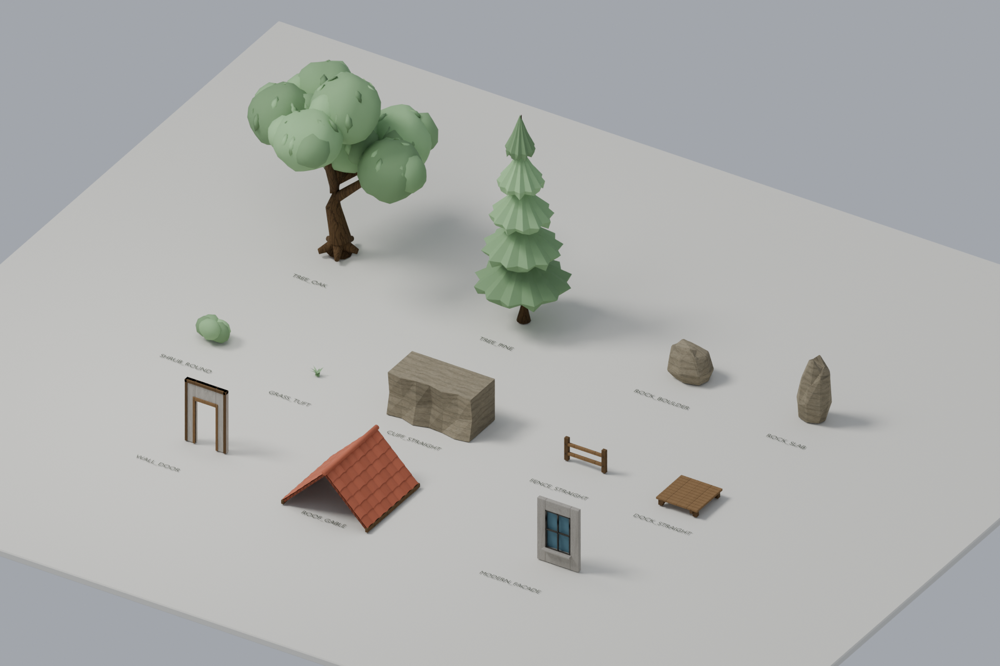

# B1 — gambar, model dan texture assets

29 September 2026. **Paket kandidat B1 sudah dibuat**, bukan hanya rencana. Produksi memakai built-in ImageGen dan **Blender 5.1.2 headless CLI**; MCP Blender tidak tersedia pada sesi ini.

## Hasil

- 2 concept/setup sheets original.
- 8 texture master grayscale, masing-masing 1254 × 1254 px; PNG lossless disimpan utuh.
- 12 master model menjadi 25 varian bentuk, masing-masing LOD0/1/2: total 75 mesh LOD.
- 1 GLB pack gabungan dan 25 GLB mandiri dengan gambar embedded.
- 3 scene Blender: source semua varian, galeri, dan setup environment.
- 14 render: galeri, setup, serta 12 hero render.
- Preview browser yang menggunakan loadTexturedPack dan material toon dari source game.

Ini interpretasi procedural Blender dari referensi, bukan hasil layanan image-to-3D otomatis. Source dan parameternya dapat diedit/dibangun ulang.

## Buka artefak

| Artefak | Lokasi |
|---|---|
| Setup konsep nature | [b1-nature-board.png](concepts/b1/b1-nature-board.png) |
| Setup konsep modular | [b1-modular-board.png](concepts/b1/b1-modular-board.png) |
| Render model aktual | [01-b1-asset-gallery.png](qa/renders/b1/01-b1-asset-gallery.png) |
| Render susunan environment | [02-b1-environment-setup.png](qa/renders/b1/02-b1-environment-setup.png) |
| Source model, collection per family | [environment_b1_v001.blend](source/b1/environment_b1_v001.blend) |
| Scene galeri dengan lighting/camera | [environment_b1_gallery_v001.blend](source/b1/environment_b1_gallery_v001.blend) |
| Scene setup landscape | [environment_b1_setup_v001.blend](source/b1/environment_b1_setup_v001.blend) |
| Pack model gabungan | [environment_b1_v001.glb](exports/staging/b1/environment_b1_v001.glb) |
| Viewer lokal | [viewer.html](qa/viewer.html) — buka lewat Vite, bukan file:// |
| Prompt dan jejak output ImageGen | [b1-image-jobs.json](catalog/b1-image-jobs.json) |
| Hasil inspeksi GLB aktual | [b1-export.json](qa/reports/b1-export.json) |
| Statistik source | [b1-authoring.json](qa/reports/b1-authoring.json) |
| Diagnostik texture | [b1-textures.json](qa/reports/b1-textures.json) |



## Inventaris model

| Master | Varian | LOD | Contoh file mandiri |
|---|---:|---:|---|
| Oak | 3 | 3 | [oak A](exports/staging/b1/env_tree_oak_a_v001.glb) |
| Pine | 3 | 3 | [pine A](exports/staging/b1/env_tree_pine_a_v001.glb) |
| Boulder | 4 | 3 | [boulder A](exports/staging/b1/env_rock_boulder_a_v001.glb) |
| Rock slab | 3 | 3 | [slab A](exports/staging/b1/env_rock_slab_a_v001.glb) |
| Grass tuft | 3 | 3 | [grass A](exports/staging/b1/env_grass_tuft_a_v001.glb) |
| Shrub | 3 | 3 | [shrub A](exports/staging/b1/env_shrub_round_a_v001.glb) |
| Cliff straight | 1 | 3 | [cliff](exports/staging/b1/env_cliff_straight_a_v001.glb) |
| Fence | 1 | 3 | [fence](exports/staging/b1/env_fence_straight_a_v001.glb) |
| Dock | 1 | 3 | [dock](exports/staging/b1/env_dock_straight_a_v001.glb) |
| Wall with doorway | 1 | 3 | [wall](exports/staging/b1/env_wall_door_a_v001.glb) |
| Gable roof | 1 | 3 | [roof](exports/staging/b1/env_roof_gable_a_v001.glb) |
| Modern facade | 1 | 3 | [facade](exports/staging/b1/env_modern_facade_a_v001.glb) |

Nama root stabil, misalnya env_tree_oak_a dengan child env_tree_oak_a_LOD0/1/2. GLB gabungan berbagi image/material; GLB mandiri menduplikasi map yang diperlukan agar portable. Untuk loading game gunakan pack gabungan, bukan semua file mandiri sekaligus.

Source utama tersusun pada grid dan collection SOURCE_nature/terrain/infrastructure/architecture. Exporter menghapus transform presentasi sementara sehingga origin game tetap benar. Metadata per varian berada di source/<family>/<master>/.

## Delapan gambar texture

| Set | Master | Pemakaian B1 |
|---|---|---|
| Ground grass | [PNG](textures/masters/ground_grass/ground_grass_v001.png) | Ground setup |
| Ground dirt | [PNG](textures/masters/ground_dirt/ground_dirt_v001.png) | Jalur setup |
| Stone cobble | [PNG](textures/masters/stone_cobble/stone_cobble_v001.png) | Paving setup |
| Stone rock | [PNG](textures/masters/stone_rock/stone_rock_v001.png) | Batu dan cliff |
| Wood trim | [PNG](textures/masters/wood_trim/wood_trim_v001.png) | Fence, dock, framing |
| Wood bark | [PNG](textures/masters/wood_bark/wood_bark_v001.png) | Trunk/cabang |
| Architecture trim | [PNG](textures/masters/architecture_trim/architecture_trim_v001.png) | Plaster dan roof LOD |
| Modern trim | [PNG](textures/masters/modern_trim/modern_trim_v001.png) | Facade dan metal frame |

Map adalah **neutral RGB albedo multiplier**: sRGB decode → dikalikan palette factor → lighting. Ini jalur material GLB portable, berbeda dari scalar NoColorSpace atlas town yang lama. Faktor warna ditulis eksplisit ke baseColorFactor setelah export karena node Multiply Blender kehilangan konstanta tint pada ekspor awal. Viewer membuktikan roof dan timber tetap berwarna.

Kompresi JPEG quality 85 hanya pada gambar embedded di GLB. Master PNG tidak diubah. Kanopi memakai opaque geometry dan warna palette, tanpa alpha cards. Lima map masuk model pack; tiga ground maps berada pada scene setup dan sebagai file texture mandiri.

## Pemeriksaan yang sudah dilakukan

- GLB aktual: 25 varian × 3 LOD, POSITION/NORMAL/TEXCOORD_0, index/triangle count, embedded images, palette factors dan bounds.
- Semua mesh berada dalam ceiling triangle yang ditetapkan per master/LOD.
- Source/render headless berhasil; galeri, setup, hero oak/cliff/roof diperiksa visual dan diperbaiki selama QA.
- Loader game berhasil menampilkan pack; perpindahan LOD 0/1/2 serta pencahayaan siang/malam diperiksa pada viewer terisolasi.
- Delapan master texture memiliki metadata hash, dimensi dan diagnostik perbedaan tepi. Repeat 4×4 tersedia di viewer.

## Batas kandidat ini

- **Update 29 September 2026:** pack gabungan dipromosikan ke `public/models/environment.glb`. Town memakai oak, pine, shrub, boulder, grass tuft, dan fence lewat `src/modes/town/render/environmentKit.js` (ukuran dinormalisasi ke model lama; pine bersalju tetap model lama). Cliff, dock, wall, roof, dan facade belum dipakai karena masih proof module. B2–B4 tetap backlog.
- B1 bukan kit rumah lengkap; wall/roof baru proof module. Scene setup adalah susunan presentasi, bukan desa navigable.
- Collider gameplay belum diintegrasikan. Beberapa socket posisi sudah dicatat; fitting seluruh kit dan traversal diuji pada B2.
- Texture hasil generasi belum disertifikasi seamless. Grass/dirt/wood perlu review seam pada skala pemakaian; trim horizontal/vertikal tidak dinilai repeat di sumbu yang tidak dirancang. Tidak ada klaim padding/mip/tiling final lolos hanya berdasarkan angka diagnostik.
- PNG master 1254² dipertahankan. Downsample/atlas/GPU compression dan profiling mobile masih tahap promosi runtime. Ukuran GLB aktual tercatat di report; target budget plan belum berarti seluruh runtime gate lulus.
- Lighting preview Blender adalah material matte studio; viewer memakai shader toon game dengan fixture tersendiri, bukan screenshot kota produksi.
- Ukuran teks pada concept sheet tidak authoritative: misalnya grass di gambar lebih tinggi daripada target. Ukuran meter mesh mengikuti katalog; render bounds aktual ada di report.

## Reproduksi

Dari root proyek, dengan Blender headless yang dapat mengakses backend grafis macOS:

```sh
/Applications/Blender.app/Contents/MacOS/Blender --background --factory-startup --threads 4 --python tools/blender/environment/scripts/build_b1.py
node tools/blender/environment/scripts/inspect_b1.mjs
npm run dev -- --host 127.0.0.1 --port 5191
```

Viewer: /tools/blender/environment/qa/viewer.html. Pipeline menulis ulang artefak v001 miliknya sendiri; copy ke v002 sebelum perubahan produksi berikutnya. Tidak menyentuh scene Blender UI atau source NPC. Snapshot palette dipatok dari src/art/palette.js dan hash-nya dicatat; refresh snapshot secara eksplisit bila palet runtime berubah.
